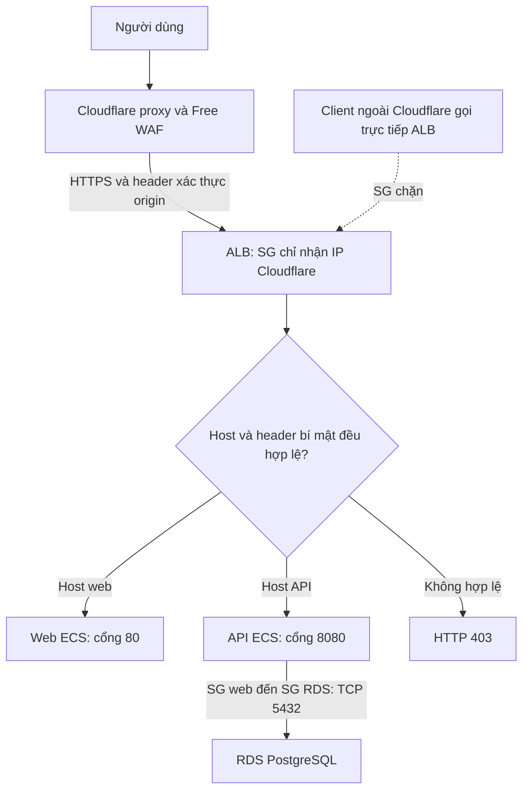

# BÁO CÁO ĐIỀU CHỈNH THIẾT KẾ BẢO MẬT HỆ THỐNG HUSHSTORE

**Nội dung:** Bỏ Network ACL tùy chỉnh, củng cố Security Group và bổ sung Web Application Firewall.

**Ngày báo cáo:** 29/10/2026. **Mốc kiểm thử cấu hình được tổng hợp:** 28/10/2026.

**Trạng thái:** Đã hoàn thành thay đổi mã Terraform, kiểm thử cấu hình và tài liệu. Chưa apply lên AWS/Cloudflare và chưa kiểm thử runtime của thiết kế mới.

**Cập nhật mã 02/11/2026:** bổ sung guard chống script apply nhầm trước migration,
backend WAF S3 mã hóa với key riêng, preflight kiểm origin/header và xử lý IP
visitor tại API khi lockdown bật. Trình tự chuyển API revision/rollback nằm ở
[runbook WAF](waf-cloudflare.md); kết quả ngày 28/10 bên dưới được giữ đúng mốc đo.

## 1. Tiếp thu ý kiến của giảng viên

Sau khi nhận góp ý về mức độ phức tạp của Network ACL (NACL) và yêu cầu bổ sung Web Application Firewall (WAF), nhóm điều chỉnh phương án bảo mật theo hướng:

1. Bỏ ba NACL tùy chỉnh tại các tầng public, application và database; sử dụng default NACL allow-all của AWS.
2. Dùng Security Group (SG) làm cơ chế kiểm soát kết nối giữa các tầng, kết hợp private subnet, IAM và VPC Endpoint hiện có.
3. Bổ sung Cloudflare Free WAF để lọc lưu lượng HTTP/HTTPS trước khi đến hệ thống AWS.
4. Khóa đường truy cập trực tiếp vào Application Load Balancer (ALB) để hạn chế việc đi vòng qua WAF.

Hệ thống tiếp tục sử dụng ECS trên EC2, chế độ mạng `bridge`, web tại cổng 80, API tại cổng 8080 và RDS PostgreSQL tại cổng **5432**.

## 2. Cơ sở điều chỉnh

### 2.1. Bỏ NACL tùy chỉnh để giảm rủi ro cấu hình

NACL là bộ lọc **stateless** tại ranh giới subnet. Khi cho phép một chiều kết nối, người quản trị phải cấu hình cả chiều phản hồi, bao gồm các cổng tạm thời. Rule được xét theo thứ tự số, vì vậy một rule DENY có số nhỏ có thể chặn cả lưu lượng hợp lệ.

Với quy mô của đồ án, việc duy trì đồng thời nhiều rule NACL và SG làm tăng số cấu hình phải kiểm tra nhưng chưa đem lại lợi ích tương xứng. Nhóm tiếp thu khuyến nghị, loại bỏ các NACL tùy chỉnh và demo DENY; không tiếp tục quản lý dải cổng ephemeral ở tầng subnet.

VPC vẫn có **default NACL**, được giữ ở trạng thái allow-all hai chiều. Nhóm không khai báo resource `aws_default_network_acl` để nhận quản lý lại rule của đối tượng này. Trước khi chuyển subnet, phải kiểm tra default NACL thực tế còn đúng chính sách allow-all. [AWS: Default network ACL](https://docs.aws.amazon.com/vpc/latest/userguide/default-network-acl.html)

### 2.2. Phân công rõ vai trò của SG và WAF

| Cơ chế | Vai trò trong thiết kế điều chỉnh |
|---|---|
| Security Group | Kiểm soát nguồn, đích, giao thức và cổng kết nối đến tài nguyên AWS |
| Private subnet và route table | Giữ máy ứng dụng không có IP public; database không có default route ra Internet |
| IAM | Giới hạn quyền truy cập dịch vụ AWS của máy chủ, ứng dụng và CI/CD |
| VPC Endpoint hiện có | Hỗ trợ đường truy cập riêng đến dịch vụ AWS khi được bật |
| WAF | Lọc request HTTP/HTTPS, chặn IP theo cấu hình và giới hạn burst đăng nhập |

SG là **stateful**: lưu lượng phản hồi của kết nối được phép sẽ tự được cho qua, không cần thêm rule ephemeral. SG chỉ hỗ trợ **allow**, nên không thể dùng một rule SG để DENY riêng một IP trong khi vẫn cho phép toàn Internet. Chức năng chặn IP ở lớp web được đặt tại WAF. [AWS: Security group rules](https://docs.aws.amazon.com/vpc/latest/userguide/security-group-rules.html)

## 3. Chính sách Security Group sau điều chỉnh

Bảng dưới đây mô tả **cấu hình đích sau khi bật khóa origin Cloudflare**, không phải trạng thái đã áp dụng trên AWS:

| Security Group | Inbound TCP | Outbound TCP |
|---|---|---|
| ALB (`sg-alb`) | 80/443 chỉ từ các dải IPv4 chính thức của Cloudflare | 80/8080 chỉ đến `sg-web` |
| Máy ứng dụng (`sg-web`) | 80/8080 chỉ từ `sg-alb` | 5432 đến `sg-rds`; 80/443 ra Internet |
| PostgreSQL (`sg-rds`) | 5432 chỉ từ `sg-web` | Rỗng |
| ECR Endpoint, khi bật | 443 chỉ từ `sg-web`, thay cho CIDR subnet ứng dụng | Rỗng |
| Default SG | Rỗng | Rỗng |

Không bổ sung cổng SSH 22, database public hoặc dải ephemeral vào SG. Egress rỗng của RDS và endpoint không ngăn phản hồi trên kết nối inbound hợp lệ vì SG có trạng thái.

HTTP/HTTPS outbound của máy ứng dụng được giữ để phục vụ bootstrap, cập nhật và gọi các API cần thiết. Đây vẫn là quyền truy cập rộng; SG không lọc theo URL hoặc domain. Với ECS `bridge`, SG bảo vệ **EC2 host**, chưa tạo ranh giới độc lập cho từng container trên cùng máy.

Trong giai đoạn chuyển NACL, ALB vẫn giữ chính sách ingress trước khóa origin. Cờ `enable_cloudflare_origin_lockdown` mặc định **false** và chỉ bật sau khi cấu hình Cloudflare đã sẵn sàng.

## 4. So sánh và lựa chọn WAF

Nhóm xem xét ba phương án dựa trên chi phí, khả năng tích hợp và công vận hành:

| Phương án | Ưu điểm | Chi phí và hạn chế | Đánh giá |
|---|---|---|---|
| **Cloudflare Free** | DNS/proxy đã được sử dụng cho tên miền; lọc request trước ALB; không dùng thêm RAM EC2 | Phí gói WAF $0; bộ managed rules có giới hạn; phải bảo vệ origin khỏi truy cập trực tiếp | **Lựa chọn cho đồ án** |
| AWS WAF Regional gắn ALB | Tích hợp trực tiếp với AWS; có các managed rule groups | Tính phí theo Web ACL, rule/group và request; cần quản lý vòng đời để kiểm soát chi phí | Phương án nâng cấp khi cần phạm vi bảo vệ rộng hơn |
| ModSecurity + OWASP CRS tự vận hành | Không có phí license; chủ động cấu hình bộ rule | Cần reverse proxy cho cả web/API, cập nhật và tuning; sử dụng CPU/RAM trên host t3.micro 1 GB vốn đang chạy ứng dụng | Cần đo tải trước khi lựa chọn |

Cloudflare Free phù hợp nhất với điều kiện hiện tại vì tận dụng proxy đã có và không thêm dịch vụ AWS tính phí. Mức $0 chỉ áp dụng cho **gói WAF Free**; các chi phí ALB, NAT, EC2 và RDS của hệ thống vẫn tồn tại. [Cloudflare plans](https://www.cloudflare.com/plans/), [AWS WAF pricing](https://aws.amazon.com/waf/pricing/), [OWASP CRS containers](https://github.com/coreruleset/modsecurity-crs-docker)

Free có tối đa 5 custom rules, 1 rate-limit rule và Free Managed Ruleset. Đây là tập rule giới hạn, **không bao gồm đầy đủ Cloudflare OWASP Core Ruleset** và không bảo đảm phát hiện mọi payload SQL injection hoặc XSS. [Cloudflare: Phạm vi WAF theo gói](https://developers.cloudflare.com/waf/)

## 5. Thiết kế WAF và ngăn truy cập đi vòng

### 5.1. Luồng xử lý đích

Sơ đồ mô tả thiết kế sau khi hoàn tất triển khai và bật khóa origin.

### 5.2. Các chức năng đã cấu hình trong mã

| Thành phần | Chính sách |
|---|---|
| Free Managed Ruleset | Do Cloudflare triển khai mặc định trên gói Free; cần xác nhận đang hoạt động trên dashboard khi triển khai |
| Custom rule đường dẫn | Chặn các đường dẫn như `/.env`, `/.git/`, `/.svn/` và một số endpoint dò quét không được ứng dụng sử dụng, trên cả host web và API |
| Custom rule IP | Chặn IP/CIDR IPv4 hoặc IPv6 được khai báo; chỉ tạo rule khi danh sách chặn không rỗng |
| Rate limit login | Mặc định 20 request/10 giây/IP tại mỗi Cloudflare data center, thời gian chặn 10 giây, cho đường dẫn `/api/auth/login` và biến thể có dấu `/` cuối |
| Header xác thực origin | Cloudflare ghi đè `x-hushstore-origin` bằng secret trên HTTPS; xóa header này trên HTTP |

Rate-limit rule của gói Free chỉ lọc theo path, nên cùng đường dẫn login trên các hostname proxied khác trong zone cũng chịu chính sách này. Bộ đếm theo data center có độ trễ thực thi; không coi đây là quota toàn cầu chính xác và không thay thế rate limiter của ứng dụng. [Cloudflare: Rate limiting rules](https://developers.cloudflare.com/waf/rate-limiting-rules/)

### 5.3. Vì sao cần khóa origin

Nếu chỉ thêm WAF tại Cloudflare nhưng vẫn cho phép gọi trực tiếp ALB, request có thể bỏ qua WAF. Việc kiểm tra `Host` một mình chưa đủ vì người gửi có thể tự đặt header này.

Thiết kế sử dụng đồng thời hai điều kiện bảo vệ:

1. SG ALB chỉ nhận TCP 80/443 từ các dải IP Cloudflare chính thức.
2. Listener ALB chỉ forward khi **Host đúng và header bí mật đúng**; request không hợp lệ nhận HTTP 403.

Cloudflare dùng thao tác **set** để ghi đè header do client gửi, thay vì tin giá trị client tự khai. Secret chỉ được đưa lên chặng HTTPS; HTTP bị xóa header trước khi ALB redirect sang HTTPS. Chế độ Full (strict) được giữ cho việc kiểm tra chứng chỉ origin trên chặng HTTPS. [Cloudflare: Request Header Transform Rules](https://developers.cloudflare.com/rules/transform/request-header-modification/)

Secret được khai báo `sensitive`, không đưa vào Git hoặc log. Tuy nhiên, Terraform state và saved plan vẫn chứa giá trị này, nên phải được bảo vệ như dữ liệu nhạy cảm.

## 6. Phạm vi đã thực hiện trong repository

| Hạng mục | Kết quả trong mã nguồn |
|---|---|
| Module mạng | Bỏ ba custom NACL, rule và demo DENY; thêm output default NACL ID để kiểm tra association |
| Module security | Giữ chuỗi SG ALB → web → RDS; chuyển nguồn ingress ECR Endpoint từ CIDR sang `sg-web`; thêm chế độ giới hạn nguồn Cloudflare |
| Module ALB | Thêm điều kiện header vào hai listener rule hiện hữu khi bật khóa origin |
| Root Cloudflare | Tách riêng tại `infra/cloudflare/`, quản lý custom/rate/header-transform rules, không quản lý DNS hoặc nhận quản lý lại managed-rules phase |
| Môi trường và script | Đồng bộ prod/dev, biến mẫu và script liên quan; giữ symlink dev |
| Kiểm thử và CI | Bổ sung kiểm tra SG, WAF, migration guard và preflight; cập nhật các bước CI tương ứng |
| Tài liệu | Cập nhật kiến trúc, bảo mật, runbook, hướng dẫn Console và hai sơ đồ draw.io |

NAT, IAM, công tắc endpoint và chế độ ECS hiện tại được giữ. AWS provider vẫn ở phiên bản 6.60.0; lỗi checksum cache được xử lý bằng package hợp lệ và hash nền tảng, không tắt kiểm tra checksum.

## 7. Kết quả kiểm thử cấu hình

Kết quả đã ghi nhận trong phiên thực hiện thay đổi ngày 28/10/2026:

| Nhóm kiểm tra | Kết quả | Phạm vi chứng minh |
|---|---|---|
| Terraform AWS, tám module | **115/115 đạt** | Kiểm tra các chính sách cấu hình; network/security/ALB dùng mock provider, một số module khác đọc data source AWS |
| Terraform Cloudflare | **14/14 đạt** | Mock plan: scope rule, tham số Free, chặn IP tùy chọn và thao tác header HTTP/HTTPS |
| Python migration guard | **20/20 đạt** | Từ chối plan sai thứ tự, xóa ACL còn association hoặc thay đổi ngoài phạm vi; kiểm tra chuẩn bị cây nguồn |
| Python WAF preflight | **11/11 đạt** | Fixture cục bộ: kiểm tra DNS/proxy, TLS, CIDR, phân trang và xử lý lỗi |
| Terraform validate | **Đạt** | Prod/dev, root Cloudflare và cả hai cây migration trên prod/dev |
| Format, shell syntax, draw.io XML | **Đạt** | Định dạng, cú pháp script và tính hợp lệ tham chiếu trong sơ đồ |

Tổng cộng **129 test Terraform và 31 test Python đạt**. Bộ Terraform test sử dụng các run `plan`, không apply tài nguyên. Các kiểm tra mock/fixture không chứng minh WAF đang chặn request thật hoặc hệ thống đang vận hành đúng sau chuyển đổi.

**Chưa thực hiện:** live plan trên state AWS/Cloudflare, apply thay đổi, xác nhận association thực tế và kiểm thử runtime kiến trúc mới. CI đã cập nhật trong mã nhưng chưa có kết quả chạy GitHub Actions cho thay đổi này. Các báo cáo và bằng chứng cũ được giữ nguyên; kết quả demo NACL DENY trước đây không được dùng để chứng minh SG/WAF mới.

## 8. Kế hoạch triển khai và nghiệm thu thực tế

Triển khai được chuẩn bị theo thứ tự sau để hạn chế gián đoạn:

1. **Kiểm tra trước chuyển đổi:** xác nhận default NACL allow-all; đối chiếu account, state và trạng thái tài nguyên.
2. **Mốc NACL chuyển tiếp:** giữ rule cũ, tháo association của sáu subnet về default NACL, đồng thời thêm ingress endpoint từ `sg-web`.
3. **Mốc NACL hoàn tất:** sau khi xác nhận cả sáu subnet đã chuyển, mới xóa custom NACL, rule cũ và ingress endpoint theo CIDR.
4. **Triển khai Cloudflare:** kiểm tra zone, proxy, TLS và ruleset có sẵn; hợp nhất/import khi cần, giữ các rule hiện hữu phải bảo toàn.
5. **Khóa origin ALB:** sau khi header-transform hoạt động, bật `enable_cloudflare_origin_lockdown` và kiểm tra plan SG/listener.
6. **Đo runtime và lưu bằng chứng mới:** xác nhận cả chức năng hợp lệ và các tình huống bị chặn.

Nếu default NACL đã bị sửa khác allow-all thì dừng chuyển association để xử lý sai lệch. Mỗi plan phải được kiểm tra để tránh thay thế VPC, subnet, SG, endpoint, ALB hoặc RDS ngoài phạm vi.

Các tiêu chí nghiệm thu runtime chính:

| Kịch bản | Kỳ vọng sau triển khai |
|---|---|
| Web, API, đăng nhập hợp lệ, CORS, nghiệp vụ chính | Hoạt động bình thường qua hai tên miền proxied |
| PostgreSQL, pull ECR, SSM, CloudWatch | Tiếp tục hoạt động |
| Kết nối mới đến web/database từ nguồn không được phép | Bị SG chặn; không kết luận chỉ từ timeout đến private IP không có đường định tuyến |
| Request đến đường dẫn nhạy cảm hoặc từ IP trong danh sách chặn | Bị Cloudflare chặn; đối chiếu Ray ID và Security Event khi có |
| Burst đăng nhập | Có bằng chứng rate-limit tại Cloudflare; phân biệt với rate limiter của ứng dụng |
| Gọi trực tiếp ALB từ ngoài Cloudflare với đúng Host | Bị SG chặn |
| Request đến listener từ đường Cloudflare nhưng thiếu/sai secret | Không được forward; ALB trả 403 |

## 9. Đánh giá sau điều chỉnh

Thiết kế mới giảm số rule stateless phải bảo trì, làm rõ quan hệ truy cập giữa các tầng và bổ sung cơ chế lọc request tại lớp ứng dụng với chi phí phù hợp đồ án. SG và WAF có vai trò bổ trợ: SG kiểm soát kết nối đến tài nguyên; WAF kiểm soát request web trước ALB.

Các giới hạn còn lại gồm bộ managed rules Free chưa đầy đủ, outbound HTTP/HTTPS của host còn rộng, SG chưa cô lập từng container và việc xác định IP visitor mới được kiểm thử local, chưa đo runtime qua Cloudflare. WAF không thay thế xác thực, phân quyền, xử lý dữ liệu đầu vào hoặc truy vấn SQL có tham số.

**Kết luận báo cáo:** Nhóm đã hoàn thành phần điều chỉnh thiết kế, mã nguồn, kiểm thử cấu hình và tài liệu theo góp ý. Việc chuyển đổi trên AWS/Cloudflare và chứng minh hiệu quả bằng lưu lượng thực tế sẽ được thực hiện trong phiên triển khai tiếp theo.

## Tài liệu đối chiếu trong dự án

- [Quy trình chuyển NACL hai mốc](nacl-to-sg-migration.md).
- [Phân tích, cấu hình và runbook Cloudflare WAF](waf-cloudflare.md).
- [Thiết kế hệ thống AWS](thiet-ke-he-thong-aws.md).
- [Chính sách và giải thích bảo mật](bao-mat-he-thong.md).
- [Terraform root Cloudflare](../infra/cloudflare/README.md).
