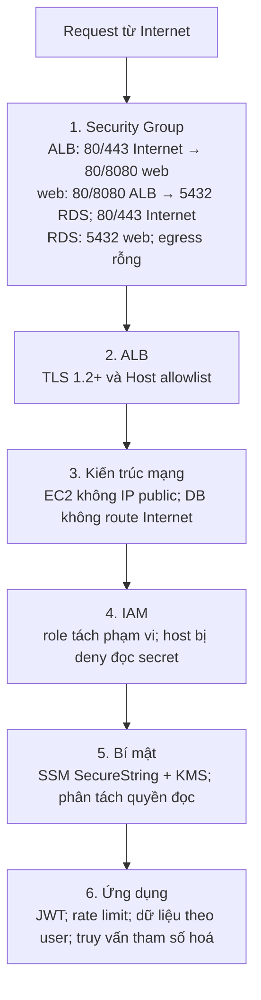

# Bảo mật hệ thống HushStore — sáu nhóm phòng thủ

**WAF 08/11/2026:** phương án Cloudflare WAF đã được gỡ (xem [phạm vi và giới hạn rollback](rollback-cloudflare-waf-2026-11-08.md)) và **thay bằng WAF mã nguồn mở tự vận hành: ModSecurity + OWASP CRS 4 chạy sidecar trong task của `api` và của `web`**. Hiện trạng đúng sự thật: **đã merge `main` và đã chạy trên AWS thật ngày 09/11/2026** — SQLi/XSS/sqlmap bị 403, luồng thật không bị chặn nhầm, XFF đúng, RAM thật đo được ([bằng chứng](evidence/acc-551897327153/2026-11-09/waf-cua-so-aws.md)). Luồng GHI chưa đi tay trên trình duyệt. Xem mục [WAF sidecar](#waf-sidecar-modsecurity--owasp-crs--đã-có-mã-chưa-chạy-trên-aws). Giữ DNS/proxy hiện có và migration SG đã apply.

> **Tài liệu này dành cho ai:** thành viên trong nhóm cần **giải thích được** hệ
> thống phòng thủ khi bảo vệ đồ án, không cần đọc code.
>
> **Khác gì hai tài liệu kia:**
> - [thiet-ke-he-thong-aws.md](thiet-ke-he-thong-aws.md) — *hệ thống là gì*
> - [security-validation-report.md](security-validation-report.md) — *kết quả 12
>   kịch bản đã chạy*, có nguyên lệnh và nguyên output
> - **Tài liệu này** — *vì sao nó chặn được*, và **trả lời được câu hỏi phản biện**
>
> Đọc mục 1, 2 và 6 là đủ để bảo vệ. Mục 3 là chi tiết từng lớp, tra khi cần.
>
> Nếu chưa dùng AWS: SG là bộ lọc stateful theo resource, có thể tham chiếu SG
> khác; NACL là bộ lọc stateless theo subnet/CIDR. Thiết kế hiện tại dùng default
> NACL allow-all do AWS tạo, không quản lý ACL bằng Terraform.

**Trạng thái:** nội dung kiến trúc dưới đây mô tả mã sau khi bỏ ba custom NACL.
Đã apply migration prod ngày 02/11/2026, đọc lại AWS để xác minh association/SG;
chưa kiểm thử runtime ứng dụng. WAF sidecar đã chạy trên AWS ngày 09/11/2026 ([bằng chứng](evidence/acc-551897327153/2026-11-09/waf-cua-so-aws.md)). Xem
[biên bản apply](bien-ban-apply-sg-2026-11-02.md). Báo cáo 12 kịch bản cũ vẫn là
hồ sơ của cấu hình tại thời điểm đo; [migration guide](nacl-to-sg-migration.md)
mô tả cách tái thực hiện và đo lại.

---

## 1. Hai nguyên tắc — và vì sao đề bài chấm đúng hai cái này

Đề bài viết: *"Đảm bảo các luật được mở theo đúng yêu cầu, không mở quá rộng, mở
theo nguyên tắc tối thiểu"* và *"các rules đã ngăn chặn được các cuộc tấn công"*.
Đó chính là hai nguyên tắc kinh điển của bảo mật hạ tầng.

### Nguyên tắc tối thiểu đặc quyền (least privilege)

**Mỗi thành phần chỉ được cấp đúng quyền nó cần để làm việc của nó — không hơn
một chút nào.**

Cách hiểu sai phổ biến: "cấp ít quyền là được". Cách hiểu đúng: **quyền được xác
định bởi công việc, không bởi cảm giác nhiều hay ít.** Nên câu hỏi luôn là *"nó
cần gì để chạy?"*, rồi cấp đúng thế, rồi **chứng minh** rằng ngoài thế là không
làm được.

Ví dụ cụ thể trong hệ thống này: container API cần ghi ảnh sản phẩm lên S3. Nên
**role** của nó (*role* = một hồ sơ quyền do AWS cấp cho container, thay cho việc
nhét mật khẩu vào code — xem Lớp 4 bên dưới) có `s3:PutObject` — và **không có** quyền nào với RDS, dù nó nói
chuyện với database suốt ngày. Vì nó nói chuyện với database qua **kết nối
PostgreSQL trên port 5432**, không qua **API của AWS**. Hai đường hoàn toàn khác nhau, và
gộp chúng lại là chỗ nhiều người mất điểm.

### Phòng thủ nhiều lớp (defense in depth)

**Giả định mỗi lớp sẽ có ngày bị vượt qua. Nên phải có lớp sau.**

Cách hiểu sai: "nhiều lớp cho chắc". Cách hiểu đúng: **mỗi lớp phải chặn được
thứ mà lớp khác không chặn được.** Ba lớp giống nhau là một lớp, chỉ tốn công.

Trong hệ thống này, các biện pháp có vai trò khác nhau:

| Biện pháp | Vai trò |
|---|---|
| Security Group | Tham chiếu SG để diễn tả ALB → web → RDS, kiểm cả nguồn và đích của kết nối mới |
| ALB | Terminate TLS, kiểm Host header, định tuyến tới đúng dịch vụ |
| Kiến trúc mạng | EC2 không IP public, DB subnet không có default route ra Internet |
| IAM, bí mật và ứng dụng | Giới hạn API AWS, quyền đọc mật khẩu và dữ liệu theo người dùng |

Default NACL vẫn gắn với sáu subnet nhưng cho phép mọi traffic hai chiều. Nó
không được tính là lớp phòng thủ chủ động. Bỏ custom ACL làm mất khả năng deny
IP/CIDR ở subnet và lớp dự phòng khi SG bị cấu hình sai; đổi lại giảm công việc
quản lý CIDR, thứ tự rule và chiều trả lời của bộ lọc stateless.

---

## 2. Sơ đồ luồng request

### 2.1. Sáu nhóm biện pháp, nhìn tĩnh



Đây là các nhóm biện pháp, không phải sáu bước xử lý tuần tự của mỗi gói tin.
SG trả lời *nguồn/đích nào được mở kết nối*, ALB trả lời *tên miền nào được
phục vụ*, route quyết định *có đường tới đích không*, IAM giới hạn *API AWS*,
bí mật giới hạn *ai đọc mật khẩu*, ứng dụng giới hạn *ai đọc dữ liệu nào*.

### 2.2. Kết nối từ Internet tới database và đường trả lời

```mermaid
sequenceDiagram
    participant C as Client / Cloudflare
    participant LB as ALB (sg-alb)
    participant AP as API trên EC2 (sg-web)
    participant DB as RDS (sg-rds)
    Note over C,DB: Sáu subnet dùng default NACL allow-all, AWS quản lý
    C->>LB: HTTPS 443 (sg-alb ingress từ Internet)
    Note over LB: TLS bằng ACM; kiểm Host header<br/>HTTP 80 redirect sang HTTPS
    LB->>AP: TCP 8080 (sg-alb egress → sg-web; sg-web ingress ← sg-alb)
    Note over AP: Kiểm JWT, rate limit, quyền theo userId<br/>Web dùng chặng tương tự tại port 80
    AP->>DB: TCP 5432 (sg-web egress → sg-rds; sg-rds ingress ← sg-web)
    DB-->>AP: Phản hồi trên kết nối đã cho phép
    AP-->>LB: Phản hồi trên kết nối đã cho phép
    LB-->>C: Phản hồi HTTPS
```

Mỗi chặng kết nối mới giữa hai SG phải khớp egress ở nguồn và ingress ở đích.
SG stateful tự cho phép gói phản hồi, nên `sg-rds` egress rỗng vẫn trả dữ liệu
PostgreSQL được. Không mở inbound ephemeral trên `sg-web`; default NACL đã cho
qua cả hai chiều. Cùng VPC không tự cấp quyền truy cập giữa các resource:
kết nối mới đi qua các SG vẫn phải khớp rule phù hợp.

| Điểm kiểm soát | Quy tắc | Giới hạn |
|---|---|---|
| `sg-alb` | Inbound 80/443 từ `0.0.0.0/0`; outbound 80/8080 chỉ tới `sg-web` | Cửa public, không deny riêng một IP |
| `sg-web` | Inbound 80/8080 chỉ từ `sg-alb` | Không có SSH; không mở theo CIDR subnet |
| `sg-web` outbound | 5432 tới `sg-rds`, 80/443 tới Internet | Đường HTTP/HTTPS hợp lệ có thể bị lợi dụng rút dữ liệu |
| `sg-rds` | Inbound 5432 chỉ từ `sg-web`; outbound rỗng | Không chặn dữ liệu trả lời trên phiên hợp lệ |
| Default SG | Ingress/egress rỗng | Resource gắn nhầm vào SG này không tự có quyền mạng |
| ECR endpoint (tuỳ chọn) | Inbound 443 chỉ từ `sg-web` | Không chấp nhận cả CIDR app subnet |

Hai sơ đồ `.drawio` đã cập nhật luồng SG này. Báo cáo và log có ghi NACL rule
50/90/95/115/120 vẫn là hồ sơ thiết kế cũ, không phải kết quả đo cấu hình mới.

---

## 3. Từng lớp — chặn gì, và không chặn gì

### Default NACL — nền mạng allow-all, không tính là lớp chặn

VPC luôn có NACL. Mã hiện tại bỏ `nacl-public`, `nacl-app`, `nacl-db` cùng rule
và association custom; sáu subnet dùng default ACL cho phép mọi traffic inbound
và outbound. Không khai báo `aws_default_network_acl` để nhận quản lý đối tượng
này. Trước khi migration, phải kiểm tra default ACL thật sự còn allow-all.

SG và route là các cơ chế chính giới hạn kết nối. Không còn rule DENY 22/5432/8080
ở subnet, không còn `enable_deny_demo`, và KB-08 chặn một IP không còn là bài
kiểm thử của thiết kế hiện tại. WAF sidecar (ModSecurity) chặn theo **nội dung request**
chứ không theo IP, nên nó không thay thế demo chặn IP này; và nó chưa chạy trên AWS. Phương án
Cloudflare đã được [rollback](rollback-cloudflare-waf-2026-11-08.md).

**Lịch sử để đối chiếu:** báo cáo cũ có demo rule 50 deny IP và rule ephemeral
stateless. Những phép đo đó được giữ nguyên, không tái diễn giải thành bằng
chứng cho default ACL. Xem [migration guide](nacl-to-sg-migration.md).

### Lớp 1 — Security Group

**Bản chất: stateful, và chỉ có allow.**

*Stateful* nghĩa là SG **nhớ** kết nối. Cho request đi vào thì phản hồi tự động
được đi ra, không cần rule. Nên SG không có bài toán cổng ephemeral — nó đơn giản
hơn khi quản lý chiều phản hồi. SG **chỉ có allow**, không diễn tả được DENY.

Điểm mạnh riêng: **nguồn của một rule có thể là một Security Group khác.**

```
sg-web ingress: cho phép 8080 từ  sg-alb
```

Không phải "từ 10.20.0.0/24". Câu này nghĩa là *"chỉ những máy đang nằm trong
sg-alb"* — nên khi ALB được dựng lại với IP mới, rule vẫn đúng, **không phải sửa
gì**. Đây là cách diễn tả *quan hệ tin cậy* thay vì *địa chỉ*, và là lý do rule
của ta không dùng CIDR ở đâu ngoài chỗ buộc phải mở ra Internet.

Ba SG ứng dụng, và các giới hạn chính:

| SG | Chi tiết đáng nói |
|---|---|
| `sg-alb` | Egress **chỉ** tới `sg-web` port 80 và 8080. ALB bị chiếm cũng không gọi ra Internet được |
| `sg-web` | **Không có rule port 22 nào.** Không phải "đóng lại" — mà là **chưa từng mở** |
| `sg-rds` | Ingress 5432 chỉ từ `sg-web`; egress **rỗng** ngăn mở kết nối mới, vẫn cho phản hồi |
| Default SG | Ingress và egress đều rỗng, được quản lý bằng `aws_default_security_group` |
| SG ECR endpoint (tuỳ chọn) | Ingress 443 chỉ từ `sg-web`; không có rule theo CIDR app |

`sg-rds` egress rỗng là chi tiết hay bị bỏ qua nhất. Đa số người chỉ nghĩ đến
"ai vào được". RDS không cần tự mở kết nối ra ngoài nên không được cấp egress.
Tuy nhiên dữ liệu vẫn đi qua phản hồi của kết nối hợp lệ; egress rỗng không chứng
minh rằng database bị chiếm thì không thể rò rỉ dữ liệu.

### Lớp 2 — Application Load Balancer

Ba việc bảo mật ALB làm:

**1. Terminate TLS.** Cert do ACM cấp, miễn phí và tự gia hạn. Policy là
`ELBSecurityPolicy-TLS13-1-2-2021-06` — cho phép TLS **1.2 và 1.3**, từ chối
1.0 và 1.1 (hai phiên bản đã bị coi là không an toàn). Listener port 80 không
phục vụ gì, chỉ redirect 301 sang 443.

> Đọc kỹ tên policy: nó **không** phải "TLS 1.3 only". Bản 1.3-only là
> `ELBSecurityPolicy-TLS13-1-3`. Ta không dùng bản đó vì sẽ loại trình duyệt cũ.

**2. Allowlist Host header.** Chỉ **hai** tên miền được đi tiếp:

```
Host: api.hushstore.io.vn  → target group api  (port 8080)
Host: hushstore.io.vn      → target group web  (port 80)
mọi Host khác              → 403 Forbidden
```

Cả hai đều là rule **tường minh**. Không dùng "default action" cho tên miền
chính — để default action giữ đúng một vai: **chặn**. Nhờ vậy máy quét tự động
gọi thẳng vào DNS của ALB sẽ nhận 403, không thấy được ứng dụng.

Và `www.hushstore.io.vn` **không** có trong allowlist, có chủ ý: nó không tồn tại
trong DNS và không có trong cert, nên sẽ lỗi ở tầng TLS trước khi tới được đây.
Một dòng allowlist không bao giờ chạy tới thì **tệ hơn là không có** — nó làm
người đọc tin rằng `www` đang được hỗ trợ.

**3. Che hoàn toàn máy thật.** Client không bao giờ biết IP của EC2. ALB là thứ
duy nhất có mặt trên Internet.

#### Chứng chỉ TLS: vòng đời và TTL

Mục này trả lời ba câu hỏi mà "cert do ACM cấp, miễn phí và tự gia hạn" ở trên bỏ
qua: **chứng chỉ sống bao lâu**, **gia hạn xảy ra khi nào**, và **cái gì làm gia
hạn thất bại**.

Lý thuyết nền (chứng chỉ là gì, chuỗi tin cậy, vì sao thời hạn đang bị rút ngắn)
ở [thiet-ke-he-thong-aws.md](thiet-ke-he-thong-aws.md) **Phần I mục 8**. Mục này
chỉ nói về hệ thống cụ thể này.

**Thời hạn thật của chứng chỉ trong hệ thống này**

| | Giá trị | Nguồn |
|---|---|---|
| Thời hạn chứng chỉ ACM cấp | **198 ngày** | Trần của CA/Browser Forum là 200 ngày kể từ 2026-03-15; ACM cấp 198 ngày để nằm trong trần |
| ACM bắt đầu gia hạn | còn **45 ngày** trước khi hết hạn | Tài liệu ACM. *(Chứng chỉ cũ 395 ngày thì mốc là 60 ngày, và bản gia hạn sẽ chỉ còn 198 ngày)* |
| ARN sau khi gia hạn | **không đổi** | Nên Terraform không thấy drift, không phải apply lại, ALB không phải cấu hình lại |
| Nếu ACM không xác thực được | Cảnh báo qua AWS Health + EventBridge ở mốc **30, 15, 7, 3, 1 ngày** | Tài liệu ACM |

Con số 198 ngày không phải AWS tự chọn. Nó là hệ quả của
[ballot SC-081v3](https://cabforum.org/2025/04/11/ballot-sc081v3-introduce-schedule-of-reducing-validity-and-data-reuse-periods/)
mà CA/Browser Forum thông qua tháng 4/2025, rút trần thời hạn chứng chỉ TLS theo
lịch: **200 ngày** từ 2026-03-15 → **100 ngày** từ 2027-03-15 → **47 ngày** từ
2029-03-15.

Điều đáng rút ra cho đồ án: xu hướng của cả ngành là **thời hạn ngắn dần**, và lý
do là cơ chế thu hồi chứng chỉ (CRL/OCSP) trong thực tế hoạt động không đáng tin —
nên cách chống một chứng chỉ bị lộ khoá tốt hơn là **để nó tự hết hạn nhanh**.
Hệ quả trực tiếp: gia hạn tay sẽ không còn khả thi. Tới 2029, một người phải thay
chứng chỉ **8 lần mỗi năm** cho mỗi tên miền. Việc chọn ACM ở đây vì thế không
phải để tiết kiệm $0 phí chứng chỉ — mà vì **tự động hoá gia hạn sắp trở thành bắt
buộc**, và ACM làm việc đó mà không cần ta viết gì.

**Cái duy nhất có thể làm gia hạn thất bại**

ACM chỉ tự gia hạn khi **cả hai** điều kiện đúng:

1. Chứng chỉ đang được một dịch vụ AWS dùng (ở đây: ALB đang tồn tại).
2. **Toàn bộ bản ghi CNAME xác thực** của ACM còn nằm trong DNS công khai — một
   bản ghi cho mỗi tên miền, tức hệ thống này có **hai**.

Điều kiện thứ hai là bẫy thật, và nó có một hình dạng cụ thể: người ta nghĩ bản
ghi CNAME xác thực chỉ cần cho **lần cấp đầu tiên**, xong thì xoá cho gọn. **Sai.**
ACM đọc lại chính hai bản ghi đó ở mỗi lần gia hạn. Xoá đi thì:

- Không có gì hỏng **ngay**. Chứng chỉ vẫn chạy tiếp tới 5–6 tháng nữa.
- Rồi tới mốc còn 45 ngày, gia hạn im lặng thất bại.
- Rồi cảnh báo bắt đầu về ở mốc 30 ngày — vào một hộp thư mà lúc đó có thể không
  ai đang đọc.
- Rồi tới ngày hết hạn, **mọi trình duyệt chặn website**, và triệu chứng không hề
  trỏ về nguyên nhân đã gây ra nó 5 tháng trước.

Nên hai bản ghi đó nằm trong danh sách "đừng xoá" ở
[terraform-runbook.md](terraform-runbook.md), và đó là lý do chúng được ghi ra
`terraform output` chứ không chỉ nằm trong state.

> Điều kiện thứ nhất cũng có một hệ quả mà dự án này đụng phải: hệ thống **mặc
> định tắt ALB** — nhắc lại, vì đây là lần đầu điều đó xuất hiện trong tài liệu này:
> **mọi resource tính tiền theo giờ (ALB, NAT Gateway, EC2, RDS) được tắt ngoài giờ
> làm việc**, bằng tay qua `down.sh` hoặc tự động bằng một Lambda chạy lúc 00:00 mỗi
> đêm. Đó là kiến trúc bật/tắt được nhắc tới bên dưới. Nếu ALB bị destroy suốt một thời gian dài rồi đúng mốc 45 ngày
> rơi vào khoảng đó, chứng chỉ mất điều kiện "đang được dùng". Chưa xảy ra vì
> khoảng tắt tính bằng ngày chứ không bằng tháng, nhưng nó là một rủi ro **có
> thật** của kiến trúc bật/tắt này, và nó chưa được canh bằng cơ chế nào.

**Bảng mọi thứ có thời hạn trong hệ thống**

"TTL" bị dùng cho quá nhiều thứ khác nhau. Bảng này gom hết lại, và cột cuối là
cột đáng đọc — nó nói **triệu chứng khi giá trị đó hết hạn**, vì đó là thứ bạn sẽ
gặp trước khi biết nguyên nhân.

| Cái gì | Giá trị | Hết hạn / vượt hạn thì sao |
|---|---|---|
| Chứng chỉ ACM | 198 ngày, tự gia hạn ở mốc còn 45 ngày | Trình duyệt chặn hoàn toàn website |
| Bản ghi CNAME xác thực ACM | **không có thời hạn — phải tồn tại mãi** | Gia hạn thất bại im lặng, biểu hiện sau ~5 tháng |
| Credential tạm của OIDC/STS | ~1 giờ | Job CI dài quá sẽ mất quyền giữa chừng |
| Credential của ECS task role | tự động luân chuyển | Không cần làm gì — đây là cái thay thế access key tĩnh |
| **Access token JWT** | **10080 phút = 7 ngày** | Xem ghi chú bên dưới — **con số này là một vấn đề** |
| Refresh token | 7 ngày | Người dùng phải đăng nhập lại |
| `ClockSkew` của JWT | 1 phút (mặc định .NET là 5) | Token hết hạn vẫn được nhận thêm đúng 1 phút |
| Cache cờ `IsActive` (khoá tài khoản) | 30 giây | Trần thời gian một tài khoản vừa bị khoá còn dùng được |
| Cửa sổ rate limit đăng nhập | 1 phút / 5 lần | Request thứ 6 nhận HTTP 429 |
| `deregistration_delay` của target group | **5 giây** | Deploy nhanh hơn, đổi lấy việc request đang bay có thể bị cắt |
| Idle timeout của ALB | 60 giây (mặc định AWS, không đặt tường minh) | Kết nối im lặng quá 60s bị đóng |
| CloudWatch Logs của container | 3 ngày | Log cũ hơn 3 ngày **không còn để điều tra** |
| Log group của Lambda cost-guard | 30 ngày | Giữ dài hơn vì đây là bằng chứng "nó có chạy đêm đó không" |
| ALB access logs trên S3 | 7 ngày | Đây là nguồn bằng chứng chính cho báo cáo kiểm thử khi Flow Logs đang tắt |
| S3 artifacts | 365 ngày | Giữ `migrate-<sha>.sql` đủ lâu để đối chiếu |
| Backup tự động của RDS | 7 ngày | Point-in-time recovery chỉ lùi được 7 ngày |
| Số image giữ trong mỗi ECR repo | 5 image gần nhất | Rollback chỉ đi lùi được 5 bản |
| **RDS tự bật lại sau khi stop** | **7 ngày** | Không phải TTL của ta, là hành vi của AWS và **không tắt được**. Lưới an toàn là Lambda cost-guard chạy 00:00 mỗi đêm |

> **Hai chỗ chưa đúng, nói thẳng ra ở đây:**
>
> **1. Access token sống 7 ngày, không phải 15 phút.**
> `src/API/appsettings.json` đặt `AccessTokenExpirationMinutes = 10080`, và
> **không có** biến môi trường nào ghi đè giá trị đó ở production — task
> definition chỉ inject `JwtSettings__SecretKey`. Nghĩa là access token và refresh
> token có **cùng** thời hạn 7 ngày, tức cơ chế refresh token đang không mang lại
> lợi ích nào: ý tưởng của nó là *access token ngắn, refresh token dài*, và ở đây
> hai cái bằng nhau.
>
> Hệ quả cụ thể: JWT là không trạng thái, cấp rồi thì không thu lại được. Nên một
> token bị lộ dùng được **7 ngày**, không phải 15 phút. Thứ duy nhất còn chặn là
> middleware kiểm cờ `IsActive` với cache 30 giây — nghĩa là cơ chế đó không phải
> "lớp bổ sung cho chắc" như mô tả ở Lớp 6, mà đang là **lớp phòng thủ chính**
> chống token bị lộ.
>
> Việc sửa nằm ở tầng code ứng dụng, đã cố ý hoãn tới sau dự án hạ tầng — hồ sơ ở
> [ra-soat-ung-dung-multi-task.md](ra-soat-ung-dung-multi-task.md).
>
> **2. Không bật HSTS.** `Program.cs` gọi `UseHttpsRedirection()` nhưng **không**
> gọi `UseHsts()`. Nên không có header `Strict-Transport-Security`, tức trình
> duyệt không được dặn "từ nay chỉ nói chuyện với tên miền này bằng HTTPS". Rủi ro
> còn lại là kịch bản request **đầu tiên** đi bằng HTTP và bị chặn giữa đường
> trước khi redirect 301 kịp xảy ra. **Full (strict)** kiểm chứng chỉ origin trên
> chặng HTTPS, không bảo vệ request HTTP đầu tiên của client. WAF không thay HSTS.
>
> *(Cloudflare là dịch vụ DNS/CDN **bên ngoài AWS**, đứng trước ALB — nó không phải
> một trong sáu nhóm ở trên. "Full (strict)" kiểm chứng chỉ origin ở **chặng HTTPS**; HTTP viewer
> vẫn cần redirect riêng. Cloudflare DNS/proxy có trước phương án WAF; ta dùng nó vì
> nó miễn phí và đã có sẵn cho tên miền này.)*

### Lớp 3 — Kiến trúc mạng: phòng thủ mạnh nhất không phải là một rule

Hai quyết định, không phải rule nào, nhưng chặn được nhiều nhất:

**EC2 không có IP public.** Không phải "chặn truy cập từ Internet" — mà là
**không tồn tại địa chỉ nào để gõ**. Không có rule nào để cấu hình sai, không có
rule nào để quên. Máy vẫn tải được phần mềm nhờ **NAT Gateway** — cơ chế cho phép
đi ra nhưng không cho vào (xem Phần I mục 6 của tài liệu thiết kế).

**Subnet database không có route ra Internet.** Route table của nó **không có**
dòng `0.0.0.0/0`. Nên kể cả khi ai đó cấu hình sai mọi Security Group và mọi
default NACL, gói tin từ RDS vẫn không có default route Internet. Đây là loại phòng thủ không phụ thuộc
vào việc con người có cấu hình đúng hay không.

### Lớp 4 — IAM: mười danh tính, và một chữ Deny quan trọng

Tách quyền theo **việc**, không theo **máy**. Toàn hệ thống có **10 IAM role**,
không role nào dùng managed policy `*FullAccess`:

**Năm role của workload (module `ecs`)** — đây là chỗ điểm least privilege được chấm:

| Role | Của ai | Được làm gì |
|---|---|---|
| `container-instance` | Máy EC2 | Đăng ký vào ECS cluster, chạy Session Manager. **Deny tường minh** đọc secret; **không** chạm S3 ảnh |
| `task-execution` | ECS agent lúc khởi `api`/`web` | Pull image, ghi log, đọc **đúng** tập secret của hai task đó |
| `task-execution-seeder` | ECS agent lúc khởi `seeder` | Như trên, nhưng tập secret **khác** — giao với tập trên bằng rỗng |
| `task-app` | Code API lúc chạy | **Chỉ** `s3:PutObject`/`GetObject` trên prefix ảnh + kênh ECS Exec |
| `task-migrator` | Task migration | Chỉ đủ để chạy migration |

**Hai role của CI/CD (module `cicd`)** — tách quyền đọc và quyền ghi:

| Role | Khi nào dùng | Được làm gì |
|---|---|---|
| `deploy` | push vào `main` | Push ECR, đăng ký task def, update 2 service. **Không** có `autoscaling:SetDesiredCapacity`, **không** có `rds:StartDBInstance` → CI **không thể** bật hạ tầng tốn tiền |
| `plan` | mở Pull Request | Chỉ đọc: `terraform plan` và đọc state. **Không** apply được gì |

**Ba role hạ tầng** — `cost-guard` (Lambda tắt hạ tầng hằng đêm), `scheduler`
(EventBridge gọi Lambda đó), `flow` (VPC Flow Logs ghi CloudWatch).

> Kịch bản kiểm thử 10 và 12 đo **7 role** (5 workload + 2 CI/CD) chứ không phải
> cả 10 — ba role hạ tầng không nhận dữ liệu người dùng và không có đường nào để
> kẻ tấn công chạm tới, nên không nằm trong ma trận blast-radius.

Tách `deploy` khỏi `plan` là một điểm đáng nói: một Pull Request từ người ngoài
chạy được `plan` để xem trước thay đổi, nhưng **không** có đường nào apply.

**Chỗ đáng nói nhất: một câu `Deny` tường minh.**

Máy EC2 cần managed policy `AmazonSSMManagedInstanceCore` để dùng Session Manager
(đường admin **duy nhất** vào máy, vì không có SSH). Nhưng cái tên đó nói ít hơn
thực tế: policy này cấp `ssm:GetParameter` với `Resource: "*"` — nghĩa là **máy
EC2 đọc được mọi bí mật của ta**, gồm mật khẩu database.

Ta không bỏ managed policy (sẽ mất đường vào máy). Ta thêm một câu Deny:

```hcl
statement {
  sid    = "DenyReadingOurSecrets"
  effect = "Deny"
  actions = [
    "ssm:GetParameter",
    "ssm:GetParameters",
    "ssm:GetParameterHistory",   # ← đủ BỐN, không phải ba
    "ssm:GetParametersByPath",
  ]
  resources = ["arn:aws:ssm:*:*:parameter/hushstore/*"]
}
```

Hai điều phải giải thích được nếu bị hỏi:

1. **Vì sao Deny thắng?** Quy tắc đánh giá của IAM: **explicit Deny luôn thắng
   mọi Allow**, bất kể Allow đến từ managed policy nào. Không có ngoại lệ.
2. **Vì sao đủ bốn action?** `GetParameterHistory` với `WithDecryption=true` trả
   về **plaintext** của các version cũ — thiếu nó là còn một đường đọc secret.
   Hiện managed policy không cấp action đó, nên nó đang là *implicit* Deny. Nhưng
   **implicit Deny bị override được** nếu sau này có ai gắn thêm policy;
   **explicit Deny thì không**. Liệt kê đủ bốn là chặn *trước*, không phải chặn
   *cái đang có*.

**Và máy không cần đọc secret.** Việc nhét mật khẩu vào container do **ECS
agent** làm bằng `task-execution` role, không phải role của máy. Nên câu Deny này
không làm gì gãy — đúng định nghĩa của least privilege: bỏ quyền mà không mất
chức năng.

### Lớp 5 — Bí mật

Không còn credential dài hạn nào trong toàn hệ thống:

| Trước | Sau | Cơ chế |
|---|---|---|
| SSH key `.pem` trên máy dev | không có | SSM Session Manager |
| `EC2_SSH_KEY` trong GitHub | không có | GitHub OIDC (token sống vài phút) |
| AWS access key trong `appsettings.json` | không có | ECS task role, SDK tự lấy |
| Token registry | không có | ECR dùng IAM |
| File `.env` trên máy | không có | ECS inject qua `secrets` |

Mật khẩu, connection string và JWT secret nằm trong **SSM Parameter Store** dạng
`SecureString` (mã hoá bằng KMS, **miễn phí** — Secrets Manager tốn $0.40/bí
mật/tháng).

**Chi tiết đáng nói: hai tập bí mật giao nhau bằng rỗng.** Task `api` và task
`seeder` dùng **hai** execution role khác nhau, mỗi role đọc được **đúng** tập
parameter của task đó. Nên một task bị chiếm cũng không làm lộ bí mật của task
kia. Đây là least privilege áp dụng ở tầng *bí mật*, không chỉ tầng *API*.

### Lớp 6 — Ứng dụng: lớp cuối, và cũng là lớp bị tấn công nhiều nhất

Bốn lớp mạng đầu chặn được kẻ tấn công **không mời**. Nhưng khách hàng thật cũng
đi qua các lớp đó — nên lớp cuối phải trả lời câu khác: *"người này được xem
dữ liệu của ai?"*

**JWT — bốn phép kiểm, không phải một.** Nhiều người tưởng xác thực token là
"kiểm chữ ký". Ta kiểm bốn thứ:

```csharp
ValidateIssuer           = true,   // ai phát token này?
ValidateAudience         = true,   // token này dành cho ứng dụng nào?
ValidateIssuerSigningKey = true,   // chữ ký có đúng khoá của ta?
ValidateLifetime         = true,   // còn hạn không?
ClockSkew = TimeSpan.FromMinutes(1)
```

`ClockSkew` mặc định của .NET là **5 phút** — nghĩa là token hết hạn vẫn được
nhận thêm 5 phút. Ta hạ xuống **1 phút**.

> **Access token sống 7 ngày, không phải 15 phút.** `appsettings.json` đặt
> `AccessTokenExpirationMinutes = 10080`, và production không ghi đè giá trị đó —
> task definition chỉ inject `JwtSettings__SecretKey`. Tức access token và refresh
> token **cùng** thời hạn 7 ngày, nên cơ chế refresh token đang không mang lại lợi
> ích nào. Đây là một lỗi thật, chưa sửa; hồ sơ ở
> [ra-soat-ung-dung-multi-task.md](ra-soat-ung-dung-multi-task.md), phân tích đầy
> đủ ở mục *Chứng chỉ TLS: vòng đời và TTL* của Lớp 2.

Và trong JWT **không có** dữ liệu nhạy cảm nào. Payload của JWT chỉ là Base64,
**ai cũng giải mã được** — nó chống *sửa*, không chống *đọc*.

**Chống dò mật khẩu.** `POST /api/auth/login` giới hạn **5 lần/phút**, request
thứ 6 nhận HTTP 429. Đây là kịch bản kiểm thử số 6.

> Giới hạn này đếm **trong RAM của một tiến trình**. Nên nếu có hai container API
> thì hạn mức thật thành 10 lần/phút. Đây là lý do thật sự của `max_size = 1`,
> và muốn scale thì phải chuyển bộ đếm sang Redis/ElastiCache. Ghi ở Phần V của
> tài liệu thiết kế.

**Chống IDOR — và ta dùng cách mạnh hơn cách thông thường.** IDOR (*Insecure
Direct Object Reference*) là lỗ hổng khi đổi số trong URL là xem được dữ liệu
người khác: `/api/orders/1042` → `/api/orders/1043`.

Cách thông thường là *kiểm rồi từ chối*:

```csharp
var order = await repo.GetByIdAsync(id);
if (order.UserId != currentUserId) return Forbid();   // kiểm-rồi-chối
```

Cách ta dùng là **đóng khung truy vấn** theo danh tính trong token:

```csharp
var userId = User.FindFirstValue(ClaimTypes.NameIdentifier);  // TỪ TOKEN
var addresses = await _repository.GetByUserIdAsync(userId);    // không nhận id từ URL
```

Khác biệt quan trọng: `userId` lấy từ **token đã xác thực**, không bao giờ từ URL
hay body. Nên **không có tham số nào để đổi**. Cách này mạnh hơn kiểm-rồi-chối vì:

- Không thể quên một endpoint (không có phép kiểm nào để quên)
- Không rò rỉ **sự tồn tại** của bản ghi — 403 gián tiếp tiết lộ "ID này có thật"

**Chống SQL injection.** Toàn bộ truy cập DB qua Entity Framework Core, sinh
**câu lệnh tham số hoá**: dữ liệu người dùng luôn đi vào như *tham số*, không bao
giờ được ghép vào chuỗi SQL. Không có `FromSqlRaw` với chuỗi nối trong dự án.

**Khoá tài khoản có hiệu lực gần như tức thì.** JWT bản chất là *không trạng
thái* — cấp rồi thì không thu lại được, hết hạn mới thôi. Nên admin khoá một tài
khoản thì access token của người đó vẫn còn hiệu lực **tối đa 7 ngày** — xem ghi
chú về `AccessTokenExpirationMinutes` ở trên.

Đóng khoảng đó bằng một middleware chạy **sau** `UseAuthentication()`: mỗi request
đã xác thực đều kiểm cờ `IsActive`, cache 30 giây để không đánh DB mỗi lần.

```
UseForwardedHeaders → UseCors → UseRateLimiter
  → UseAuthentication → [kiểm IsActive] → UseAuthorization
```

Thứ tự này bắt buộc: phải biết *ai* (`UseAuthentication`) trước khi kiểm *người
đó còn được vào không*. Bị khoá thì nhận 403 kèm header `X-Account-Status: locked`
để client tự đăng xuất. **Trần thời gian tụt từ 7 ngày xuống 30 giây.**

> Vì access token thật sống 7 ngày chứ không phải 15 phút, middleware này không
> phải một lớp bổ sung cho chắc — nó đang là **lớp phòng thủ chính** chống một
> token đã bị lộ. Nghĩa là nếu nó hỏng (cache không invalidate, hoặc thứ tự
> middleware bị đổi) thì trần thời gian nhảy từ 30 giây lên 7 ngày.

**`UseForwardedHeaders` phải chạy đầu tiên** — và đây là một chi tiết bảo mật, không
chỉ là chuyện thứ tự. ALB terminate TLS rồi chuyển tiếp bằng HTTP, nên nếu không
đọc `X-Forwarded-Proto` thì ứng dụng tưởng mọi request là HTTP không mã hoá, và
`UseHttpsRedirection` sẽ redirect vô hạn. Quan trọng hơn: **IP thật của client
nằm trong `X-Forwarded-For`** — không đọc header đó thì rate limiter đếm sai, nó
sẽ thấy mọi request đến từ cùng một IP (của ALB) và chặn oan người dùng thật.
Mã làm đúng như sau (`src/API/Middleware/ProxyHeaders.cs`): **xoá cả `KnownIPNetworks` lẫn
`KnownProxies`** — tức là middleware đọc `X-Forwarded-*` từ **bất kỳ** peer nào, không giới hạn theo
CIDR VPC — và đặt `ForwardLimit = 1`, nên chỉ lấy **một** phần tử, phần tử **cuối** của
`X-Forwarded-For` (phần ALB nối vào), bỏ qua phần client tự khai ở đầu chuỗi. Thứ chặn kẻ lạ tự
gửi `X-Forwarded-For` giả **không phải** mã này mà là `sg-web`: chỉ cho ALB đi vào (comment
trong file: "sg-web allows only ALB traffic").

---

### WAF sidecar (ModSecurity + OWASP CRS) — đã có mã, chưa chạy trên AWS

> **Trạng thái trung thực:** mã (image, Terraform, CI, script) đã xong trên nhánh
> `codex/remove-custom-nacl`; **đo ở máy local bằng Docker**, upstream là nginx giả, không phải
> `api`/`web` thật. **Cập nhật 09/11/2026: đã merge `main` và đã đo trên AWS thật** — xem
> [`evidence/acc-551897327153/2026-11-09/waf-cua-so-aws.md`](evidence/acc-551897327153/2026-11-09/waf-cua-so-aws.md): 403 khi `On`, 0 chặn nhầm ở các luồng đọc + đăng nhập,
> XFF đúng (2 IP không khoá lẫn nhau), RAM WAF 40–63 MiB lúc rảnh. Luồng GHI (sửa sản phẩm,
> upload, checkout) mới chỉ được phủ bởi `run.sh` với upstream giả.

**Vì sao có:** giảng viên muốn một WAF mã nguồn mở tự vận hành trên EC2 để học được nhiều hơn
(Cloudflare WAF đã bị rollback vì lý do đó), và cho phép WAF chạy chung máy với web/api.

**Nó nằm ở đâu — làm "sidecar", tức một container đứng ngay trước app, trong cùng một task:**

```
Internet → ALB :443 (định tuyến theo Host, mặc định 403)
   ├─ tg-api (cổng host 8080) → [task api]  waf ──link──▶ api:8080  (api KHÔNG mở cổng host)
   └─ tg-web (cổng host 80)   → [task web]  waf ──link──▶ web:80    (web KHÔNG mở cổng host)
```

Nói đơn giản: trước đây ALB gọi thẳng vào `api`/`web`. Giờ ALB chỉ gọi được container `waf`;
container `waf` kiểm tra request rồi mới chuyển cho app. App **không còn cổng nào trên máy**
để ai đó gọi vòng qua WAF từ bên ngoài.

**Vì sao sidecar, không phải một service WAF riêng:** `api` và `web` không có health check ở tầng
container, sức khoẻ của chúng **chỉ** do target group của ALB đo. Nếu ALB trỏ sang một service WAF
riêng thì (a) deploy hỏng không còn ai thấy, (b) `api` chết làm health check qua WAF đỏ và ECS
**giết nhầm container WAF** (vô tội) trong khi `api` không bị đụng tới. Làm sidecar thì `api` chết
nghĩa là cả task (kèm WAF) bị thay — đúng như cũ. Cái giá: hai tiến trình WAF trên một máy, tốn
RAM gấp đôi, nên `instance_type` mặc định của `envs/prod` là **t3.small** (không còn vừa t3.micro).

**Cấu hình đã chốt:** `MODSEC_RULE_ENGINE=On`, `BLOCKING_PARANOIA=1`, ngưỡng điểm bất thường
inbound 5 / outbound 4 (mặc định của CRS), `MODSEC_RESP_BODY_ACCESS=Off`, 1 worker nginx. Trần body:
`api` 8 MB (ảnh tối đa 5 MB cộng phần đệm multipart), `web` 1 MB. Image: `devops/waf/Dockerfile`
(gốc `owasp/modsecurity-crs:4.30.0-nginx-alpine-202610180210`, ghim tag có ngày), đẩy lên ECR repo
`hushstore-waf`, dùng chung `image_tag` với `api`/`web`.

#### WAF chặn gì

Request có dấu hiệu tấn công theo luật CRS mức nhạy 1 → trả **403** và ghi một dòng log JSON có
mã luật + điểm bất thường. Đã chạy thật ở local (30/30 ca của `run.sh` đạt). ⚠️ **Upstream của bộ kiểm thử là `nginx:alpine`
trả lại header (echo), KHÔNG phải app thật**: nó chứng minh luật CRS và exclusion đúng trên các
payload mẫu, **không** chứng minh mọi luồng thật của app qua được WAF — vì vậy lần đầu lên AWS phải
chạy `DetectionOnly` trước (mục [Lần đầu trên AWS](#lần-đầu-trên-aws-bắt-đầu-bằng-detectiononly-không-phải-on)):

| Loại | Ví dụ đã thử | Kết quả |
|---|---|---|
| SQL injection | `search=' OR 1=1--`; email đăng nhập `a' OR 1=1--`; SQLi kèm header `Authorization: Bearer <chuỗi ngẫu nhiên>` (không phải JWT thật) | 403 |
| XSS | `{"comment":"<script>alert(1)</script>"}` | 403 |
| Path traversal | `/..%2f..%2fetc/passwd` | 403 hoặc 400 |
| Công cụ quét | User-Agent `sqlmap/1.7` | 403 |
| Body quá 8 MB (api) | JSON 9 MB | 413 |

Và **không chặn nhầm** các luồng thật: đăng nhập thường và mật khẩu có ký tự đặc biệt, refresh
token, sửa sản phẩm tiếng Việt, tìm kiếm có dấu, upload ảnh 5 MB, JSON gần 1 MB, health check của ALB
(Host là IP), file Blazor `_framework/*`, mô tả sản phẩm là HTML có ``/`<a>` (exclusion 1005,
chỉ trường `description`/`shortDescription` của `POST/PUT /api/products`; `<script>` ở đó vẫn 403), và
upload ảnh có tên file chứa `'` hoặc `;` (exclusion 1006; API đổi tên thành GUID nên tên gốc không
được dùng).

#### WAF KHÔNG chặn gì (nói thẳng khi bảo vệ)

| Không chặn | Vì sao |
|---|---|
| **IDOR/BOLA** (khách A xem đơn của khách B) | Request trông hoàn toàn hợp lệ; chỉ code kiểm tra ownership mới chặn được |
| **Lỗi logic nghiệp vụ, race condition** (dùng voucher quá hạn mức, bán vượt tồn) | WAF không hiểu nghiệp vụ; đã có `LoadProbe` và conditional update ở DB |
| **Brute force / rate limit** | WAF không làm rate limit (chủ đích). Rate limit đăng nhập nằm ở app |
| **DDoS, bot** | Không có bot management; tầng 3/4 là AWS Shield Standard |
| **Rò rỉ ở chiều trả lời** (response) | `MODSEC_RESP_BODY_ACCESS=Off` — WAF không đọc body trả về, nên luật outbound của CRS thực tế không có tác dụng với nội dung |
| **Trường mật khẩu** ở `/api/auth/login|register|change-password`, `/api/customers`, `/api/employees` | **Cố ý không soi** (exclusion ID 1002): để mật khẩu không lọt vào log và không bị chặn nhầm vì ký tự đặc biệt |

#### Bật/tắt chế độ chặn — biến `waf_rule_engine`

Biến Terraform `waf_rule_engine` (`infra/tf/envs/prod/variables.tf`), giá trị `On` (chặn, **mặc
định**) hoặc `DetectionOnly` (chỉ ghi log, không chặn — công tắc lùi khi chặn nhầm). Không có
`Off`: tắt hẳn thì mất cả log. ⚠️ Service có `ignore_changes = [task_definition]`, nên đổi biến
**chỉ có hiệu lực ở lần deploy kế tiếp** (pipeline lấy revision ACTIVE mới nhất làm khuôn), không
đổi ngay trên task đang chạy.

**Công tắc khẩn cấp nhanh nhất** (đang chặn nhầm người dùng thật): đặt `waf_rule_engine =
"DetectionOnly"` rồi `terraform apply` — việc này chỉ tạo **revision task definition mới**, chưa đổi
task đang chạy. Sau đó trỏ service sang revision mới ngay, không chờ pipeline:

```bash
aws ecs update-service --cluster hushstore --service hushstore-api --task-definition <revision mới>
aws ecs update-service --cluster hushstore --service hushstore-web --task-definition <revision mới>
```

(cluster tên `hushstore` = `var.project`; hai service `hushstore-api` / `hushstore-web`; lấy số
revision từ output của apply hoặc `aws ecs describe-services`.) ECS thay task theo kiểu rolling nên
vẫn mất vài phút — đây là cách nhanh nhất có sẵn, không phải tức thời.

#### Lần đầu trên AWS: bắt đầu bằng `DetectionOnly`, không phải `On`

Local chỉ đo với upstream giả, nên **chưa ai biết luật CRS có chặn nhầm luồng thật nào của app**.
Hai ca đã lọt qua bộ kiểm thử rồi mới bị review bắt (mô tả HTML có ``, tên file upload có `'`)
chính là loại lỗi này. Vì vậy cửa sổ AWS đầu tiên phải đi theo thứ tự:

1. Bật stack với `waf_rule_engine = "DetectionOnly"` (WAF chỉ ghi log, không chặn).
2. Đi qua tay các luồng thật chính: đăng nhập, xem/sửa sản phẩm (kể cả mô tả HTML), upload ảnh,
   giỏ hàng, thanh toán, phiếu nhập kho, phiếu xuất kho.
3. Đọc CloudWatch `/ecs/hushstore-waf`: mọi bản ghi của request hợp lệ là một dương tính giả cần
   exclusion mới trong `devops/waf/REQUEST-900-EXCLUSION-RULES-BEFORE-CRS.conf` (hẹp theo path +
   tham số, kèm ca trong `run.sh`). Thêm exclusion nghĩa là **build lại image và merge** — không sửa
   được tại chỗ.
4. Chỉ khi log sạch mới chuyển `waf_rule_engine = "On"` (apply + công tắc ở trên), rồi chạy demo 403.

#### Chạy bộ kiểm thử local (cổng chặn hồi quy của WAF)

```bash
devops/waf/test/run.sh                              # On: ca hợp lệ phải 200, ca tấn công phải 403
RULE_ENGINE=DetectionOnly devops/waf/test/run.sh    # chỉ để gom xem luật nào khớp
WAF_LOG_OUT=/tmp/waf.log devops/waf/test/run.sh     # lưu log hai WAF trước khi dọn stack
```

Cần `docker compose`, `curl`, `jq`. Thoát `0` khi mọi ca đạt, `1` khi có ca hỏng (in tên ca).
Sửa `default.conf.template`, file exclusion hay đổi tag image gốc thì chạy lại trước khi commit.

#### Log

Audit log JSON ra stdout → CloudWatch log group `/ecs/hushstore-waf`, hai stream
`waf-api` và `waf-web` — demo chỉ cần mở một chỗ. Audit log chỉ ghi các phần `AHZ`: A (thông tin
giao dịch), H (luật nào khớp, điểm bao nhiêu), Z (kết thúc). **Không** có phần B (header của
request), nên header `Authorization: Bearer …` không có trong log — **trừ khi một luật CRS khớp
chính header `Authorization`**: khi đó `logdata` của luật chép nguyên giá trị khớp vào phần H. (Ca
`audit_log_khong_lo_token` chỉ đo trường hợp luật khớp ở tham số khác.) Audit engine `RelevantOnly`
ghi theo hai điều kiện: request bị luật gắn cờ, **hoặc** status trả về khớp
`SecAuditLogRelevantStatus` — mặc định của image là `^(?:5|4(?!04))`, tức mọi 4xx **trừ 404** và mọi
5xx **của app** cũng được ghi (vd. 401 đăng nhập sai, 400 validation, 503 của `/health/ready` lúc DB
đang khởi động). Bản ghi đó chỉ chứa URI/status, không bí mật. Ước lượng dung lượng CloudWatch phải
tính cả luồng này, không chỉ request bị chặn.

#### Giới hạn đã biết (đã quyết định, không phải quên)

- **403 của WAF không có header CORS** → trình duyệt báo lỗi mạng chứ không hiện "bị chặn". Blazor
  chỉ thấy "network error". Muốn thấy 403 thật thì xem trong tab Network hoặc log WAF.
- **`proxy_read_timeout` là mặc định nginx, 60 giây** (bằng idle timeout mặc định của ALB). Request
  nào của `api` chạy quá 60 giây sẽ bị cắt ở WAF.
- **CRS luật 920450 chặn header `Expect`.** Trình duyệt không gửi nó nên người dùng thật không dính;
  nhưng `curl -F` với file lớn thì có. Script upload bằng curl phải thêm `-H 'Expect:'`.
- **Upload đồng thời vẫn dùng được làm DoS:** 20 upload 8 MB cùng lúc có thể vượt trần cứng 512 MiB
  của container `waf` (đo local: 549–594 MiB). Vấn đề này **chưa được giải quyết**.
- **Số RAM đo trên Docker arm64 (máy Mac), chưa đo trên EC2 amd64.** Trên amd64 giả lập, RAM sau tải
  còn tăng qua 3 lượt đo — chưa biết là rò rỉ thật hay do giả lập. Phải đo lại trên EC2.
- **Bộ kiểm thử local dùng upstream giả (echo), không phải app thật.** Dương tính giả với luồng thật
  chỉ lộ khi chạy `DetectionOnly` trên AWS (xem mục "Lần đầu trên AWS").
- **`terraform.tfvars` có thể ghi đè `instance_type` về `t3.micro`** (file này không thuộc mã
  commit). Với 2 sidecar, t3.micro không đủ RAM ⇒ chủ dự án **phải kiểm tfvars** trước khi bật stack.
- **"App không có cổng host" chỉ nghĩa là không tới được từ ngoài máy.** Container khác trên
  cùng máy vẫn gọi được IP bridge của app. Trên máy chỉ có container của dự án nên không phá yêu cầu
  "mọi request của người dùng đi qua WAF".

#### Hai cái bẫy im lặng (đừng đụng khi chưa hiểu)

1. **Bẫy XFF:** WAF phải chuyển **nguyên văn** `X-Forwarded-For` (`$http_x_forwarded_for`),
   **không bao giờ** dùng `$proxy_add_x_forwarded_for`. App tin đúng một hop
   (`ProxyHeaders.ForwardLimit = 1`); nối IP của peer (ALB) vào chuỗi (đo: image mặc định làm đúng như vậy) thì `api` đọc phần tử cuối
   và thấy IP của ALB thay vì IP client; hệ quả **suy ra, chưa đo trên app thật**: mọi người dùng bị
   coi là cùng một IP và rate limit đăng nhập khoá **tất cả mọi người cùng lúc**. `run.sh` có ca
   `xff_giu_nguyen` canh điều này (đối chứng âm: evidence local §6).
2. **Bẫy `containerPort` không `hostPort`:** ở bridge mode, nếu container app khai `containerPort`
   mà thiếu `hostPort`, ECS gán cho nó một **cổng host động** — tức mở lại đường đi vòng
   WAF mà ta cố ý đóng. Vì vậy container `api`/`web` **không** khai `portMappings` nào; test Terraform
   `app_khong_mo_cong_host_de_khong_di_vong_waf` canh điều này.

**Bằng chứng và thiết kế:**
[đo RAM + soi image](evidence/2026-11-08-waf-ram-spike.md) ·
[image + bộ kiểm thử local](evidence/2026-11-08-waf-local.md) ·
[thiết kế](superpowers/specs/2026-11-08-waf-modsecurity-ec2-design.md) ·
[kế hoạch](superpowers/plans/2026-11-08-waf-modsecurity-ec2.md).
Kiểm thử trên AWS: **chưa làm**.

---

## 4. Tấn công nào bị lớp nào chặn

Cột "lớp dự phòng" là chỗ thể hiện *defense in depth*: lớp đầu hỏng thì còn gì.

Mười hai mã kịch bản được giữ để đối chiếu với **12 phép đo lịch sử** trong
[security-validation-report.md](security-validation-report.md), tra bằng chứng
theo số. **Các phép đo này chạy** ngày 2026-08-24, khi còn SQL Server port 1433
và ba custom NACL. Bảng dưới là **kỳ vọng theo cấu hình hiện tại**, không phải
kết quả runtime đã chạy lại. Sau khi được phép apply, dùng
[migration guide](nacl-to-sg-migration.md) để kiểm SG, đường phục vụ, DB, egress và
Flow Logs. Không khẳng định "12/12 đạt" cho cấu hình mới; KB-08 đã nghỉ hưu.

| # | Tấn công | Lớp chặn đầu tiên | Lớp dự phòng |
|---|---|---|---|
| 1 | Quét toàn bộ port của ALB | `sg-alb` chỉ mở 80, 443; kỳ vọng port khác bị lọc | Default NACL allow-all không chặn thay |
| 2 | Gọi thẳng IP riêng của EC2 | **Không có IP public để gọi** → timeout | app subnet không có route ra IGW |
| 3 | Kết nối trực tiếp vào database | `publicly_accessible=false` → endpoint phân giải ra **IP riêng** | `sg-rds` chỉ nhận 5432 từ `sg-web`; db subnet không default route Internet |
| 4 | Gọi port ứng dụng `:8080` qua ALB | ALB không có listener 8080 → **timeout**, không phải refused | `sg-web` chỉ nhận 80/8080 từ `sg-alb` |
| 5 | SSH vào mọi hướng | Không có SG rule 22 nào tồn tại; hệ thống có **0 key pair** | SG không có ingress 22; không còn lớp NACL deny dự phòng |
| 6 | Dò mật khẩu `/api/auth/login` | Kỳ vọng rate limit 5 lần/phút, sau đó HTTP 429; cần đo lại | Identity hash mật khẩu; cờ khoá tài khoản |
| 7 | Giả `Host: evil.com` | ALB allowlist → 403 (kể cả `www` và DNS thô của ALB) | Cert ACM không khớp tên miền lạ |
| 8 | **Lịch sử: DENY đúng một IP bằng NACL** | Đã nghỉ hưu: rule 50 và `enable_deny_demo` bị xoá | Không chạy bài này và không tính đạt trong thiết kế SG hiện tại |
| 9 | Flow Logs ghi nhận kết nối bị từ chối | Sau triển khai, đối chiếu nguồn/đích/port với rule SG; REJECT tự nó không chỉ ra rule chặn | — cần bằng chứng mới; default ACL không chủ động chặn |
| 10 | Chiếm được một danh tính, thử với sang phạm vi khác | Host có explicit deny đọc secret; ma trận 12 phép thử trên 7 role là kết quả cũ cần đối chiếu | `sg-rds` egress rỗng ngăn kết nối mới, không ngăn dữ liệu trả lời |
| 11 | Giả OIDC token để đóng vai CI | JWT tự ký **đủ mọi claim** trust policy đòi vẫn bị `InvalidIdentityToken` — AWS chặn ở bước **xác thực chữ ký**, trước cả khi xét trust policy | trust condition ghim `aud` + `sub` theo repo và branch |
| 12 | Chiếm được role CI, thử bật hạ tầng tốn tiền | Kỳ vọng các quyền ngoài phạm vi bị từ chối — gồm `autoscaling:SetDesiredCapacity`, `rds:StartDBInstance`, `s3:GetObject` trên tfstate | không có `terraform apply` trong workflow nào |
| — | SQL injection qua form | EF Core tham số hoá; không có `FromSqlRaw` nối chuỗi trong dự án | *(chưa kiểm bằng `sqlmap` — đây là lập luận từ mã nguồn, không phải kết quả đo)* |
| — | XSS qua nội dung người dùng | Blazor escape output theo mặc định | *(chưa kiểm)* |
| — | CSRF | API dùng JWT trong header `Authorization`, không dùng cookie → không có bề mặt CSRF cổ điển | *(chưa kiểm)* |

Ba dòng cuối là chỗ trung thực đáng giữ: chúng **có lập luận phòng thủ** nhưng
**không có bằng chứng đo được**. Nếu bị hỏi, trả lời đúng như vậy — mạnh hơn là
nói "đã chặn".

Kết quả đo lịch sử của cả 12 kịch bản, kèm nguyên lệnh và nguyên output:
[security-validation-report.md](security-validation-report.md).

---

## 5. Cái hệ thống này **không** chặn được

Nói thẳng phần này khi bảo vệ sẽ được điểm cao hơn là vờ như hệ thống kín.

| Không chặn được | Vì sao, và cần gì để chặn |
|---|---|
| **Tấn công tầng ứng dụng (XSS, CSRF, SQLi ở tầng HTTP)** | WAF sidecar ModSecurity + CRS **đã có mã và đo local, chưa chạy trên AWS** — khi chạy sẽ chặn payload SQLi/XSS phổ biến bằng 403 (mức nhạy 1). Nó **không** thay EF tham số hoá, validation, Blazor escape output; CSRF và logic nghiệp vụ nó không thấy. Xem [mục WAF](#waf-sidecar-modsecurity--owasp-crs--đã-có-mã-chưa-chạy-trên-aws) |
| **DDoS quy mô lớn** | Chỉ có AWS Shield Standard (bật sẵn, miễn phí), chặn tầng 3/4. Chặn tầng 7 cần Shield Advanced ($3.000/tháng) hoặc Cloudflare |
| **Rò rỉ dữ liệu qua egress hợp lệ** | `sg-web` được mở 443 ra Internet để pull ECR. Kẻ chiếm được container có thể dùng chính đường đó đẩy dữ liệu ra. Lọc theo tên miền cần AWS Network Firewall (~$300/tháng) |
| **Kẻ tấn công đã có credential hợp lệ của user** | Các lớp mạng đều có thể cho họ vào. Chặn được bằng MFA — chưa có |
| **Hành vi bất thường sau khi đã vào** | Không có GuardDuty, không có alarm nào. Không ai được thông báo |
| **Điều tra sau sự cố quá 90 ngày** | Chưa tạo CloudTrail trail. Chỉ có Event History mặc định (90 ngày, chỉ management event) |
| **Lỗ hổng trong thư viện phụ thuộc** | ECR có `scan_on_push`, nhưng CI **không** fail khi phát hiện. Còn **3 package mức High chưa vá** — xem mục 5.1 bên dưới để biết tên và số hiệu advisory |
| **Instance launch không chỉ định SG sẽ rơi vào default SG** | AWS tạo một security group `default` cho **mỗi** VPC, không cho xoá, và mặc định nó cho phép mọi traffic từ chính nó — gồm port 22. Đo được: **0 ENI** đang dùng nó nên hiện không có bề mặt thật, nhưng dự án chưa đặt rule của nó về rỗng. Bịt bằng `aws_default_security_group` với ingress/egress trống, hoặc SCP |
| **Danh tính vận hành yếu hơn danh tính workload** | IAM user `hushstore-ops` có `AdministratorAccess`, **không MFA**, và một access key dài hạn. Đây là đánh đổi có ý thức: bật SSO buộc vào Organization và làm hết hạn credit. Giảm nhẹ ngay được bằng cách **bật MFA** — không ảnh hưởng credit |

Điểm chung của bảng này: các lớp đã có mạnh ở **phòng ngừa**, yếu ở **phát hiện**
và **phản ứng**. Đó là hình dạng điển hình của một hệ thống làm đúng phần hạ tầng
nhưng chưa có phần vận hành bảo mật (Security Operations) — và cũng đúng là ranh
giới hợp lý cho phạm vi một đồ án.


### 5.1 Ba gói phụ thuộc còn lỗ hổng mức High (đo được, chưa vá)

`dotnet build` in ra cảnh báo **NU1903** ở mỗi lần build. Đây là số liệu **đo
được từ chính máy build**, không phải suy đoán — nên nó là bằng chứng tốt cho
luận điểm "kiểm soát chuỗi cung ứng phụ thuộc":

| Gói | Phiên bản lúc đo | Số advisory | Dùng ở | Trạng thái hôm nay |
|---|---|---|---|---|
| `System.Security.Cryptography.Xml` | 9.0.0 và 10.0.0 | **8** | Infrastructure, Service | ✅ **đã vá** — ghim `10.0.10` |
| `AutoMapper` | 16.0.0 | 1 (GHSA-rvv3-g6hj-g44x) | API, Service | ✅ **đã GỠ HẲN** — không dòng code nào dùng |
| `Microsoft.OpenApi` | 2.4.1 | 1 (GHSA-v5pm-xwqc-g5wc) | API | ✅ **đã vá** — ghim `2.7.5` |

Ba điều đáng nói khi bảo vệ:

1. **Cảnh báo đã hiện sẵn ở mỗi lần build mà không ai dừng lại đọc.** Đó mới là
   vấn đề thật — không phải bản thân ba gói này. Công cụ đã báo đúng; quy trình
   chưa có chỗ nào bắt buộc phải xử lý cái báo đó.
2. **`scan_on_push` của ECR quét image nhưng CI không fail.** Kết quả quét nằm
   đó chờ người vào xem, tức trên thực tế là không ai xem.
3. **Cách bịt rẻ nhất:** thêm một bước `dotnet list package --vulnerable
   --include-transitive` vào pipeline và cho nó fail build khi có mức High. Không
   tốn thêm đồng nào, và biến "cảnh báo trôi qua" thành "không merge được".

✅ **Cả ba đã xử lý xong, và điều số 3 ở trên đã được làm.** Bảng trên là bản ghi
của lần đo trong **đợt 2**; cột cuối là trạng thái hiện tại, nên đừng trích ba dòng
đầu ra để trả lời "còn mấy lỗ hổng chưa vá" — câu trả lời đúng là **không còn cái
nào**. Cách xử lý khác nhau theo từng gói, và sự khác nhau đó mới là chỗ đáng nói:

- Hai gói `System.Security.Cryptography.Xml` và `Microsoft.OpenApi` là **phụ thuộc
  gián tiếp** (*transitive*) — không dòng code nào của dự án `using` chúng, chúng bị
  một gói khác kéo vào. Không nâng thẳng được, nên vá bằng cách **ghim tay** một
  `PackageReference` vào `.csproj` để buộc NuGet chọn bản đã vá.
- `AutoMapper` thì **gỡ hẳn**, không nâng. Lý do: đo lại thấy dự án có `0` chỗ dùng
  nó — nó nằm trong `.csproj` mà không ai gọi. Không nâng một gói mà xoá nó đi là
  cách vá rẻ nhất và triệt để nhất, khi có thể.

Và điều số 3 ở trên **đã trở thành cổng CI thật**:
[`devops/scripts/check-vulnerable-packages.sh`](../devops/scripts/check-vulnerable-packages.sh),
chặn ở bước `dotnet build`. Nó **đọc nội dung báo cáo chứ không tin mã thoát** — vì
đã đo được rằng `dotnet list package --vulnerable` trả về `0` (nghĩa là "thành công")
**kể cả khi in ra đủ 10 advisory**. Một bước CI viết ngây thơ dạng
`run: dotnet list package --vulnerable` sẽ **luôn xanh, vĩnh viễn** — đúng loại "bằng
chứng an toàn giả" mà tài liệu này nhắc nhiều lần.

---

## 6. Câu hỏi phản biện — và câu trả lời

Phần đáng đọc nhất trước khi bảo vệ.

**"Bỏ custom NACL thì firewall còn ở đâu?"**

SG stateful là bộ lọc mạng chính: ALB chỉ gửi 80/8080 tới web, web chỉ nhận từ
ALB, RDS chỉ nhận 5432 từ web. EC2 vẫn không có IP public và DB vẫn không có
route Internet. Default ACL của AWS vẫn tồn tại và cho phép hai chiều; Terraform
không quản lý nó. Default SG lại rỗng cả hai chiều — đừng nhầm hai đối tượng.

**"Đánh đổi khi bỏ NACL là gì?"**

Mất deny IP/CIDR ở subnet và một lớp bảo vệ nếu SG sai. Không thể dùng SG để tái
hiện rule 50 deny riêng một IP. KB-08 là hồ sơ cũ, không còn bước demo. Quyết định
này giảm số rule stateless cần quản lý; không biến SG thành bộ lọc có deny.

**"Vì sao không mở 1024–65535 nữa?"**

SG theo dõi kết nối nên cho phép chiều phản hồi tự động, kể cả khi RDS egress
rỗng. Default NACL allow-all cũng cho qua phản hồi. Cổng tạm vẫn tồn tại trong
TCP, nhưng không cần một rule SG inbound mở cả dải để nhận response.

**"Không có SSH thì làm sao vào máy sửa lỗi?"**

**SSM Session Manager.** Agent trên máy **tự gọi ra** AWS và giữ kênh mở; ta bấm
connect từ phía AWS. Không ai gọi *vào* máy, nên không cần mở port nào. Ưu thế:
không có khoá `.pem` để mất, thu quyền bằng sửa IAM policy có hiệu lực ngay, và
mọi phiên đều được CloudTrail ghi lại — khác với SSH, nơi log nằm **trên chính
máy** vừa bị chiếm.

**"Nhưng phải tin AWS?"**

Đúng, và đó là *mô hình trách nhiệm chia sẻ* (shared responsibility model): AWS
chịu trách nhiệm bảo mật **của** cloud (phần cứng, hypervisor, mạng vật lý), ta
chịu trách nhiệm bảo mật **trong** cloud (rule, IAM, mã nguồn). Không tin AWS thì
tự dựng datacenter — và khi đó phải tự làm tất cả những việc AWS đang làm.

**"Mật khẩu database nằm ở đâu? Có ai đọc được không?"**

SSM Parameter Store dạng `SecureString`, mã hoá bằng KMS. Đọc được đúng **một**
danh tính: `task-execution` role, và chỉ để nhét vào container lúc khởi động.
Máy EC2 chạy container đó **bị Deny tường minh** không cho đọc — nên chiếm được
máy cũng không lấy được mật khẩu. Đã kiểm chứng bằng IAM Policy Simulator và
bằng lệnh thật trên instance (kịch bản 10).

**"Nếu kẻ tấn công chiếm được container API thì sao?"**

Họ có `s3:PutObject` trên prefix ảnh, và không gì khác. Cụ thể:

- **Không** đọc được mật khẩu DB (nằm ở biến môi trường của tiến trình, không ở
  parameter store mà role này đọc được)
- **Không** gọi được API AWS nào của RDS
- **Không** đẩy dữ liệu ra được từ database — `sg-rds` egress rỗng
- **Không** sang được máy khác — chỉ có một máy, và `sg-web` không cho `sg-web`
  gọi `sg-web`

Đây là **blast radius** — phạm vi thiệt hại — và giữ nó nhỏ là mục đích của việc
tách 10 role thay vì dùng một role chung.

**"Vì sao chỉ có 1 EC2? Không sợ chết máy à?"**

Sợ, và đây là một giới hạn **có ý thức**, không phải sơ suất. Ba lý do:

1. **Chi phí** — đồ án chạy trên credit.
2. **Rate limiter đếm trong RAM** — 2 container API sẽ làm hạn mức 5 lần/phút
   thành 10.
3. **Chốt cứng nhất là host port tĩnh 80/8080** — hai container không cùng bind
   một port trên một máy. Mở ra thì phải chọn `awsvpc` — chế độ mạng cấp cho
   **mỗi container một card mạng ảo riêng** (ENI, *Elastic Network Interface*), mà
   loại máy nhỏ `t3.micro` chỉ gắn được vài cái, không đủ cho nhiều container — hoặc mở dải ephemeral `32768–65535` trên `sg-web`.

Lý do thứ ba là chỗ đáng nói nhất: **scale ngang buộc phải đánh đổi với "rule tối
thiểu" — đúng chiều mà đề bài đang chấm.** Ta chọn bề mặt tấn công nhỏ hơn hàng
nghìn lần, và trả giá bằng 20–40 giây downtime mỗi lần deploy.

**"Rule nào là rule rộng nhất trong hệ thống? Có bào mòn được không?"**

Trung thực: `sg-web` egress `443 → 0.0.0.0/0`. Cần nó để pull image từ ECR, gọi
SSM và ghi CloudWatch Logs. Thu hẹp được bằng **VPC interface endpoint** cho từng
service (khi đó không cần ra Internet chút nào) — nhưng 6 endpoint tốn ~$50/tháng,
**đắt hơn cả NAT Gateway chạy 24/7**. Nên đây là đánh đổi kinh tế, không phải sơ
suất, và đã ghi ở Phần V của tài liệu thiết kế.

**"Đã kiểm thử thật chưa, hay chỉ đọc cấu hình?"**

Đã có 12 kịch bản runtime của **thiết kế cũ** trong
`docs/evidence/acc-551897327153/`. Bản bỏ custom NACL đã apply ngày 02/11; bằng
chứng mới xác minh cấu hình/association, chưa chạy lại các kịch bản traffic.
Bộ `terraform test` kiểm bất biến trong mã (quan hệ SG, port, egress, không custom
ACL); test plan không chứng minh association hay rule đang chạy trên AWS. Kết quả
check local và kết quả đo sau triển khai phải được ghi tách biệt, có thời gian và
bằng chứng mới; không sửa log cũ để tạo cảm giác đã xác nhận cấu hình mới.

---

## 7. Tra nhanh

| Cần biết | Đọc ở đâu |
|---|---|
| Kiến thức nền mạng (CIDR, port, stateful/stateless, NAT, TLS) | [thiet-ke-he-thong-aws.md](thiet-ke-he-thong-aws.md) Phần I |
| SG hiện tại, default ACL và đánh đổi | [thiet-ke-he-thong-aws.md](thiet-ke-he-thong-aws.md), Phần III |
| Migration, rollback và kiểm tra sau triển khai | [nacl-to-sg-migration.md](nacl-to-sg-migration.md) |
| Linux: boot, quyền file, container, vì sao không SSH | Phần III mục "Linux" |
| Kết quả 12 kịch bản tấn công, có số và log | [security-validation-report.md](security-validation-report.md) |
| Toàn bộ giới hạn đã biết | Phần V |
| Tắt gấp khi thấy chi phí tăng | [emergency-shutdown.md](emergency-shutdown.md) |
