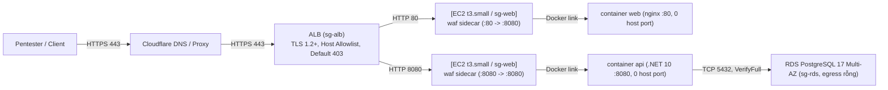

# Kịch bản Pentest hạ tầng & ứng dụng HushStore (PBL3)

> **Trạng thái đối chiếu (2026-11-23):** tài liệu này chuẩn hóa lại khung kịch bản pentest của giảng viên cho **đúng kiến trúc thực tế đang chạy trong mã nguồn HushStore** (PostgreSQL 17, Security Group stateful + default NACL allow-all, WAF sidecar ModSecurity + OWASP CRS 4, SSM Parameter Store, Cloudflare DNS, GitHub OIDC).
>
> - **Bằng chứng nền đã đo trước đó:** 12 kịch bản hạ tầng/IAM ngày 24/09/2026 ([`security-validation-report-2026-09-24.md`](security-validation-report-2026-09-24.md)) và cửa sổ đo WAF sidecar ngày 09/11/2026 ([`waf-cua-so-aws.md`](evidence/acc-551897327153/2026-11-09/waf-cua-so-aws.md)). Lưu ý **KB08 cũ (chặn IP bằng custom NACL DENY) đã nghỉ hưu** sau migration NACL → SG ngày 02/11/2026 ([`nacl-to-sg-migration.md`](nacl-to-sg-migration.md)).
> - **Các bản vá vừa áp dụng trong mã nguồn (2026-11-23, CHƯA build CI / deploy / đo runtime):** kiểm soát quyền + folder allowlist + magic bytes + rate limit ở `POST /api/images/upload`; kiểm tra `IsActive` + thu hồi refresh token ở `PUT /api/auth/change-password`; chống enumeration `LockReason` trước khi xác thực mật khẩu ở `POST /api/auth/login`; bổ sung Security Headers + tắt `Server` header cho cả API (`Program.cs`) và Web (`nginx.conf` + `security-headers.conf`); chạy non-root cho `migrator` và `seeder`. Mọi thay đổi này **bắt buộc phải build CI, deploy và xác minh lại trên runtime** trong cửa sổ test.

---

## 1. Mục tiêu, Phạm vi & Quy tắc thực hiện

### 1.1. Mục tiêu

Đánh giá bảo mật toàn diện theo mô hình **defense-in-depth** và **least privilege** trên cả hạ tầng AWS lẫn ứng dụng web/API của HushStore (ASP.NET Core 10 + Blazor WASM + PostgreSQL 17):

- Xác minh lớp mạng (VPC 3 tier, Security Group stateful `sg-alb` → `sg-web` → `sg-rds`, default NACL allow-all, `default` SG rỗng, không SSH 22, S3 Gateway Endpoint và ECR Interface Endpoints tùy chọn).
- Xác minh lớp biên và WAF (Cloudflare DNS/Proxy, ALB terminate TLS 1.2+, Host Allowlist 403, **WAF sidecar ModSecurity v3 + OWASP CRS 4** đứng trước cả `web` và `api`).
- Xác minh lớp danh tính & bí mật (10 IAM role, explicit `Deny` đọc `/hushstore/*` trên EC2 host, IMDSv2 + `hop_limit = 1`, ECS Task Metadata `169.254.170.2`, SSM Parameter Store `SecureString` + KMS, GitHub OIDC CI/CD).
- Xác minh lớp ứng dụng & dữ liệu (AuthN/AuthZ, JWT, Session/Account Lockout, File Upload, XSS/Sanitization, Business Logic & Race Condition, PostgreSQL 17 `SSL Mode=VerifyFull` & parameterized queries, container hardening).

### 1.2. Phạm vi In-Scope

- **AWS Account & Region:** Account `551897327153`, region `ap-southeast-1`, profile `hushstore`.
- **Tên miền mục tiêu:** `hushstore.io.vn` (Web Blazor WASM) và `api.hushstore.io.vn` (API).
  - **Làm rõ môi trường:** trên hạ tầng hiện tại của dự án, `hushstore.io.vn` và `api.hushstore.io.vn` là **môi trường demo/staging của đồ án** (`infra/tf/envs/prod`, CIDR `10.20.0.0/16`, dữ liệu seed giả lập, **không có người dùng/giao dịch thật**). Môi trường `infra/tf/envs/dev` (`dev.hushstore.io.vn`, `10.30.0.0/16`) chỉ dùng để thử nghiệm `terraform apply` (1 NAT, không Multi-AZ, `t3.micro` không đủ RAM cho 2 WAF sidecar, pipeline CI chưa push image vào ECR dev — xem [`envs/dev/variables.tf`](../infra/tf/envs/dev/variables.tf#L89-L204)).
- **Tài nguyên AWS thuộc stack:**
  - VPC `hushstore-vpc` (`10.20.0.0/16`), 6 subnet (2 public, 2 app private, 2 db isolated), NAT Gateway (×2 khi bật), S3 Gateway Endpoint, ECR Interface Endpoints (`ecr.api`, `ecr.dkr` khi bật `enable_ecr_endpoints = true`).
  - ALB `hushstore-alb`, ACM certificate, Target Groups `tg-web` / `tg-api`, Security Groups (`sg-alb`, `sg-web`, `sg-rds`, `default`, `sg-vpce`).
  - ECS Cluster `hushstore`, ASG EC2 `t3.small`, Services `hushstore-web` (container `web` + sidecar `waf`) và `hushstore-api` (container `api` + sidecar `waf`), one-off tasks `migrator` & `seeder`.
  - RDS PostgreSQL 17 `hushstore-db-tf` (`db.t4g.micro`, Multi-AZ, cổng `5432`, mã hóa gp3, backup 7 ngày).
  - SSM Parameter Store (`/hushstore/prod/*`, `SecureString` + KMS).
  - 4 S3 buckets (`hushstore-public-assets-551897327153`, `hushstore-artifacts-551897327153`, `hushstore-alb-logs-551897327153`, `hushstore-tfstate-551897327153`).
  - 5 ECR repositories (`hushstore-api`, `hushstore-web`, `hushstore-migrator`, `hushstore-seeder`, `hushstore-waf`).
  - CloudWatch Log Groups (`/ecs/hushstore-*`, `/vpc/hushstore/flowlogs`, `/aws/lambda/hushstore-cost-guard`), IAM Roles (10 roles gồm 5 workload, 2 CI/CD OIDC, 3 hạ tầng).
  - Terraform IaC (`infra/tf/modules/*`, `envs/prod`, `envs/dev` — tách root theo môi trường, không dùng Terraform workspace).
- **Ứng dụng:** Frontend Blazor WASM (`src/Client/`) và Backend API (`src/API/`, `src/Service/`, `src/Infrastructure/`).

### 1.3. Phạm vi Out-of-Scope

- Tài nguyên của người dùng dùng chung account AWS hoặc ngoài VPC `hushstore-vpc`.
- Hạ tầng thuộc **Cloudflare** (không chạy port scan, brute-force, hay exploit nhắm vào IP edge của Cloudflare).
- Social engineering, tấn công vật lý, DDoS/flooding cường độ lớn làm cạn kiệt tài nguyên.
- Tấn công AWS control plane ngoài quyền được cấp cho IAM role/user kiểm thử.

### 1.4. Quy tắc an toàn & vận hành cửa sổ Pentest

1. **Tuân thủ AWS Pentest & Cloudflare:** không chạy `masscan` hay `nmap` tốc độ cao vào IP proxy Cloudflare (sẽ quét nhầm edge Cloudflare). Với `nmap`, chỉ chạy trực tiếp vào **DNS/IP ALB origin** ở tốc độ kiểm soát (`--max-rate 50`, `-Pn`), và chỉ khi được phép trên tài khoản sở hữu.
2. **Xử lý DNS Cloudflare trước buổi test:** ALB đổi DNS sau mỗi chu kỳ `down.sh` → `up.sh`. Cần cập nhật bản ghi CNAME trên Cloudflare (hoặc chuyển DNS-only tạm thời khi chạy tool quét trực tiếp ALB) trước buổi đo để không gặp lỗi `530 / 1016` ([`VIEC-CON-LAI.md`](VIEC-CON-LAI.md#L127-L157)).
3. **Tránh cửa sổ Cost Guard (`00:00` giờ VN):** Lambda Cost Guard tự động dừng ASG/ECS/ALB/RDS lúc `00:00` Asia/Ho_Chi_Minh ([`envs/prod/variables.tf`](../infra/tf/envs/prod/variables.tf#L204-L214)). Không mở cửa sổ pentest vắt qua nửa đêm nếu chưa tạm chỉnh lịch.
4. **Bật/tắt công tắc tốn phí đúng cách:**
   - Bật `enable_flow_logs = true` trước khi chạy test mạng để ghi nhận packet `REJECT` trong `/vpc/hushstore/flowlogs`.
   - Nếu có kiểm thử ECR Interface Endpoints, bật `enable_ecr_endpoints = true` trong lúc đo và **bắt buộc trả về `false` ngay sau khi xong** — công tắc này tốn ~$0.04/giờ và **không tự tắt khi chạy `down.sh`** ([`network/vpc.tf`](../infra/tf/modules/network/vpc.tf#L249-L250)).
5. **Xuất bằng chứng ngay trong ngày:** CloudWatch Logs của container giữ **3 ngày** và ALB Access Logs giữ **7 ngày** ([`bao-mat-he-thong.md`](bao-mat-he-thong.md#L304-L306)). Phải export log thô về `docs/evidence/acc-551897327153/<ngày>/` trước khi chạy `down.sh`.
6. **Không phá dữ liệu seed & không in secret ra log/báo cáo:** chỉ thao tác trên tài khoản test tạo thêm rồi dọn sạch; che/redact mọi token, mật khẩu hoặc connection string nếu trích xuất được trong bài Assumed Breach.

---

## 2. Giả định & Topology thực tế

### 2.1. Sơ đồ luồng request

### 2.2. Thông số môi trường thực tế

- **Tầng mạng:**
  - `public` subnet (`10.20.0.0/24`, `10.20.1.0/24`): ALB + 2 NAT Gateway (`nat_gateway_count = 2`).
  - `app` private subnet (`10.20.10.0/24`, `10.20.11.0/24`): EC2 `t3.small` chạy ECS (`bridge` mode, không public IP).
  - `db` isolated subnet (`10.20.20.0/24`, `10.20.21.0/24`): RDS PostgreSQL 17 Multi-AZ (`publicly_accessible = false`, route table không có `0.0.0.0/0`).
  - Cả 6 subnet dùng **default NACL allow-all** do AWS quản lý; `default` Security Group khóa ingress/egress rỗng ([`network/vpc.tf`](../infra/tf/modules/network/vpc.tf#L30-L37)).
- **Security Groups ([`security/main.tf`](../infra/tf/modules/security/main.tf#L62-L202)):**
  - `sg-alb`: Inbound TCP 80/443 từ `0.0.0.0/0`; Outbound TCP 80/8080 chỉ tới `sg-web`.
  - `sg-web`: Inbound TCP 80/8080 chỉ từ `sg-alb`; Outbound TCP 5432 tới `sg-rds` và TCP 80/443 tới `0.0.0.0/0`. *(Lưu ý: `bridge` mode dùng chung `sg-web` ở mức EC2 host, chưa cô lập từng container).*
  - `sg-rds`: Inbound TCP 5432 chỉ từ `sg-web`; Outbound rỗng.
  - `sg-vpce` (khi bật ECR endpoint): Inbound TCP 443 chỉ từ `sg-web`; Outbound rỗng.
- **WAF & Proxy ([`ecs/taskdef.tf`](../infra/tf/modules/ecs/taskdef.tf#L75-L304), [`devops/waf/default.conf.template`](../devops/waf/default.conf.template)):**
  - Container `web` và `api` không khai báo `portMappings`. Chỉ container sidecar `waf` mở static host port `80` (web) và `8080` (api) và chuyển tiếp nội bộ qua Docker `links`.
  - WAF bật `MODSEC_RULE_ENGINE=On` (có công tắc lùi `DetectionOnly`), `BLOCKING_PARANOIA=1`, `MODSEC_RESP_BODY_ACCESS=Off`, `MODSEC_AUDIT_LOG_PARTS=AHZ` (bỏ Part B để không ghi `Authorization: Bearer` vào CloudWatch).
  - WAF chuyển nguyên `$http_x_forwarded_for`; API dùng `ForwardLimit = 1` và `KnownIPNetworks`/`KnownProxies.Clear()` ([`ProxyHeaders.cs`](../src/API/Middleware/ProxyHeaders.cs#L8-L16)).
- **Secrets & Metadata:**
  - Không dùng AWS Secrets Manager. Connection string, DB password, JWT secret lưu ở **SSM Parameter Store (`SecureString` + KMS)**.
  - EC2 Launch Template ép IMDSv2 (`http_tokens = "required"`, `http_put_response_hop_limit = 1`) ([`ecs/cluster.tf`](../infra/tf/modules/ecs/cluster.tf#L58-L66)); `container-instance-role` có **explicit `Deny`** 4 action `ssm:GetParameter*` trên `arn:aws:ssm:*:*:parameter/hushstore/*` ([`ecs/iam.tf`](../infra/tf/modules/ecs/iam.tf#L65-L83)).
  - `task_execution` và `task_execution_seeder` là hai role riêng đọc hai tập secret giao rỗng; container `api` chạy với `task_app` role (chỉ có quyền S3 `public-assets`, ECS Exec channel, và DataProtection `/hushstore/prod/dataprotection/*`).
- **ALB & Health Check:** ALB terminate TLS (`ELBSecurityPolicy-TLS13-1-2-2021-06`), HTTP 80 redirect 301 sang HTTPS 443, Host-based routing (`api.hushstore.io.vn` → `:8080`, `hushstore.io.vn` → `:80`, Host khác → `403`), health check `/healthz` (web) và `/health/ready` (api, kiểm tra DB).

### 2.3. Các bản vá đã áp dụng trong mã nguồn (chờ build CI + xác minh runtime)

| Hạng mục | Tệp thay đổi | Tác dụng bảo mật cần xác minh lại |
|---|---|---|
| Upload Authorization, Folder Allowlist, Magic Bytes & Rate Limit | [`ImageController.cs`](../src/API/Controllers/Admin/ImageController.cs), [`S3StorageService.cs`](../src/Service/Storage/S3StorageService.cs) | `Customer` chỉ upload vào `avatars`; `Admin, Employee` mới upload vào `products/banners/manufacturers/categories/general`; kiểm tra magic bytes + khớp MIME/extension; giới hạn `20 req/60s` (`UploadImageRateLimit`). |
| Khóa tài khoản trên `change-password` & thu hồi Refresh Token | [`AuthService.cs`](../src/Service/Auth/AuthService.cs), [`Program.cs`](../src/API/Program.cs) | Không bỏ qua kiểm tra `IsActive` ở `/api/auth/change-password`; kiểm tra `user.IsActive` trước khi đổi mật khẩu và xóa `RefreshToken`/`RefreshTokenExpiryTime` khi đổi thành công. |
| Chống Account Lockout Enumeration | [`AuthService.cs`](../src/Service/Auth/AuthService.cs) | Kiểm tra mật khẩu trước khi kiểm tra `user.IsActive` để không tiết lộ `LockReason` cho người gọi chưa xác thực. |
| Security Headers & ẩn `Server` banner | [`Program.cs`](../src/API/Program.cs), [`security-headers.conf`](../src/Client/security-headers.conf), [`src/Client/nginx.conf`](../src/Client/nginx.conf), [`src/Client/Dockerfile`](../src/Client/Dockerfile) | Tắt `Server: Kestrel` và `nginx` (`server_tokens off`); bổ sung `HSTS`, `X-Frame-Options`, `X-Content-Type-Options`, `Referrer-Policy`, `Permissions-Policy`, `Content-Security-Policy` cho cả API và Web. |
| Non-root cho task phụ trợ | [`Dockerfile.migrator`](../src/Infrastructure/Dockerfile.migrator), [`Dockerfile.seeder`](../src/Infrastructure/Dockerfile.seeder) | Chạy container `migrator` (`appuser`) và `seeder` (`seeder`) bằng non-root user. |

### 2.4. Các điểm yếu / giới hạn thiết kế đã biết (dự kiến ghi nhận hoặc xử lý ở đợt sau)

1. **Thiếu CloudWatch Metric Alarm cho sự cố bảo mật:** hiện mới có Budgets + Cost Guard cho chi phí, chưa có `aws_cloudwatch_metric_alarm` cho spike 403 WAF, 429 brute-force hoặc 5xx.
2. **API kết nối RDS bằng master user:** `ConnectionStrings__DefaultConnection` dùng `var.db_username` (master role) thay vì PostgreSQL role chỉ có quyền DML (`SELECT/INSERT/UPDATE/DELETE`) cho runtime API ([`data/main.tf`](../infra/tf/modules/data/main.tf#L223-L234)).
3. **S3 Gateway Endpoint dùng policy mặc định (`Allow *`):** chưa gắn endpoint policy giới hạn chỉ các bucket thuộc account `551897327153` ([`network/vpc.tf`](../infra/tf/modules/network/vpc.tf#L213-L226)).
4. **Outbound `sg-web` TCP 80/443 mở ra `0.0.0.0/0`:** cho phép task bị chiếm gọi ra Internet qua NAT (để tải package / gọi AWS API nếu chưa có đầy đủ endpoint).
5. **Container `web` chạy `nginx:alpine` ở cổng `80` (privileged port) và các container chưa bật `readonlyRootFilesystem: true`:** master process nginx cần bind port 80; các image gốc `web`/`api`/`migrator`/`seeder` vẫn còn CVE từ lần ECR scan 09/11/2026 ([`waf-cua-so-aws.md`](evidence/acc-551897327153/2026-11-09/waf-cua-so-aws.md#L79-L83)).
6. **`MODSEC_RESP_BODY_ACCESS=Off` & 403 của WAF không kèm CORS headers:** WAF không soi rò rỉ trong body trả về; trình duyệt có thể thấy lỗi mạng thay vì JSON 403 khi WAF chặn API.

---

## 3. Kịch bản theo giai đoạn

### Giai đoạn 1: Reconnaissance (Thu thập thông tin công khai)

- **DNS, Cloudflare & ACM:**
  - Truy vấn bản ghi `A`/`AAAA`/`CNAME`/`TXT` cho `hushstore.io.vn`, `api.hushstore.io.vn` và các bản ghi CNAME xác thực ACM trên Cloudflare.
  - Xác định trạng thái **proxied (mây cam)** hay **DNS-only (mây xám)** và kiểm tra xem DNS có lộ trực tiếp DNS của ALB origin (`*.ap-southeast-1.elb.amazonaws.com`) hoặc tài nguyên cũ không.
  - Đọc thông tin chứng chỉ TLS (SAN `hushstore.io.vn`, `api.hushstore.io.vn`, thời hạn 198 ngày của ACM, tổ chức cấp phát).
- **HTTP Headers & Công nghệ:**
  - Kiểm tra response headers trên cả `hushstore.io.vn` và `api.hushstore.io.vn`: xác nhận không còn `Server: Kestrel` hoặc version `nginx`, không lộ `X-Powered-By`, có đầy đủ `Strict-Transport-Security`, `X-Content-Type-Options: nosniff`, `X-Frame-Options: DENY`, `Referrer-Policy`, `Permissions-Policy`, `Content-Security-Policy` trên mọi đường dẫn (kể cả `/_framework/*`, `/index.html`, `/appsettings.json` và lỗi 4xx/5xx của API).
  - Xác định công nghệ từ frontend (`_framework/blazor.webassembly.*.js`, `MudBlazor`) và kiểm tra `/appsettings.json` chỉ chứa `ApiBaseUrl`, không có secret.
- **Endpoint công khai & Rò rỉ mã nguồn:**
  - Rà soát `/`, `/healthz`, `/health`, `/health/live`, `/health/ready`, `/robots.txt`, `/sitemap.xml`.
  - Xác nhận **`/swagger`, `/swagger/v1/swagger.json`, `/openapi/v1.json` trả 404** ở Production ([`Program.cs`](../src/API/Program.cs#L625-L633)).
  - Kiểm tra GitHub repository / commit history / GitHub Actions logs xem có lộ `*.tfstate`, `*.tfvars`, connection string, hoặc key bí mật không.

**Công cụ gợi ý:** `dig`, `whois`, `subfinder`/`amass`, `httpx`, `curl -I`, browser DevTools (tab Network & Console để kiểm tra lỗi CSP).

---

### Giai đoạn 2: Scanning & Enumeration

#### 2.1. Hạ tầng

- **Port scan có kiểm soát từ Internet (`nmap -Pn --max-rate 50`):** quét trực tiếp **DNS/IP của ALB origin** (không quét vào IP Cloudflare). Kỳ vọng: chỉ port `80` và `443` mở (`open`); port `22`, `5432`, `8080`, `32768-65535` không lộ (`filtered`/timeout).
- **Kiểm tra hiệu lực Security Group từ bên trong VPC:** thực hiện ca đối chứng dương/âm từ một probe trong VPC (hoặc qua SSM/ECS Exec theo quy trình [`nacl-to-sg-migration.md`](nacl-to-sg-migration.md#L199-L215)): chứng minh nguồn không mang `sg-alb` không mở được kết nối mới tới `:80`/`:8080` trên EC2 và nguồn không mang `sg-web` không nối được `:5432` trên RDS hoặc `:443` trên ECR Interface Endpoint (khi bật).
- **Kiểm tra VPC Endpoint:** kiểm tra `S3 Gateway Endpoint` (policy hiện có giới hạn bucket/account không) và `ECR Interface Endpoints` (khi bật `enable_ecr_endpoints = true`, `private_dns_enabled = true`, SG `sg-vpce`).
- **Enumerate 4 S3 buckets & 5 ECR repositories:**
  - `hushstore-public-assets-551897327153`: kiểm tra `ListObjects` (phải bị chặn `AccessDenied`), chỉ cho `GetObject` công khai với các object đã biết URL.
  - `hushstore-artifacts-*`, `hushstore-alb-logs-*`, `hushstore-tfstate-*`: phải bật đủ 4 cờ Block Public Access và từ chối mọi truy cập ẩn danh/ngoài account.
  - 5 ECR repo (`api`, `web`, `migrator`, `seeder`, `waf`): kiểm tra repository policy không public (`Allow *`), `IMMUTABLE` tags, kết quả `scan_on_push`.
- **Kiểm tra Metadata & IAM Role:** rà cấu hình IMDSv2 + `hop_limit = 1` trên EC2 và kiểm tra quyền thực tế của `container-instance-role`, `task_app`, `task_migrator`, `task_execution`, `task_execution_seeder`, `deploy`, `plan`.

#### 2.2. Ứng dụng

- **Directory / file fuzzing trên Web & API:** kiểm tra các đường dẫn nhạy cảm (`/.git/config`, `/.env`, `/appsettings.Development.json`, `/appsettings.Production.json`, `/_framework/*.pdb`, `/api/admin/diagnostics/*`).
- **Kiểm tra HTTP Methods:** thử `TRACE`, `CONNECT`, `TRACK`, `DELETE`, `PUT` trên `hushstore.io.vn` (WAF web giữ danh sách `GET HEAD POST OPTIONS`) và trên `/api/*` (WAF API mở thêm `PUT PATCH DELETE` nhưng vẫn phải chặn `TRACE`/`CONNECT`).
- **Kiểm tra CORS Policy:** gửi `Origin: https://evil.com`, `Origin: https://hushstore.io.vn.evil.com`, `Origin: null` kèm `Access-Control-Request-Method` — chỉ `https://hushstore.io.vn` được chấp nhận ([`envs/prod/main.tf`](../infra/tf/envs/prod/main.tf#L97), [`Program.cs`](../src/API/Program.cs#L204-L213)).
- **Kiểm tra phân tầng WAF & Rate Limiting:**
  - Chạy kiểm thử đối chiếu ở 2 chế độ `waf_rule_engine = DetectionOnly` và `On` để phân biệt lỗi do WAF chặn (`403`) với lỗi/bảo vệ do ứng dụng xử lý (`400`/`429`).
  - Xác định ngưỡng các bộ đếm rate limit: `LoginRateLimit` (5/60s), `RegisterRateLimit` (3/3600s), `RefreshRateLimit` (10/60s), `LookupRateLimit` (10/60s), `UploadImageRateLimit` (20/60s) nằm trong PostgreSQL `RateLimitCounters`, cùng `PublicReadRateLimit` (60/60s) và `GlobalLimiter` (100/10s) trong RAM.

**Công cụ gợi ý:** `nmap` (`--max-rate 50`, không dùng `masscan` vào Cloudflare), `ffuf`/`gobuster`, `nuclei`, `Burp Suite` / `OWASP ZAP`, `aws` CLI, `curl`.

---

### Giai đoạn 3: Vulnerability Assessment & Exploitation (có kiểm soát)

#### 3.1. Ma trận kiểm thử toàn diện (13 hạng mục)

| # | Hạng mục | Kịch bản test cụ thể | Kỳ vọng / Mục tiêu |
|---|---|---|---|
| 1 | **Network & SG** | Quét ALB origin (`nmap`); kết nối trực tiếp tới RDS `:5432` và EC2 `:22`/`:80`/`:8080` từ Internet & từ ENI sai SG trong VPC; kiểm tra `default` SG và default NACL | Internet chỉ thấy `80/443` trên ALB; RDS/EC2 timeout & xuất hiện `REJECT` trong Flow Logs; `default` SG rỗng; 6 subnet ở default NACL allow-all |
| 2 | **ALB, TLS & Host Routing** | Chạy `testssl.sh` kiểm tra TLS 1.0/1.1, weak cipher; test HTTP `80 → 301 HTTPS`; gửi `Host: evil.com` / IP trực tiếp tới ALB; kiểm tra HSTS trên cả `hushstore.io.vn` và `api.hushstore.io.vn` | Chỉ nhận TLS 1.2/1.3 (`ELBSecurityPolicy-TLS13-1-2-2021-06`); redirect 80→443 giữ path/query; Host lạ trả **403**; cả 2 host phát `Strict-Transport-Security` |
| 3 | **WAF Sidecar & XFF Spoofing** | Kiểm tra `describe-task-definition` chứng minh `api`/`web` không mở host port; bắn SQLi/XSS/path traversal/User-Agent `sqlmap`; gửi `X-Forwarded-For` giả (`1.2.3.4, 5.6.7.8`) để vượt rate limit login; kiểm tra bẫy XFF khi bật Cloudflare proxy (`CF-Connecting-IP` vs IP edge) | Không đi vòng được WAF; WAF chặn `403` + ghi log JSON; `ForwardLimit = 1` lấy đúng IP peer cuối cùng từ ALB (lưu ý nếu bật Cloudflare proxy, kiểm chứng xem 2 IP user khác nhau có bị đếm chung IP edge Cloudflare hay không) |
| 4 | **WAF Exclusions & Response Leak** | Thử lạm dụng Exclusion `1002` (trường `password` trên `/api/auth/*`, `/api/customers`, `/api/employees`), `1005` (`description`/`shortDescription` trên `POST/PUT /api/products`), `1006` (tên file trên `/api/images/upload`); kiểm tra audit log không lộ password/`Bearer`; gửi input gây lỗi để soi response body (`MODSEC_RESP_BODY_ACCESS=Off`) | Exclusion hẹp đúng trường/method/path; `<script>`/`on*`/`javascript:` trong mô tả vẫn bị WAF hoặc `HtmlContentSanitizer` loại sạch; không lộ stack trace/SQL error; audit log `AHZ` sạch token/password |
| 5 | **File Upload & S3 Security** | Dùng JWT **Customer** thử `POST /api/images/upload?folder=products` / `folder=banners` / `folder=../../secret`; upload file `.html`/`.svg` giả `Content-Type: image/png`; spam >20 req/60s; kiểm tra `s3:ListBucket` trên `public-assets` và public access của `tfstate`/`artifacts`/`alb-logs` | Customer upload ngoài `avatars` bị **403**; folder lạ/traversal bị **400**; magic bytes sai bị **400**; request thứ 21 bị **429**; cả 4 S3 bucket không lộ danh sách hoặc file nhạy cảm |
| 6 | **Secrets & Metadata** | Kiểm tra không hardcode secret trong 5 image (`docker history`/`env`), Git repo, JS/WASM bundle, `/appsettings.json`; trên EC2/container thử truy cập `169.254.169.254` (IMDSv1 không token & IMDSv2 từ container bridge) và **ECS Task Metadata `169.254.170.2`** | IMDSv1 bị `401`; container không gọi được IMDSv2 (`hop_limit = 1`); host role bị explicit `Deny` đọc `/hushstore/*`; secret chỉ vào container qua ECS `secrets` |
| 7 | **RDS, SQLi & Encryption in Transit** | Thử SQL Injection trên search, filter, login, order, service ticket (tắt tạm WAF hoặc test trong local/DetectionOnly để kiểm chứng tầng EF Core); thử kết nối PostgreSQL `:5432` không bật TLS (`sslmode=disable`) và kiểm chứng `verify-full` + CA pin; đánh giá đặc quyền DB user trong connection string | 100% EF Core parameterized + `SearchPattern` escape `%`/`_`; `rds.force_ssl` từ chối non-TLS; **ghi nhận Finding nếu API vẫn dùng master DB user thay vì role DML-only** |
| 8 | **AuthN/AuthZ & Session** | Thử JWT `alg: none`, sửa payload, hết hạn > `ClockSkew` 1 phút; dùng access token của user vừa bị admin khóa (`IsActive = false`) gọi `/api/orders` và **`PUT /api/auth/change-password`**; đổi mật khẩu rồi dùng lại **Refresh Token cũ**; thử đăng nhập sai mật khẩu với tài khoản bị admin khóa để kiểm tra lộ `LockReason`; thử IDOR trên Orders/Addresses/ServiceTickets/Cart; thử dùng Customer/Employee gọi `/api/admin/diagnostics/*` và mọi endpoint Admin; fuzz endpoint `[AllowAnonymous]` (`/api/servicetickets/intake`, `/api/vouchers/validate-code`) | Token sai/hết hạn bị `401`; tài khoản bị khóa bị `403` trên cả `/api/auth/change-password`; refresh token bị vô hiệu hóa sau khi đổi mật khẩu; login sai mật khẩu không lộ `LockReason`; query đóng khung theo `UserId` trong JWT chặn IDOR; AdminDiagnostics chỉ cho `Admin`; oracle `[AllowAnonymous]` bị kẹp bởi `LookupRateLimit` |
| 9 | **XSS, Blazor WASM & Security Headers** | Chèn payload XSS vào Product `Description`/`ShortDescription` (`MarkupString`), Review, User Profile, tên file/tên sản phẩm; kiểm tra CSP, `X-Frame-Options`, `X-Content-Type-Options`, `Referrer-Policy`, `Permissions-Policy` và CORS trên 2 domain; đánh giá rủi ro lưu JWT/Refresh Token trong `localStorage` | `HtmlContentSanitizer` loại bỏ script/handler/`style`/`form`/`javascript:`; Security Headers đầy đủ trên 2 host; **lưu ý**: xác minh trên trình duyệt thật CSP không làm gãy Blazor WASM/MudBlazor/Google Fonts |
| 10 | **Business Logic & Race Conditions** | Thử sửa giá/giảm giá/số lượng âm khi tạo đơn hoặc POS; bắn đồng thời nhiều request cho voucher `MaxUsesPerUser`/`Quantity=1`, trùng serial, trùng phiếu kiểm kê, và **concurrent refresh token rotation** (đối chiếu với kịch bản `tools/LoadProbe`) | `ConcurrencyStamp` / `xmin` / conditional `ExecuteUpdateAsync` / DB `SEQUENCE` giữ đúng bất biến dữ liệu (409/400) |
| 11 | **Container & Supply Chain** | Kiểm tra `User` trong 5 Dockerfile (`api`, `web`, `waf`, `migrator`, `seeder`), `readonlyRootFilesystem`, `privileged`, volume mount; chạy `trivy` / đọc kết quả ECR `scan_on_push` cho cả 5 image | `api`, `waf`, `migrator`, `seeder` chạy non-root; ghi nhận Finding cho `web` (`nginx` port 80), `readonlyRootFilesystem` chưa bật, và các CVE base image còn tồn tại |
| 12 | **CI/CD GitHub OIDC & IAM** | Giả lập `sts:AssumeRoleWithWebIdentity` với token tự ký/JWT giả (`kb11`); chạy `aws iam simulate-principal-policy` kiểm tra `deploy-role` (`PassRole`, `RunTask` chỉ `migrator`, không tự bật ASG/RDS), `plan-role` (explicit Deny S3 `GetObject`, SSM, KMS, Logs, `AssumeRole`), `task_app`, `container-instance-role` | OIDC từ chối chữ ký giả & nhánh PR không vào được `deploy-role`; `deploy-role` không pass được `instance-role` hay `task_execution_seeder-role`; `plan-role` không đọc được `tfstate`/secret |
| 13 | **Logging, Monitoring & IaC** | Sinh traffic tấn công (403 WAF, 429 rate limit, 401/403 AuthZ, port scan) → kiểm tra CloudWatch `/ecs/hushstore-waf`, `/ecs/hushstore-api`, `/vpc/hushstore/flowlogs`, S3 `alb-logs`; kiểm tra Terraform bằng `terraform test` + `tfsec`/`checkov` | WAF audit JSON, App log, Flow Logs `REJECT`, ALB Access Logs ghi nhận đủ; **ghi nhận Finding: chưa có CloudWatch Metric Alarm tự động cảnh báo khi bị tấn công** |

#### 3.2. Các kịch bản Exploitation có kiểm soát đề xuất (8 kịch bản)

1. **Assumed Breach → Cloud & Task Metadata (`169.254.169.254` vs `169.254.170.2`):** Vì backend không có tính năng server-side URL fetch (SSRF), dùng **ECS Exec** vào container `api` để mô phỏng RCE: kiểm tra gọi `http://169.254.169.254/latest/meta-data/` bị chặn bởi IMDSv2 + `hop_limit = 1`, sau đó đọc `http://169.254.170.2$AWS_CONTAINER_CREDENTIALS_RELATIVE_URI` để đo blast radius thực tế của `task_app` role.
2. **WAF Bypass & SQL Injection ở tầng ứng dụng:** Test SQLi cả ở trạng thái WAF `On` (kỳ vọng `403`, log rule `942xxx`) lẫn ở `DetectionOnly`/local (kỳ vọng EF Core parameterization chặn hoàn toàn, không trích xuất được dữ liệu).
3. **WAF Exclusion Abuse → Stored XSS → Chiếm `localStorage` JWT:** Thử bypass `HtmlContentSanitizer` qua các trường được mở bởi Exclusion `1005` (`description`/`shortDescription` của sản phẩm) và đánh giá mức độ cô lập nếu một XSS payload lọt xuống trình duyệt (`MarkupString` + `localStorage` + CSP).
4. **File Upload Bypass & Arbitrary S3 Prefix:** Dùng tài khoản `Customer` thử upload file thực thi (`.html`/`.svg` giả `image/png`) và chèn `folder=products` / `folder=../../` vào `POST /api/images/upload` để xác minh bản vá authorization, allowlist và magic bytes.
5. **IDOR / Broken Object & Function Level Authorization:** Thay `id` đơn hàng, phiếu bảo hành, địa chỉ giao hàng của user khác; dùng token `Customer`/`Employee` thử gọi `/api/admin/diagnostics/dataprotection-verify` (`mode: protect/unprotect`) và các endpoint quản trị.
6. **JWT & Account Lockout / Refresh Token Attack:** Thử `alg: none`, `HS256` với secret yếu, replay token sau khi quá `ClockSkew` 1 phút; khóa tài khoản rồi dùng token cũ gọi `PUT /api/auth/change-password`; đổi mật khẩu rồi replay `RefreshToken` cũ.
7. **Rate Limit Bypass qua XFF & Concurrent Race Condition:** Giả mạo `X-Forwarded-For: 1.2.3.4` gửi 20 request vào `/api/auth/login`; dùng Burp Intruder / `tools/LoadProbe` bắn song song vào voucher, checkout và `refresh-token` để kiểm tra lỗi điều kiện tranh chấp.
8. **Misconfigured S3 / VPC Endpoint / IAM OIDC Pivot:** Kiểm tra liệt kê object S3, thử truy cập S3 bucket ngoài account từ trong container qua S3 Gateway Endpoint (`Allow *`), và chạy `aws iam simulate-principal-policy` tìm đường leo thang trên `deploy-role` / `task_app` / `container-instance-role`.

---

### Giai đoạn 4: Post-Exploitation & Lateral Movement (Assumed Breach mô phỏng)

Do hệ thống không mở SSH và không có SSRF URL-fetch tự nhiên, thực hiện mô phỏng **Assumed Breach** có kiểm soát tại 2 điểm chạm:

1. **Giả định container `api` bị RCE (qua `aws ecs execute-command`):**
   - Kiểm tra biến môi trường (`env` / `/proc/self/environ`): xác minh attacker đọc được `ConnectionStrings__DefaultConnection` và `JwtSettings__SecretKey` đã inject từ SSM lúc khởi container → từ đó thử kết nối RDS `:5432` bằng TLS `verify-full` và đánh giá blast radius của việc **API dùng chung master DB user** (có đọc/ghi/DROP toàn bộ DB hay không).
   - Dùng credential tạm của `task_app` role (từ `169.254.170.2`) kiểm tra quyền IAM: xác nhận **không** đọc được `/hushstore/prod/connection-string`, `/hushstore/prod/jwt-secret`, `/hushstore/prod/db-password`, **không** assume được role khác, nhưng đọc/ghi/xóa được bucket `public-assets` và key ring `/hushstore/prod/dataprotection/*` (rủi ro giả mạo DataProtection token nếu mở rộng tính năng dùng `IDataProtector`).
   - Kiểm tra khả năng lateral movement & data exfiltration: do `bridge` mode dùng chung EC2 host và `sg-web` mở outbound `80/443`, kiểm tra khả năng container `api` gọi sang container `web`/`waf` nội bộ, chạm `172.17.0.1` hoặc đẩy dữ liệu DB ra Internet / bucket S3 ngoài account qua S3 Gateway Endpoint.
2. **Giả định EC2 host bị chiếm (qua SSM Session Manager):**
   - Thử gọi `aws ssm get-parameter --with-decryption` và `get-parameter-history` đối với `/hushstore/prod/db-password`, `/hushstore/prod/connection-string`, `/hushstore/prod/jwt-secret` → xác nhận **explicit `Deny` chặn hoàn toàn**.
   - Đánh giá giới hạn của ECS `bridge` mode: user có quyền root trên EC2 host có thể `docker inspect` / đọc memory/env của container đang chạy trên chính host đó (từ đó thấy được chuỗi kết nối đã giải mã) — làm cơ sở đề xuất bảo vệ đường quản trị SSM Session Manager bằng MFA/IAM chặt chẽ.

---

### Giai đoạn 5: Reporting

Báo cáo tổng hợp nộp cuối kỳ trình bày theo cấu trúc chuẩn, phân tách rành mạch **bằng chứng đã đo** và **giới hạn còn mở**:

1. **Executive Summary:** Tóm tắt mục tiêu, phạm vi, trạng thái bảo mật tổng thể và bảng đếm Findings theo mức độ.
2. **Scope & Methodology:** Nêu rõ kiến trúc thực tế (PostgreSQL 17, SG stateful, WAF sidecar, Cloudflare DNS, SSM Parameter Store), đối chiếu với 2 báo cáo lịch sử (`2026-09-24` và `2026-11-09`) và ghi chú **KB08 (NACL DENY) đã nghỉ hưu**.
3. **Findings (Critical / High / Medium / Low / Info):**
   - Mỗi finding bắt buộc có: CVSS v3.1, phạm vi ảnh hưởng (`file:line` hoặc AWS ARN), PoC tái hiện (request/response hoặc CLI output đã che secret), ảnh chụp/log thô lưu tại `docs/evidence/`, và **Remediation** cụ thể.
   - Đưa riêng phần đối chiếu **Pre-test Remediations** cho 5 nhóm lỗ hổng đã vá trong mã nguồn (nêu rõ kết quả kiểm chứng sau khi deploy bản vá).
4. **Architecture Review:**
   - Điểm mạnh đã chứng minh: không SSH 22, SG least privilege theo tham chiếu SG + `default` SG rỗng, WAF sidecar không có host port trên app, RDS isolated + Multi-AZ + encrypted + `verify-full`, IMDSv2 `hop_limit = 1`, explicit Deny SSM trên host, tách `task_execution` vs `task_execution_seeder`, GitHub OIDC `StringEquals` tách `plan` vs `deploy`, parameterized EF Core + `HtmlContentSanitizer` + `DbRateLimit` PostgreSQL.
   - Các giới hạn còn tồn tại: thiếu CloudWatch Alarm an ninh, API dùng master DB user, outbound `sg-web` 80/443 rộng, S3 Gateway Endpoint chưa giới hạn policy, `web` container chạy `nginx` root & chưa bật `readonlyRootFilesystem`, các CVE base image còn lại.
5. **Recommendations ưu tiên:** Xếp theo Short-term (bật CloudWatch Alarms, tách PostgreSQL DML user cho API, gắn S3 Gateway Endpoint policy, cập nhật base image CVE), Mid-term (siết outbound bằng VPC Endpoints / egress proxy khi ngân sách cho phép, cân nhắc `readonlyRootFilesystem` + non-root port >1024 cho `web`), Long-term (chuyển Access Token sang HttpOnly Cookie hoặc BFF để giảm rủi ro `localStorage`).
6. **Appendix:** Danh sách công cụ, câu lệnh nguyên văn đã chạy và tham chiếu tới các tệp bằng chứng thô.

---

## 4. Công cụ đề xuất (phù hợp PBL3)

| Nhóm | Công cụ | Lưu ý sử dụng cho HushStore |
|---|---|---|
| **Recon & TLS** | `dig`, `whois`, `subfinder`, `amass`, `httpx`, `testssl.sh`, Browser DevTools | Kiểm tra cả `hushstore.io.vn`, `api.hushstore.io.vn` và kiểm tra CSP trực tiếp trên Console trình duyệt |
| **Network** | `nmap` (`-Pn --max-rate 50`), `nc`, `curl --resolve` | Không dùng `masscan` hoặc chĩa scanner vào IP proxy Cloudflare |
| **Web / API / Concurrency** | `Burp Suite Community`, `OWASP ZAP`, `ffuf`, `sqlmap` (kiểm soát), `tools/LoadProbe` | Dùng `LoadProbe` cho race condition/rate limit dùng chung trên PostgreSQL (`RateLimitCounters`) |
| **AWS & IAM Audit** | `aws` CLI (`iam simulate-principal-policy`, `sts`), `Prowler` / `ScoutSuite`, `Pacu` (chỉ đọc/kiểm thử có kiểm soát trên account `551897327153`) | Kết hợp kiểm tra 10 IAM roles, 4 S3 buckets, 5 ECR repos, VPC Endpoints, Flow Logs |
| **Container & IaC** | `trivy`, AWS ECR `scan_on_push`, `terraform test`, `tfsec` / `checkov` | Quét đủ 5 image (`api`, `web`, `waf`, `migrator`, `seeder`) và toàn bộ `infra/tf/` |

---

## 5. Kết quả dự kiến pentest sẽ xác nhận

- **Bề mặt mạng thu hẹp tối đa:** Không mở SSH (`22`), không có public IP trên EC2/RDS, cổng `5432` cô lập ở `db` subnet chỉ nhận từ `sg-web` (egress của `sg-rds` rỗng), `default` SG rỗng.
- **Không thể đi vòng WAF hay ALB:** ALB terminate TLS 1.2+, chỉ mở 80/443, định tuyến theo Host allowlist (mặc định 403), và cả `web`/`api` đều nằm sau sidecar ModSecurity + OWASP CRS 4 (không mở host port).
- **Bảo vệ danh tính & bí mật theo chiều sâu:** Secrets lưu trong SSM Parameter Store (`SecureString` + KMS), không hard-code; EC2 host không đọc được `/hushstore/*` (explicit `Deny`); IMDSv2 `hop_limit = 1` chặn container đọc instance role; GitHub OIDC tách `plan` và `deploy`.
- **An toàn ứng dụng được kiểm chứng đa lớp:** WAF chặn payload tấn công phổ biến + EF Core tham số hóa + kiểm soát upload (role, folder allowlist, magic bytes, rate limit) + phân quyền/khóa phiên nhất quán + `HtmlContentSanitizer` + Security Headers.
- **Tính sẵn sàng & phục hồi dữ liệu:** RDS PostgreSQL 17 Multi-AZ, mã hóa at-rest + `SSL Mode=VerifyFull` in-transit, backup tự động 7 ngày.
- **Tính trung thực kỹ thuật:** Báo cáo đồng thời chỉ rõ các khoảng trống còn lại (thiếu CloudWatch Alarm bảo mật, DB user cấp cho API còn quyền master, outbound 80/443 và S3 Gateway Endpoint còn mở rộng) làm lộ trình nâng cấp tiếp theo.
