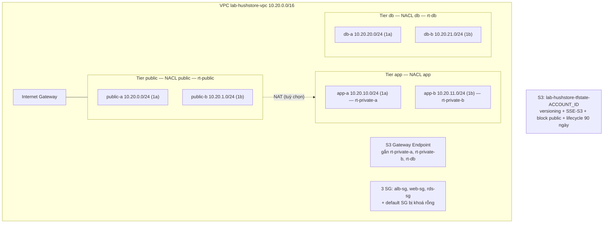
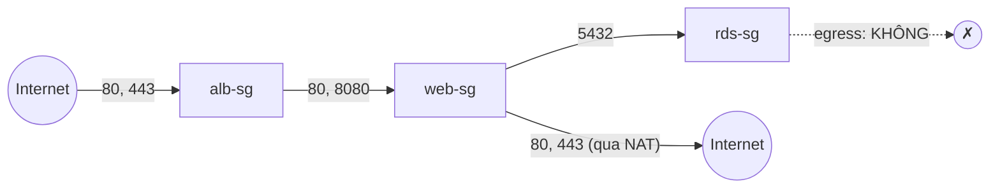
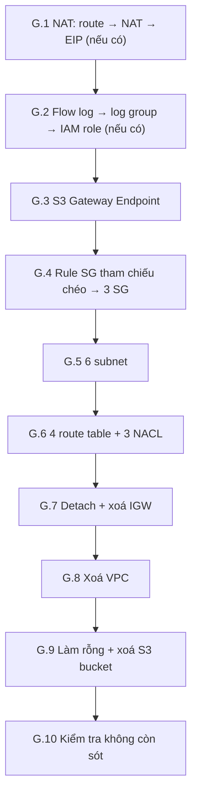

# Thực hành trên AWS Console — Dựng lại Giai đoạn 0 → 3 bằng tay

> **Mục đích.** Hiểu hệ thống AWS của HushStore bằng cách **tự tay bấm lại** đúng
> những gì Terraform đã dựng ở Giai đoạn 0 (khảo sát), 1 (S3 chứa state),
> 2 (mạng) và 3 (Security Group) trong
> [nhat-ky-trien-khai.md](nhat-ky-trien-khai.md). Cuối tài liệu là quy trình
> **xoá sạch** mọi thứ vừa tạo.
>
> **Nguồn sự thật là code Terraform, không phải nhật ký.** Nhật ký kể lại lúc
> hệ thống còn dùng SQL Server/1433 và một NAT. Mọi giá trị dưới đây lấy trực
> tiếp từ:
>
> | Giai đoạn | File Terraform |
> |---|---|
> | 1 — S3 state | [bootstrap/main.tf](../infra/tf/bootstrap/main.tf) |
> | 2 — Mạng | [modules/network/vpc.tf](../infra/tf/modules/network/vpc.tf), [modules/network/nacl.tf](../infra/tf/modules/network/nacl.tf) |
> | 3 — Security Group | [modules/security/main.tf](../infra/tf/modules/security/main.tf) |
> | Giá trị đầu vào | [envs/prod/variables.tf](../infra/tf/envs/prod/variables.tf) |

---

## Mục lục

- [Phần A — Quy ước bắt buộc trước khi bấm](#phần-a--quy-ước-bắt-buộc-trước-khi-bấm)
- [Phần B — Giai đoạn 0: Khảo sát hiện trạng](#phần-b--giai-đoạn-0-khảo-sát-hiện-trạng)
- [Phần C — Giai đoạn 1: S3 bucket chứa state](#phần-c--giai-đoạn-1-s3-bucket-chứa-state)
- [Phần D — Giai đoạn 2: Mạng](#phần-d--giai-đoạn-2-mạng)
- [Phần E — Giai đoạn 3: Security Group](#phần-e--giai-đoạn-3-security-group)
- [Phần F — Kiểm chứng tổng thể](#phần-f--kiểm-chứng-tổng-thể)
- [Phần G — Xoá toàn bộ resource](#phần-g--xoá-toàn-bộ-resource)
- [Phụ lục 1 — Nhật ký vs Terraform: những chỗ đã đổi](#phụ-lục-1--nhật-ký-vs-terraform-những-chỗ-đã-đổi)
- [Phụ lục 2 — Console làm khác Terraform ở đâu](#phụ-lục-2--console-làm-khác-terraform-ở-đâu)

---

# Phần A — Quy ước bắt buộc trước khi bấm

## A.1 Không đụng vào hạ tầng thật

Account `551897327153` **đang có** hạ tầng do Terraform quản lý (tag
`ManagedBy = terraform`). Bài lab này dựng một **bản sao song song**, nên mọi
thứ phải phân biệt được bằng mắt và bằng tag:

| Quy ước | Hạ tầng thật (Terraform) | Bản lab (bạn bấm tay) |
|---|---|---|
| Tiền tố tên | `hushstore-` | **`lab-hushstore-`** |
| Tag `Project` | `hushstore` | **`hushstore-lab`** |
| Tag `ManagedBy` | `terraform` | **`console`** |
| Tag `Env` | `prod` | **`lab`** |

> [!CAUTION]
> Trước mỗi thao tác **sửa** hoặc **xoá**, nhìn cột *Name*: phải bắt đầu bằng
> `lab-hushstore-`. Sửa nhầm một NACL hay route table có tag
> `ManagedBy = terraform` là làm hạ tầng thật lệch khỏi state — đúng loại lỗi
> khó chữa nhất mà nhật ký đã cảnh báo.

**Ba tag gọi tắt là "bộ tag lab"** — ở mọi màn hình tạo resource có mục *Tags*,
thêm đủ ba tag này (ngoài tag `Name` và các tag riêng được ghi trong từng bước):

```
Project   = hushstore-lab
ManagedBy = console
Env       = lab
```

## A.2 Region

Góc trên bên phải console → chọn **Asia Pacific (Singapore) `ap-southeast-1`**.
Kiểm tra lại mỗi khi mở tab mới — VPC, Subnet, SG đều là resource **theo
region**, tạo nhầm region là "biến mất" khỏi màn hình.

## A.3 CIDR trùng với hạ tầng thật — có sao không?

Bản lab dùng **đúng** `10.20.0.0/16` như thiết kế để mọi CIDR trong NACL khớp
từng chữ số với Terraform. Hai VPC trùng CIDR **được phép** cùng tồn tại trong
một account: chúng chỉ xung đột khi bạn nối chúng lại (peering, Transit
Gateway, VPN). Lab này không nối gì cả.

> [!NOTE]
> Nhật ký (Giai đoạn 0) chọn `10.20` để **không trùng** `10.0.0.0/16` của stack
> cũ, vì hai stack đó có thể cần nói chuyện với nhau trong lúc chuyển đổi. Bản
> lab thì không bao giờ cần, nên trùng là chấp nhận được.

## A.4 Chi phí

| Resource | Giá | Ghi chú |
|---|---|---|
| S3 bucket rỗng / vài KB | ~$0 | |
| VPC, subnet, IGW, route table, NACL, SG | **$0** | |
| S3 Gateway Endpoint | **$0** | (Interface endpoint mới tốn tiền) |
| **NAT Gateway** | **~$0,059/giờ mỗi cái** + $0,045/GB | Terraform ghim 2 cái khi bật ⇒ ~$0,12/giờ |
| **Elastic IP** (gắn NAT) | ~$0,005/giờ mỗi IP | AWS tính phí mọi IPv4 public |
| Flow Logs (tuỳ chọn) | phí ingest CloudWatch | Rất nhỏ với lab |

> [!WARNING]
> Bước NAT Gateway (D.9) là **tuỳ chọn** — trong Terraform nó cũng mặc định
> **tắt** (`enable_nat = false`). Nếu làm, hãy làm ngay trước khi xoá và xoá
> trong vòng 30 phút. Mọi bước khác miễn phí, bạn có thể để qua đêm.

## A.5 Công cụ kiểm chứng

Mỗi bước có một ô **✅ Checkpoint** gồm (1) thứ phải nhìn thấy trên console và
(2) một lệnh AWS CLI **chỉ đọc** để đối chiếu. Lệnh CLI là tuỳ chọn nhưng nên
chạy — mắt người dễ bỏ sót một ô tick. Tất cả dùng profile `hushstore`:

```bash
aws sts get-caller-identity --profile hushstore   # phải ra Account 551897327153
```

---

# Phần B — Giai đoạn 0: Khảo sát hiện trạng

Giai đoạn 0 trong nhật ký **không tạo resource**: đọc hệ thống đang có, quyết
định làm lại. Phiên bản thực hành: **đọc hạ tầng Terraform đang chạy trên
console** để biết mình sắp tái tạo cái gì, và kiểm tra account đủ chỗ cho bản
lab.

## B.1 Xác nhận danh tính và quyền

1. Click tên tài khoản góc trên phải → ghi lại **Account ID**. Phải là
   `551897327153`.
2. Bạn cần quyền tạo/xoá: S3, EC2/VPC (subnet, route table, IGW, NAT, EIP,
   NACL, SG, endpoint), và (nếu làm Flow Logs) IAM + CloudWatch Logs.

## B.2 Đọc hạ tầng thật bằng Tag Editor

1. Mở dịch vụ **Resource Groups & Tag Editor** → menu trái **Tag Editor**.
2. *Regions*: `ap-southeast-1`. *Resource types*: `All supported resource types`.
3. *Tags*: Key `ManagedBy`, Value `terraform` → **Search resources**.
4. Lọc theo cột *Type*, tìm các loại `AWS::EC2::VPC`, `AWS::EC2::Subnet`,
   `AWS::EC2::RouteTable`, `AWS::EC2::NetworkAcl`, `AWS::EC2::SecurityGroup`.

Ghi lại: có VPC `hushstore-vpc` (10.20.0.0/16) không? Có mấy subnet, mấy route
table? Đây là bản gốc bạn sẽ so sánh ở cuối mỗi phần.

> [!TIP]
> Mở **VPC console → Your VPCs → `hushstore-vpc` → tab Resource map**. Đây là
> sơ đồ trực quan nhất của toàn bộ Giai đoạn 2: subnet nào nối route table
> nào, route table nào ra IGW/NAT. Chụp lại để so với bản lab ở Phần F.

## B.3 Kiểm tra quota (giới hạn) của account

**Service Quotas** → *AWS services* → **Amazon Virtual Private Cloud (Amazon VPC)**:

| Quota | Mặc định | Bản lab cần thêm |
|---|---|---|
| VPCs per Region | 5 | 1 |
| Internet gateways per Region | 5 | 1 |
| NAT gateways per Availability Zone | 5 | 1 mỗi AZ (nếu làm D.9) |

**Amazon Elastic Compute Cloud (Amazon EC2)** → *EC2-VPC Elastic IPs*: mặc định
5, cần thêm 2 nếu làm D.9.

Đếm số đang dùng ở VPC console (*Your VPCs*, *Internet gateways*) và EC2
console (*Elastic IPs*). Nếu đã chạm trần thì dừng ở đây.

## B.4 Bản đồ những gì sẽ dựng



**Thứ tự bắt buộc và lý do:** S3 trước (mọi thứ sau ghi vào state) → VPC
trước mọi thứ trong nó → subnet → IGW → route table (cần IGW làm đích) →
endpoint (cần route table) → NACL (cần subnet để gắn) → SG (cần VPC, và SG cần
tồn tại hết trước khi khai rule trỏ lẫn nhau).

---

# Phần C — Giai đoạn 1: S3 bucket chứa state

Terraform: [bootstrap/main.tf](../infra/tf/bootstrap/main.tf) — 5 resource:
bucket, versioning, mã hoá, block public access, lifecycle.

| Thiết lập | Giá trị trong Terraform | Bản lab |
|---|---|---|
| Tên | `hushstore-tfstate-<account_id>` | `lab-hushstore-tfstate-551897327153` |
| Versioning | Enabled | Enabled |
| Mã hoá | `AES256` (= SSE-S3) | SSE-S3 |
| Block public access | cả 4 cờ `true` | cả 4 bật |
| Lifecycle | rule `expire-old-state-versions`, xoá version cũ sau **90** ngày | giống hệt |
| `prevent_destroy` | `true` | *không có tương đương trên console* (xem C.4) |

> [!NOTE]
> Nhật ký ghi tên bucket là `hushstore-tfstate`; code thật nối thêm **account
> ID** vì tên S3 là duy nhất **toàn cầu** — gắn account ID là cách gần như chắc
> chắn không trùng ai.

## C.1 Tạo bucket

1. **S3 console** → **Buckets** → **Create bucket**.
2. *AWS Region*: `Asia Pacific (Singapore) ap-southeast-1`.
3. *Bucket type*: **General purpose**.
4. *Bucket name*: `lab-hushstore-tfstate-551897327153`.
5. *Object Ownership*: **ACLs disabled (recommended)** — để mặc định.
6. *Block Public Access settings for this bucket*: giữ tick
   **Block all public access** (cả 4 ô con đều được tick).
7. *Bucket Versioning*: chọn **Enable**.
8. *Tags*: thêm **bộ tag lab** (A.1).
9. *Default encryption*:
   - *Encryption type*: **Server-side encryption with Amazon S3 managed keys (SSE-S3)**.
   - *Bucket Key*: để mặc định (không ảnh hưởng với SSE-S3).
10. **Create bucket**.

## C.2 Thêm lifecycle rule dọn version cũ

Không có rule này, mỗi lần `terraform apply` để lại một version state cũ và
bucket phình vô hạn.

1. Mở bucket vừa tạo → tab **Management** → **Create lifecycle rule**.
2. *Lifecycle rule name*: `expire-old-state-versions`.
3. *Choose a rule scope*: **Apply to all objects in the bucket** → tick ô xác
   nhận *I acknowledge that this rule will apply to all objects…*
   (tương đương `filter {}` trong Terraform).
4. *Lifecycle rule actions*: tick **duy nhất**
   **Permanently delete noncurrent versions of objects**.
5. *Days after objects become noncurrent*: `90`.
   *Number of newer versions to retain*: **để trống**.
6. **Create rule**.

> [!IMPORTANT]
> **Không** tick "Expire current versions of objects". Rule đó xoá chính file
> state đang dùng — Terraform sẽ "quên" toàn bộ hạ tầng.

## C.3 (Thực hành) Thấy tận mắt versioning và cơ chế lock

1. Tạo trên máy một file `terraform.tfstate` chứa một dòng `v1`.
2. Trong bucket → **Create folder** `prod` → vào `prod/` → **Upload** file đó.
3. Sửa file thành `v2`, upload đè lên cùng đường dẫn.
4. Bật công tắc **Show versions**: thấy **2 version** của cùng một key. Đây là
   lưới an toàn: state hỏng thì tải version trước về.
5. (Hiểu về lock) Terraform ≥ 1.10 với `use_lockfile = true` khi chạy sẽ tạo
   object `prod/terraform.tfstate.tflock`; tiến trình thứ hai thấy file đó tồn
   tại thì dừng. Upload một file tên `terraform.tfstate.tflock` vào `prod/` để
   hình dung — đó **chính là** "lock", không cần bảng DynamoDB.

## C.4 Về `prevent_destroy`

Đó là lưới an toàn **của Terraform** (nó từ chối lập plan xoá bucket), không
phải thuộc tính của bucket. Trên console không có ô nào tương đương — điều duy
nhất ngăn bạn xoá nhầm là phải gõ tên bucket để xác nhận. Đây là ví dụ cụ thể
cho câu "console không cho bạn xem trước" ở Phần I của nhật ký.

## ✅ Checkpoint C

Console — tab **Properties** của bucket: *Bucket Versioning* = **Enabled**;
*Default encryption* = **SSE-S3**. Tab **Permissions**: *Block public access* =
**On**. Tab **Management**: 1 rule, *Status* **Enabled**.

```bash
B=lab-hushstore-tfstate-551897327153
aws s3api get-bucket-versioning           --bucket $B --profile hushstore   # "Status": "Enabled"
aws s3api get-bucket-encryption           --bucket $B --profile hushstore   # "SSEAlgorithm": "AES256"
aws s3api get-public-access-block         --bucket $B --profile hushstore   # 4 cờ true
aws s3api get-bucket-lifecycle-configuration --bucket $B --profile hushstore # NoncurrentDays: 90
```

So với bản thật: thay `$B` bằng `hushstore-tfstate-551897327153` — kết quả phải
giống hệt (trừ tên).

---

# Phần D — Giai đoạn 2: Mạng

Terraform: [vpc.tf](../infra/tf/modules/network/vpc.tf) +
[nacl.tf](../infra/tf/modules/network/nacl.tf).

**Danh sách resource bản lab** (đếm theo code hiện tại, khác nhật ký — xem Phụ
lục 1): 1 VPC · 6 subnet · 1 IGW · **4** route table · 1 S3 Gateway Endpoint ·
3 NACL (14 rule tự khai + rule `*` mặc định) · default SG bị khoá ·
*(tuỳ chọn)* 2 EIP + 2 NAT · *(tuỳ chọn)* Flow Logs · *(tuỳ chọn)* rule deny demo.

## D.1 VPC

1. **VPC console** → **Your VPCs** → **Create VPC**.
2. *Resources to create*: **VPC only**.

   > [!IMPORTANT]
   > **Không** chọn "VPC and more". Wizard đó tự sinh subnet, route table và
   > endpoint theo khuôn của nó (mỗi subnet một route table, tên khác, CIDR
   > khác) — **không** khớp thiết kế 3 tier.

3. *Name tag*: `lab-hushstore-vpc`.
4. *IPv4 CIDR block*: **IPv4 CIDR manual input** → `10.20.0.0/16`.
5. *IPv6 CIDR block*: **No IPv6 CIDR block**.
6. *Tenancy*: **Default**.
7. *Tags*: `Name` đã có sẵn; thêm **bộ tag lab**.
8. **Create VPC**.

### Bật DNS hostnames (bắt buộc)

Tạo kiểu "VPC only" thì *DNS resolution* bật nhưng *DNS hostnames* thường **tắt**.

1. Chọn VPC vừa tạo → **Actions** → **Edit VPC settings**.
2. Tick cả **Enable DNS resolution** và **Enable DNS hostnames**.
3. **Save**.

**Vì sao:** không có DNS hostnames thì endpoint của RDS không phân giải ra IP
private — app không kết nối được database (Giai đoạn 5).

> Khi tạo VPC, AWS **tự động** sinh kèm 3 thứ: một **main route table**, một
> **default network ACL** (cho phép tất cả), một **default security group**.
> Không xoá được chúng; ta sẽ (a) không dùng main route table, (b) chuyển mọi
> subnet sang NACL riêng, (c) khoá default SG ở D.8.

## D.2 Subnet — 6 cái

1. **Subnets** → **Create subnet**.
2. *VPC ID*: chọn `lab-hushstore-vpc`.
3. Nhập subnet thứ nhất, rồi bấm **Add new subnet** cho các subnet tiếp theo
   (một wizard tạo được cả 6):

| Subnet name | Availability Zone | IPv4 subnet CIDR block | Tag thêm |
|---|---|---|---|
| `lab-hushstore-public-a` | `ap-southeast-1a` | `10.20.0.0/24` | `Tier = public` |
| `lab-hushstore-public-b` | `ap-southeast-1b` | `10.20.1.0/24` | `Tier = public` |
| `lab-hushstore-app-a` | `ap-southeast-1a` | `10.20.10.0/24` | `Tier = app` |
| `lab-hushstore-app-b` | `ap-southeast-1b` | `10.20.11.0/24` | `Tier = app` |
| `lab-hushstore-db-a` | `ap-southeast-1a` | `10.20.20.0/24` | `Tier = db` |
| `lab-hushstore-db-b` | `ap-southeast-1b` | `10.20.21.0/24` | `Tier = db` |

   Mỗi subnet: *IPv4 VPC CIDR block* = `10.20.0.0/16`; phần *Tags* thêm tag
   `Tier` **và** bộ tag lab.

4. **Create subnet**.

### Bật auto-assign public IP — CHỈ cho 2 subnet public

Đây là `map_public_ip_on_launch`, mà nhật ký gọi là *"thiết lập bảo mật quan
trọng nhất của toàn hệ thống"*.

1. Chọn `lab-hushstore-public-a` → **Actions** → **Edit subnet settings**.
2. Tick **Enable auto-assign public IPv4 address** → **Save**.
3. Lặp lại cho `lab-hushstore-public-b`.
4. **Không** làm cho 4 subnet app/db — mặc định của subnet mới là **tắt**,
   đúng với `false` trong Terraform.

> [!NOTE]
> Ba dải `/23` dùng trong NACL ở D.7 là kết quả **gộp** hai subnet `/24` của
> mỗi tier: public `10.20.0.0/23` (= .0 + .1), app `10.20.10.0/23`
> (= .10 + .11), db `10.20.20.0/23` (= .20 + .21). Terraform tính bằng
> `cidrsubnet(var.vpc_cidr, 7, n)`; ở console bạn gõ tay.

### ✅ Checkpoint D.2

Danh sách Subnets lọc theo VPC lab: 6 dòng, cột *Auto-assign public IPv4
address* = **Yes** chỉ ở 2 dòng `public-*`.

```bash
VPC=$(aws ec2 describe-vpcs --filters Name=tag:Name,Values=lab-hushstore-vpc \
  --query 'Vpcs[0].VpcId' --output text --profile hushstore); echo $VPC
aws ec2 describe-vpc-attribute --vpc-id $VPC --attribute enableDnsHostnames --profile hushstore  # true
aws ec2 describe-subnets --filters Name=vpc-id,Values=$VPC --profile hushstore \
  --query 'sort_by(Subnets,&CidrBlock)[].[Tags[?Key==`Name`]|[0].Value,CidrBlock,AvailabilityZone,MapPublicIpOnLaunch]' --output table
```

## D.3 Internet Gateway

1. **Internet gateways** → **Create internet gateway**.
2. *Name tag*: `lab-hushstore-igw`; thêm bộ tag lab → **Create internet gateway**.
3. Banner xanh hiện ra → **Attach to a VPC** (hoặc **Actions** → **Attach to
   VPC**) → chọn `lab-hushstore-vpc` → **Attach internet gateway**.

Checkpoint: *State* = **Attached**.

## D.4 Route table — 4 cái

Terraform hiện có **4** route table (không phải 3 như nhật ký): app tier được
tách **mỗi AZ một bảng**, vì một route table chỉ chứa được **một** route
`0.0.0.0/0` — dùng chung thì không biểu diễn được "mỗi AZ đi NAT của chính nó".

### Tạo 4 bảng

**Route tables** → **Create route table**, lặp 4 lần. *VPC*: `lab-hushstore-vpc`; thêm bộ tag lab.

| Name | Mục đích |
|---|---|
| `lab-hushstore-rt-public` | Có đường vào **và** ra (qua IGW) |
| `lab-hushstore-rt-private-a` | App AZ-a: chỉ có đường ra (qua NAT-a, khi bật) |
| `lab-hushstore-rt-private-b` | App AZ-b: chỉ có đường ra (qua NAT-b, khi bật) |
| `lab-hushstore-rt-db` | **Không** có đường ra Internet, **không bao giờ** |

### Thêm route ra IGW cho rt-public

1. Chọn `lab-hushstore-rt-public` → tab **Routes** → **Edit routes** → **Add route**.
2. *Destination*: `0.0.0.0/0`; *Target*: **Internet Gateway** → chọn `lab-hushstore-igw`.
3. **Save changes**.

Ba bảng còn lại **không thêm route nào** lúc này — chỉ có dòng `10.20.0.0/16 →
local` mà AWS tự tạo (và không xoá được).

> Route table của db tier là ví dụ đẹp nhất của nguyên tắc tối thiểu: bảo mật
> đến từ **việc thiếu một dòng**, không phải từ việc thêm rule.

### Gắn subnet (Subnet associations)

Với từng bảng: chọn bảng → tab **Subnet associations** → khung *Explicit
subnet associations* → **Edit subnet associations** → tick → **Save associations**.

| Route table | Subnet gắn vào |
|---|---|
| `lab-hushstore-rt-public` | `public-a`, `public-b` |
| `lab-hushstore-rt-private-a` | `app-a` |
| `lab-hushstore-rt-private-b` | `app-b` |
| `lab-hushstore-rt-db` | `db-a`, `db-b` |

> [!WARNING]
> Subnet nào **không** gắn tường minh sẽ rơi về **main route table** — bảng
> không tên mà AWS tạo ở D.1. Sau bước này, main route table phải có **0**
> explicit association. Đừng thêm route nào vào main route table.

### ✅ Checkpoint D.4

Mở **Your VPCs → `lab-hushstore-vpc` → Resource map**: 6 subnet nối đúng 4
route table như bảng trên; chỉ `rt-public` có mũi tên tới IGW.

```bash
aws ec2 describe-route-tables --filters Name=vpc-id,Values=$VPC --profile hushstore \
  --query 'RouteTables[].{Name:Tags[?Key==`Name`]|[0].Value,Main:Associations[?Main]|[0].Main,Subnets:length(Associations[?SubnetId]),Routes:Routes[].[DestinationCidrBlock,GatewayId||NatGatewayId]}'
```

## D.5 S3 Gateway Endpoint

1. **Endpoints** → **Create endpoint**.
2. *Name tag*: `lab-hushstore-s3-endpoint`.
3. *Type* (hoặc *Service category*): **AWS services**.
4. *Services*: gõ `s3` vào ô tìm → chọn dòng
   **`com.amazonaws.ap-southeast-1.s3`** mà cột *Type* là **Gateway**.

   > [!IMPORTANT]
   > Cùng tên service có **hai** dòng: *Gateway* và *Interface*. Chọn nhầm
   > Interface là tốn ~$7/tháng **mỗi AZ** và không giống thiết kế.

5. *VPC*: `lab-hushstore-vpc`.
6. *Route tables*: tick **3** bảng — `rt-private-a`, `rt-private-b`, **`rt-db`**.
   **Không** tick `rt-public` (public subnet ra S3 qua IGW, đúng như Terraform).
7. *Policy*: **Full access** (Terraform không khai policy ⇒ mặc định full access).
8. *Tags*: bộ tag lab → **Create endpoint**.

**Vì sao gồm cả `rt-db`:** code ghi rõ *"phải phủ MỌI private route table"*.
Nhật ký chỉ nhắc app tier — code đã mở rộng sau đó.

### ✅ Checkpoint D.5

Endpoint *Status* = **Available**. Mở tab **Routes** của `rt-private-a`: có
thêm một dòng đích là **prefix list** `pl-xxxxxxxx` → target `vpce-xxxxxxxx`.
Dòng đó do endpoint tự thêm — đây là *cách* gateway endpoint hoạt động: bằng
route, không bằng ENI.

## D.6 Network ACL — tạo 3 cái và gắn subnet

1. **Network ACLs** → **Create network ACL**, lặp 3 lần. *VPC*: `lab-hushstore-vpc`; bộ tag lab.

   | Name |
   |---|
   | `lab-hushstore-nacl-public` |
   | `lab-hushstore-nacl-app` |
   | `lab-hushstore-nacl-db` |

   NACL mới tạo chỉ có rule `*` **Deny** ở cả hai chiều — tức **chặn hết**.
   Đây là lý do nói NACL "an toàn theo mặc định". (Khác với **default** NACL
   của VPC, vốn *allow all*.)

2. Gắn subnet — chọn NACL → tab **Subnet associations** → **Edit subnet associations**:

   | NACL | Subnet |
   |---|---|
   | `nacl-public` | `public-a`, `public-b` |
   | `nacl-app` | `app-a`, `app-b` |
   | `nacl-db` | `db-a`, `db-b` |

   Mỗi subnet chỉ gắn được **một** NACL; gắn vào NACL mới là tự động rời khỏi
   default NACL. Sau bước này, default NACL của VPC lab phải có **0** subnet.

> [!TIP]
> Có thể **gắn subnet sau khi đã nhập xong rule** (D.7) — trong lab thì không
> sao vì chưa có gì chạy, nhưng với hệ thống thật thì thứ tự đúng là *rule
> trước, gắn sau*: gắn một NACL rỗng vào subnet đang chạy là cắt mạng ngay lập
> tức.

## D.7 Network ACL — nhập rule

Cách nhập (giống nhau cho cả 3 NACL): chọn NACL → tab **Inbound rules** (hoặc
**Outbound rules**) → **Edit inbound rules** → **Add new rule** cho mỗi dòng.
Mỗi dòng có các ô: *Rule number*, *Type*, *Protocol*, *Port range*,
*Source* (inbound) / *Destination* (outbound), *Allow/Deny*.

**Quy ước nhập:** *Type* luôn chọn **Custom TCP** rồi gõ *Port range* (kể cả
port 80/443 — để giống Terraform, nơi mọi rule là `tcp` + from/to). Chọn
"HTTP (80)" cũng cho ra cùng kết quả, chỉ khác nhãn hiển thị.

NACL **xét rule theo số từ nhỏ đến lớn và dừng ở rule khớp đầu tiên**. Rule
`*` cuối cùng là Deny, AWS tự thêm, không xoá được.

### D.7.1 `lab-hushstore-nacl-public` — chứa ALB + NAT

**Inbound (3 rule):**

| Rule # | Type | Port range | Source | Allow/Deny | Vì sao |
|---|---|---|---|---|---|
| 100 | Custom TCP | `80` | `0.0.0.0/0` | Allow | Client gọi ALB (HTTP, sau đó redirect) |
| 110 | Custom TCP | `443` | `0.0.0.0/0` | Allow | Client gọi ALB (HTTPS) |
| 120 | Custom TCP | `1024-65535` | `0.0.0.0/0` | Allow | Return traffic: phản hồi Internet về NAT, phản hồi app về ALB |

**Outbound (5 rule):**

| Rule # | Type | Port range | Destination | Allow/Deny | Vì sao |
|---|---|---|---|---|---|
| 100 | Custom TCP | `80` | `10.20.10.0/23` | Allow | ALB → nginx container (app tier) |
| 110 | Custom TCP | `8080` | `10.20.10.0/23` | Allow | ALB → API container |
| 120 | Custom TCP | `80` | `0.0.0.0/0` | Allow | NAT đẩy traffic HTTP ra Internet (yum) |
| 125 | Custom TCP | `443` | `0.0.0.0/0` | Allow | NAT đẩy HTTPS ra Internet (ECR, SSM) |
| 130 | Custom TCP | `1024-65535` | `0.0.0.0/0` | Allow | Phản hồi về client; phản hồi từ NAT về app tier |

### D.7.2 `lab-hushstore-nacl-app` — chứa ECS container instance

> [!IMPORTANT]
> **Thứ tự rule ở đây là điểm kỹ thuật cốt lõi.** Rule 120 *buộc* phải mở
> `1024-65535` từ `0.0.0.0/0` (để phản hồi từ Internet đi qua NAT về được —
> NACL **stateless**, không nhớ kết nối). Nhưng dải đó **chứa** 5432 (database)
> và 8080 (API). Rule 90/95/115 là **DENY với số nhỏ hơn 120** để bịt đúng
> những port đó lại. Chúng tồn tại **vì** rule 120, không phải vì thừa.

**Inbound (6 rule) — nhập đúng số:**

| Rule # | Type | Port range | Source | Allow/Deny | Vì sao |
|---|---|---|---|---|---|
| 90 | Custom TCP | `22` | `0.0.0.0/0` | **Deny** | Không SSH, bất kể SG cấu hình gì |
| 95 | Custom TCP | `5432` | `0.0.0.0/0` | **Deny** | 🔴 Thứ **duy nhất** ngăn rule 120 mở cổng PostgreSQL ra Internet |
| 100 | Custom TCP | `80` | `10.20.0.0/23` | Allow | Chỉ ALB (public tier) gọi nginx |
| 110 | Custom TCP | `8080` | `10.20.0.0/23` | Allow | Chỉ ALB gọi API |
| 115 | Custom TCP | `8080` | `0.0.0.0/0` | **Deny** | Mọi nguồn khác tới 8080 bị chặn trước khi rơi vào rule 120 |
| 120 | Custom TCP | `1024-65535` | `0.0.0.0/0` | Allow | Return traffic từ Internet qua NAT |

**Outbound (4 rule):**

| Rule # | Type | Port range | Destination | Allow/Deny | Vì sao |
|---|---|---|---|---|---|
| 100 | Custom TCP | `5432` | `10.20.20.0/23` | Allow | App → PostgreSQL (db tier) |
| 110 | Custom TCP | `80` | `0.0.0.0/0` | Allow | Ra Internet qua NAT (yum) |
| 115 | Custom TCP | `443` | `0.0.0.0/0` | Allow | Ra Internet qua NAT (ECR, SSM, CloudWatch), và tới S3 qua endpoint |
| 120 | Custom TCP | `1024-65535` | `10.20.0.0/23` | Allow | Phản hồi về ALB — **chỉ** tới public tier, không ra `0.0.0.0/0` |

### D.7.3 `lab-hushstore-nacl-db` — chặt nhất, đúng 1 rule mỗi chiều

| Chiều | Rule # | Type | Port range | Source/Destination | Allow/Deny |
|---|---|---|---|---|---|
| Inbound | 100 | Custom TCP | `5432` | `10.20.10.0/23` | Allow |
| Outbound | 100 | Custom TCP | `1024-65535` | `10.20.10.0/23` | Allow |

Chiều ra chỉ là **phản hồi** về app tier (port ephemeral của client). DB không
có đường nào khác.

### Tự kiểm bằng câu hỏi (trả lời trước khi đọc đáp án)

1. Một máy trên Internet gửi gói tới `10.20.10.x:5432`. Rule nào khớp đầu tiên?
   → *Rule 95 Deny* (90 không khớp port; 95 khớp ⇒ dừng). Nếu xoá 95 ⇒ rule
   120 Allow khớp — cổng DB mở.
2. App gọi `https://ecr...` qua NAT; phản hồi về app-a từ `52.x.x.x:443` tới
   port `51000`. Rule inbound nào cho qua? → *Rule 120*.
3. Vì sao không cần rule nào cho phản hồi của **Security Group**? → SG
   **stateful**, NACL **stateless**.

### (Tuỳ chọn) Rule deny demo — kịch bản kiểm thử số 8

Terraform: `public_deny_demo`, chỉ bật khi `enable_deny_demo = true`. Thử để
thấy điều NACL làm được mà SG không làm được: **chặn riêng một IP**.

1. Lấy IP của bạn: mở `https://checkip.amazonaws.com`.
2. `nacl-public` → **Edit inbound rules** → **Add new rule**:
   *Rule #* `50`, *Type* **All traffic**, *Source* `<IP-của-bạn>/32`, **Deny**.
3. Quan sát: rule 50 đứng trên 100/110 ⇒ IP bạn bị chặn trước khi tới rule allow.
4. **Xoá rule 50 ngay sau khi xem xong** (nhật ký: Issue #12 là chuyện quên tắt nó).

### ✅ Checkpoint D.7

Tổng số rule tự khai: public 3 + 5, app 6 + 4, db 1 + 1 = **20** (cộng các
rule `*`). Mỗi NACL có cột *Associated with* = **2 Subnets**.

```bash
aws ec2 describe-network-acls --filters Name=vpc-id,Values=$VPC --profile hushstore \
  --query 'NetworkAcls[].{Name:Tags[?Key==`Name`]|[0].Value,Default:IsDefault,Subnets:length(Associations),Rules:Entries[?RuleNumber!=`32767`]|sort_by(@,&RuleNumber)[].[Egress,RuleNumber,RuleAction,CidrBlock,PortRange.From,PortRange.To]}'
```

So với bản thật: thay `$VPC` bằng ID của `hushstore-vpc` — danh sách rule phải
trùng khớp từng dòng (trừ khi bản thật đang bật deny demo).

## D.8 Khoá default security group về rỗng

Terraform: `aws_default_security_group` với ingress/egress **trống**. AWS tạo
SG `default` cho mọi VPC, không cho xoá, và mặc định của nó là *"cho phép mọi
protocol, mọi port, từ chính nó"* — kể cả port 22. Ai launch một instance mà
quên chọn SG thì AWS gán SG này.

1. **Security groups** → lọc *VPC ID* = VPC lab → chọn dòng *Security group
   name* = `default`.
2. Cột *Name* (tag) đang trống → bấm biểu tượng bút chì → đặt
   `lab-hushstore-default-KHONG-DUNG`.
3. Tab **Inbound rules** → **Edit inbound rules** → **Delete** dòng
   *All traffic / source = chính sg này* → **Save rules**.
4. Tab **Outbound rules** → **Edit outbound rules** → **Delete** dòng
   *All traffic / 0.0.0.0/0* → **Save rules**.
5. (Tuỳ chọn) Tab **Tags** → **Manage tags** → thêm bộ tag lab.

Checkpoint: cả hai tab hiện *"You do not have any inbound/outbound rules"*.

## D.9 (Tuỳ chọn, CÓ TÍNH TIỀN) NAT Gateway × 2

Tương ứng `enable_nat = true` với `nat_gateway_count = 2` (giá trị **ghim**
trong [envs/prod/variables.tf](../infra/tf/envs/prod/variables.tf)). Mỗi AZ
một NAT để mất một AZ không cắt egress của AZ còn lại.

> [!WARNING]
> Bắt đầu tính tiền từ lúc tạo. Làm xong D.9 thì chuyển **thẳng** sang Phần G
> bước G.1.

### Cấp 2 Elastic IP

**EC2 console** (hoặc VPC console) → **Elastic IPs** → **Allocate Elastic IP
address** → *Network border group* `ap-southeast-1`, *Public IPv4 address
pool* **Amazon's pool of IPv4 addresses** → tag `Name` + bộ tag lab →
**Allocate**. Làm 2 lần:

- `lab-hushstore-nat-eip-a`
- `lab-hushstore-nat-eip-b`

### Tạo 2 NAT Gateway

**VPC console** → **NAT gateways** → **Create NAT gateway**:

| Ô | NAT thứ nhất | NAT thứ hai |
|---|---|---|
| *Name* | `lab-hushstore-natgw-a` | `lab-hushstore-natgw-b` |
| *Subnet* | **`lab-hushstore-public-a`** | **`lab-hushstore-public-b`** |
| *Connectivity type* | **Public** | **Public** |
| *Elastic IP allocation ID* | `lab-hushstore-nat-eip-a` | `lab-hushstore-nat-eip-b` |
| *Tags* | bộ tag lab | bộ tag lab |

> Nếu console hiện thêm mục *Availability mode* (Zonal/Regional), chọn
> **Zonal** — đúng với Terraform, nơi mỗi NAT được gắn vào **một** subnet.

NAT **phải** nằm ở public subnet: bản thân nó cần đường ra IGW. Chờ *State* =
**Available** (1–3 phút).

### Thêm route 0.0.0.0/0 cho app tier

| Route table | Destination | Target |
|---|---|---|
| `lab-hushstore-rt-private-a` | `0.0.0.0/0` | NAT Gateway → `lab-hushstore-natgw-a` |
| `lab-hushstore-rt-private-b` | `0.0.0.0/0` | NAT Gateway → `lab-hushstore-natgw-b` |
| `lab-hushstore-rt-db` | — | **không thêm gì** |

(*Route tables* → chọn bảng → **Routes** → **Edit routes** → **Add route**.)

> **Ghi vào báo cáo:** NAT Gateway **không gắn được Security Group**. Kiểm soát
> chiều ra nằm hoàn toàn ở `web-sg` (E.3) và NACL app (D.7.2).

## D.10 (Tuỳ chọn) VPC Flow Logs — chỉ ghi REJECT

Terraform: `enable_flow_logs` (mặc định tắt). Cần 3 thứ: log group, IAM role,
flow log.

**1. Log group** — **CloudWatch** → **Logs** → **Log groups** → **Create log group**:
*Log group name* `/vpc/lab-hushstore/flowlogs`, *Retention setting* **1 day**,
bộ tag lab → **Create**.

**2. IAM role** — **IAM** → **Roles** → **Create role**:

- *Trusted entity type*: **Custom trust policy**, dán:

  ```json
  {
    "Version": "2012-10-17",
    "Statement": [{
      "Effect": "Allow",
      "Principal": { "Service": "vpc-flow-logs.amazonaws.com" },
      "Action": "sts:AssumeRole"
    }]
  }
  ```

- **Next** → không chọn managed policy nào → **Next** → *Role name*
  `lab-hushstore-flowlogs-role` → **Create role**.
- Mở role → **Add permissions** → **Create inline policy** → tab **JSON**, dán
  (thay account ID nếu khác):

  ```json
  {
    "Version": "2012-10-17",
    "Statement": [{
      "Effect": "Allow",
      "Action": [
        "logs:CreateLogStream",
        "logs:PutLogEvents",
        "logs:DescribeLogGroups",
        "logs:DescribeLogStreams"
      ],
      "Resource": "arn:aws:logs:*:*:log-group:/vpc/lab-hushstore/flowlogs:*"
    }]
  }
  ```

  *Policy name* `lab-hushstore-flowlogs-write` → **Create policy**.

**3. Flow log** — **VPC console** → chọn `lab-hushstore-vpc` → tab **Flow logs**
→ **Create flow log**:

| Ô | Giá trị | Vì sao |
|---|---|---|
| *Name* | `lab-hushstore-flowlogs-reject` | |
| *Filter* | **Reject** | Chỉ ghi kết nối bị chặn — đủ cho báo cáo, rẻ hơn hàng chục lần `All` |
| *Maximum aggregation interval* | **10 minutes** | Ít bản ghi, ít tiền |
| *Destination* | **Send to CloudWatch Logs** | |
| *Destination log group* | `/vpc/lab-hushstore/flowlogs` | |
| *Service access / IAM role* | **Use an existing service role** → `lab-hushstore-flowlogs-role` | |
| *Log record format* | **AWS default format** | |

→ **Create flow log**.

> Bản lab không có instance nào nên gần như không có bản ghi. Mục đích là thấy
> **cấu trúc** 3 mảnh (đích, quyền ghi, nguồn) và lý do chọn `REJECT`.

## D.11 (Không làm) ECR Interface Endpoint

Terraform có `enable_ecr_endpoints` (mặc định **tắt**) dựng `ecr.api` +
`ecr.dkr` kèm SG `sg-vpce`. Interface endpoint tính tiền theo ENI × AZ và
**không** được `enable_nat` che chắn. Ngoài phạm vi Giai đoạn 2 của nhật ký —
chỉ cần biết nó tồn tại.

## ✅ Checkpoint D (tổng)

**Your VPCs → `lab-hushstore-vpc` → Resource map** phải cho thấy:

- 6 subnet, 2 AZ.
- `rt-public` → IGW. `rt-private-a`/`rt-private-b` → (NAT nếu làm D.9) +
  endpoint S3. `rt-db` → chỉ endpoint S3.
- Main route table: không subnet nào.

Mở song song Resource map của `hushstore-vpc` (bản thật): cấu trúc phải giống
(bản thật có thể không có NAT vì đang tắt).

---

# Phần E — Giai đoạn 3: Security Group

Terraform: [modules/security/main.tf](../infra/tf/modules/security/main.tf) —
3 SG · **5** rule vào · **5** rule ra. (Nhật ký ghi "4 rule ra" và port 1433 —
đã cũ, xem Phụ lục 1.)

## E.1 Tổng quan

| SG | Inbound | Outbound |
|---|---|---|
| `alb-sg` | 80 ← `0.0.0.0/0` · 443 ← `0.0.0.0/0` | 80 → `web-sg` · 8080 → `web-sg` |
| `web-sg` | 80 ← `alb-sg` · 8080 ← `alb-sg` | 5432 → `rds-sg` · 443 → `0.0.0.0/0` · 80 → `0.0.0.0/0` |
| `rds-sg` | 5432 ← `web-sg` | **không có rule nào** |



**Vấn đề gà-trứng:** `alb-sg` cần trỏ tới `web-sg` (outbound) và `web-sg` cần
trỏ tới `alb-sg` (inbound). Không thể khai rule trỏ tới SG chưa tồn tại. Cách
giải — y hệt Terraform: **tạo 3 SG rỗng trước** (E.2), **rồi mới thêm rule**
(E.3).

## E.2 Tạo 3 SG rỗng

**VPC console** (hoặc EC2) → **Security groups** → **Create security group**, lặp 3 lần.

> [!IMPORTANT]
> **Description chỉ nhận ký tự ASCII** — không dấu tiếng Việt. Đó là lý do mọi
> description trong Terraform viết không dấu. Copy **nguyên văn** cột dưới.
> Description của SG **không sửa được** sau khi tạo (muốn đổi phải tạo SG mới).

| *Security group name* | *Description* (copy nguyên văn) | Tag `Name` |
|---|---|---|
| `lab-hushstore-alb-sg` | `ALB: nhan 80/443 tu internet, chuyen tiep sang sg-web` | `lab-hushstore-alb-sg` |
| `lab-hushstore-web-sg` | `ECS container instance: chi nhan traffic tu ALB, khong co port 22` | `lab-hushstore-web-sg` |
| `lab-hushstore-rds-sg` | `RDS PostgreSQL: chi nhan 5432 tu sg-web, egress rong` | `lab-hushstore-rds-sg` |

Với mỗi SG:

1. *VPC*: chọn `lab-hushstore-vpc` (**không** phải default VPC — console hay
   chọn sẵn default VPC).
2. *Inbound rules*: để trống.
3. *Outbound rules*: console tự điền sẵn một dòng **All traffic → 0.0.0.0/0**.
   Bấm **Delete** dòng đó.

   > Đây là khác biệt cố ý so với console: Terraform **không** giữ egress
   > allow-all mặc định, nên mỗi đường ra là một quyết định có ý thức.

4. *Tags*: thêm `Name` (bảng trên) + bộ tag lab.
5. **Create security group**.

Ghi lại 3 SG ID (`sg-...`) — bước sau cần.

> [!NOTE]
> Terraform dùng `name_prefix` (AWS thêm hậu tố ngẫu nhiên, ví dụ
> `hushstore-alb-sg-20260905…`) chứ không dùng tên cố định. Lý do: kết hợp với
> `create_before_destroy`, tên cố định làm lần thay thế SG thất bại
> (`InvalidGroup.Duplicate`) — đã xảy ra thật ở đợt 7. Console không có
> `name_prefix`, nên bản lab dùng tên cố định. Tag `Name` mới là thứ người và
> script đọc.

## E.3 Thêm rule

Cách nhập: chọn SG → tab **Inbound rules** / **Outbound rules** → **Edit … rules**
→ **Add rule**. Với rule trỏ tới SG khác: ô *Source*/*Destination* chọn
**Custom**, gõ `sg-` hoặc tên `lab-hushstore-…` rồi chọn SG trong danh sách.

> [!IMPORTANT]
> **Điền Description cho mọi rule** (ASCII, copy nguyên văn). Sáu tháng sau đó
> là thứ duy nhất cho biết rule mở để làm gì — rule không mô tả là rule không
> ai dám xoá.

### `lab-hushstore-alb-sg`

**Inbound:**

| Type | Port range | Source | Description |
|---|---|---|---|
| Custom TCP | `80` | Custom `0.0.0.0/0` | `HTTP tu internet, se bi redirect sang HTTPS o listener` |
| Custom TCP | `443` | Custom `0.0.0.0/0` | `HTTPS tu internet` |

**Outbound:**

| Type | Port range | Destination | Description |
|---|---|---|---|
| Custom TCP | `80` | Custom → `lab-hushstore-web-sg` | `Forward sang nginx container` |
| Custom TCP | `8080` | Custom → `lab-hushstore-web-sg` | `Forward sang API container` |

`alb-sg` là SG **duy nhất** nhận traffic từ CIDR công cộng, và nó **không** ra
được Internet — chỉ nói chuyện với `web-sg`.

### `lab-hushstore-web-sg`

**Inbound:**

| Type | Port range | Source | Description |
|---|---|---|---|
| Custom TCP | `80` | Custom → `lab-hushstore-alb-sg` | `nginx container serve Blazor WASM, chi tu ALB` |
| Custom TCP | `8080` | Custom → `lab-hushstore-alb-sg` | `API container, chi tu ALB` |

**Không có** rule port 22 — không SSH, vào máy bằng SSM.

**Outbound:**

| Type | Port range | Destination | Description |
|---|---|---|---|
| Custom TCP | `5432` | Custom → `lab-hushstore-rds-sg` | `Ket noi PostgreSQL` |
| Custom TCP | `443` | Custom `0.0.0.0/0` | `Pull image tu ECR, goi SSM va CloudWatch` |
| Custom TCP | `80` | Custom `0.0.0.0/0` | `yum update tren ECS-optimized AMI` |

### `lab-hushstore-rds-sg`

**Inbound:**

| Type | Port range | Source | Description |
|---|---|---|---|
| Custom TCP | `5432` | Custom → `lab-hushstore-web-sg` | `PostgreSQL, chi tu container instance` |

> Có thể chọn *Type* **PostgreSQL** — console tự điền TCP 5432, kết quả như nhau.

**Outbound:** **để trống hoàn toàn.** Database không bao giờ cần chủ động gọi
ra. SG stateful nên phản hồi cho app vẫn đi bình thường. Egress rỗng nghĩa là
nếu database bị chiếm, kẻ tấn công **không gửi được dữ liệu ra** — chặn đường
rút, không phải đường vào.

### Vì sao nguồn/đích là **SG ID**, không phải dải IP

IP của EC2 đổi mỗi lần máy được tạo lại; SG ID thì không. Rule "8080 từ
`alb-sg`" nghĩa là *"từ bất kỳ ENI nào đang mang `alb-sg`"* — tự đúng mãi, bất
kể ALB có bao nhiêu node ở IP nào.

## ✅ Checkpoint E

Console: mỗi SG — tab *Inbound rules* / *Outbound rules* đếm đúng: alb 2/2,
web 2/3, rds 1/**0**. Tab **Outbound rules** của `rds-sg` hiện *"You do not
have any outbound rules"*.

```bash
aws ec2 describe-security-group-rules --profile hushstore \
  --filters Name=group-id,Values=$(aws ec2 describe-security-groups --profile hushstore \
    --filters Name=vpc-id,Values=$VPC Name=tag:Project,Values=hushstore-lab \
    --query 'SecurityGroups[].GroupId' --output text | tr '\t' ',') \
  --query 'sort_by(SecurityGroupRules,&GroupId)[].[GroupId,IsEgress,FromPort,ToPort,CidrIpv4||ReferencedGroupInfo.GroupId,Description]' \
  --output table
```

Kết quả phải có đúng **10** dòng (5 vào, 5 ra). Không dòng nào có port 22,
không dòng nào `IpProtocol = -1`.

---

# Phần F — Kiểm chứng tổng thể

## F.1 Bảng đếm cuối cùng

| Resource | Số lượng mong đợi | Xem ở đâu |
|---|---|---|
| S3 bucket | 1 (versioning, SSE-S3, block public, 1 lifecycle rule) | S3 |
| VPC | 1, DNS hostnames **Enabled** | Your VPCs |
| Subnet | 6 (auto-assign IP chỉ ở 2 public) | Subnets |
| Internet gateway | 1, Attached | Internet gateways |
| Route table tự tạo | 4 (+1 main không dùng) | Route tables |
| VPC endpoint | 1 Gateway S3, gắn 3 route table | Endpoints |
| NACL tự tạo | 3, mỗi cái 2 subnet (+1 default, 0 subnet) | Network ACLs |
| NACL rule tự khai | 20 | |
| Security group | 3 (+ default đã khoá rỗng) | Security groups |
| SG rule | 5 inbound + 5 outbound | |
| *(tuỳ chọn)* EIP / NAT | 2 / 2 | Elastic IPs, NAT gateways |
| *(tuỳ chọn)* Flow log + log group + role | 1 + 1 + 1 | VPC → Flow logs; CloudWatch; IAM |

## F.2 Mười câu "phản biện" thiết kế — trả lời được là hiểu

1. Nếu bật auto-assign public IP cho `app-a`, hệ thống mất lớp bảo vệ nào?
2. Vì sao NACL app cần rule 95 nhưng NACL db **không** cần rule deny nào?
3. Vì sao `rt-db` được gắn S3 endpoint dù db không có route `0.0.0.0/0`?
4. Xoá `rt-private-b`, subnet `app-b` đi ra bằng route table nào?
5. Vì sao `alb-sg` không có egress `0.0.0.0/0`?
6. NAT Gateway không gắn SG — vậy chặn egress port 25 từ app tier ở đâu?
7. Vì sao lifecycle xoá *noncurrent* chứ không xoá *current* version?
8. Default SG đang có rule "từ chính nó" — rủi ro cụ thể là gì?
9. Vì sao Terraform dùng `name_prefix` còn console thì không cần?
10. Đổi engine DB sang cổng khác mà quên sửa rule 95 thì chuyện gì xảy ra,
    và vì sao không có gì báo lỗi?

---

# Phần G — Xoá toàn bộ resource

> [!CAUTION]
> **Chỉ xoá resource có tên `lab-hushstore-…` và tag `Project = hushstore-lab`.**
> Trước mỗi lần bấm *Delete*, đọc lại tên. Không bao giờ xoá thứ có
> `ManagedBy = terraform`.

**Thứ tự xoá = ngược thứ tự tạo**, vì AWS chặn xoá resource đang bị phụ thuộc:



## G.1 NAT Gateway và Elastic IP (nếu đã làm D.9) — LÀM ĐẦU TIÊN

1. **Route tables** → `lab-hushstore-rt-private-a` → **Routes** → **Edit
   routes** → **Remove** dòng `0.0.0.0/0` → **Save**. Lặp với `rt-private-b`.
   (Không xoá route thì sau khi xoá NAT nó thành *Blackhole* — vô hại nhưng bẩn.)
2. **NAT gateways** → chọn `lab-hushstore-natgw-a` → **Actions** → **Delete
   NAT gateway** → gõ `delete` → **Delete**. Lặp với `natgw-b`.
3. **Chờ** *State* = **Deleted** (vài phút). Chưa Deleted thì EIP vẫn bị giữ.
4. **Elastic IPs** → chọn `lab-hushstore-nat-eip-a` và `-b` → **Actions** →
   **Release Elastic IP addresses** → **Release**.

> [!WARNING]
> **EIP không release vẫn bị tính tiền** dù không gắn vào gì. Đây là khoản phí
> rò rỉ phổ biến nhất sau khi xoá NAT.

## G.2 Flow Logs (nếu đã làm D.10)

1. **Your VPCs** → `lab-hushstore-vpc` → tab **Flow logs** → chọn flow log →
   **Actions** → **Delete flow logs** → gõ `delete` → **Delete**.
2. **CloudWatch** → **Log groups** → chọn `/vpc/lab-hushstore/flowlogs` →
   **Actions** → **Delete log group(s)** → **Delete**.
3. **IAM** → **Roles** → `lab-hushstore-flowlogs-role` → **Delete** → gõ tên
   role → **Delete** (inline policy bị xoá theo).

## G.3 S3 Gateway Endpoint

**Endpoints** → `lab-hushstore-s3-endpoint` → **Actions** → **Delete VPC
endpoints** → gõ `delete` → **Delete**. Dòng prefix-list trong 3 route table tự
biến mất.

## G.4 Security Group

Không xoá được SG đang bị **SG khác tham chiếu** (`alb-sg` ↔ `web-sg` ↔
`rds-sg`). Xoá thẳng sẽ gặp lỗi kiểu *"…has a dependent object"*. Phải gỡ rule
tham chiếu trước:

1. `lab-hushstore-alb-sg` → **Outbound rules** → **Edit** → xoá 2 rule trỏ
   `web-sg` → **Save rules**.
2. `lab-hushstore-web-sg` → **Inbound rules** → xoá 2 rule trỏ `alb-sg` →
   **Save**. **Outbound rules** → xoá rule 5432 trỏ `rds-sg` → **Save**.
3. `lab-hushstore-rds-sg` → **Inbound rules** → xoá rule trỏ `web-sg` → **Save**.
4. Chọn cả 3 SG → **Actions** → **Delete security groups** → gõ `delete` →
   **Delete**.

> Default SG (`lab-hushstore-default-KHONG-DUNG`) **không xoá được** và không
> cần xoá — nó biến mất cùng VPC ở G.8.

## G.5 Subnet

**Subnets** → lọc VPC lab → chọn cả 6 subnet `lab-hushstore-*` → **Actions** →
**Delete subnet** → gõ `delete` → **Delete**.

Nếu lỗi *"has dependencies"*: còn ENI trong subnet (thường là NAT chưa xoá
xong ở G.1). Vào **EC2 → Network Interfaces**, lọc theo subnet để xem ai giữ.

Xoá subnet sẽ tự gỡ mọi liên kết subnet ↔ route table và subnet ↔ NACL.

## G.6 Route table và Network ACL

1. **Route tables** → chọn 4 bảng `lab-hushstore-rt-*` → **Actions** →
   **Delete route table** → gõ `delete` → **Delete**.
   (Main route table không xoá được — nó đi cùng VPC.)
2. **Network ACLs** → chọn 3 NACL `lab-hushstore-nacl-*` → **Actions** →
   **Delete network ACLs** → gõ `delete` → **Delete**.
   (Default NACL đi cùng VPC.)

## G.7 Internet Gateway

1. **Internet gateways** → `lab-hushstore-igw` → **Actions** → **Detach from
   VPC** → **Detach internet gateway**.
2. **Actions** → **Delete internet gateway** → gõ `delete` → **Delete internet gateway**.

## G.8 VPC

**Your VPCs** → `lab-hushstore-vpc` → **Actions** → **Delete VPC** → đọc danh
sách resource console liệt kê sẽ bị xoá kèm (lúc này chỉ còn main route table,
default NACL, default SG) → gõ `delete` → **Delete**.

> [!TIP]
> **Lối tắt:** *Delete VPC* trên console tự xoá kèm subnet, route table, NACL,
> SG, IGW và gateway endpoint của VPC đó (nhưng **không** xoá NAT Gateway/EIP
> còn sống và **không** xoá Flow Logs → log group/role). Lab dạy thứ tự phụ
> thuộc nên đi tay từ G.3 → G.7; khi đã hiểu, bạn có thể làm G.1 + G.2 rồi
> nhảy thẳng tới G.8 — **luôn đọc danh sách xác nhận** trước khi gõ `delete`.

## G.9 S3 bucket

Bucket bật versioning nên "xoá object" chỉ tạo *delete marker*; phải xoá **mọi
version**. Nút **Empty** làm đúng việc đó.

1. **S3** → **Buckets** → chọn `lab-hushstore-tfstate-551897327153` → **Empty**
   → gõ `permanently delete` → **Empty**.
2. Quay lại danh sách → chọn bucket → **Delete** → gõ tên bucket → **Delete bucket**.

> [!CAUTION]
> Bucket thật `hushstore-tfstate-551897327153` nằm **ngay cạnh** trong danh
> sách. Làm rỗng nhầm nó là Terraform mất toàn bộ trí nhớ về hạ tầng thật
> (version cũ có thể vẫn cứu được, nhưng *Empty* xoá **mọi** version). Đọc tên
> hai lần.

## G.10 Kiểm tra không còn sót

1. **Tag Editor** → region `ap-southeast-1` → *Resource types* `All supported`
   → Tag `Project` = `hushstore-lab` → **Search resources** ⇒ kết quả **0**.
   (Tag Editor có thể trễ vài phút.)
2. **EC2 → Elastic IPs**: không còn `lab-hushstore-nat-eip-*`.
3. **VPC → NAT gateways**: `lab-hushstore-natgw-*` ở trạng thái **Deleted**
   (dòng Deleted còn hiện khoảng một giờ rồi tự biến mất).
4. **CLI** (tuỳ chọn):

```bash
P="--profile hushstore"
aws ec2 describe-vpcs        $P --filters Name=tag:Project,Values=hushstore-lab --query 'Vpcs[].VpcId'
aws ec2 describe-addresses   $P --filters Name=tag:Project,Values=hushstore-lab --query 'Addresses[].PublicIp'
aws ec2 describe-nat-gateways $P --filter Name=tag:Project,Values=hushstore-lab \
  --query 'NatGateways[?State!=`deleted`].NatGatewayId'
aws s3api head-bucket --bucket lab-hushstore-tfstate-551897327153 $P   # phải lỗi 404 Not Found
aws logs describe-log-groups $P --log-group-name-prefix /vpc/lab-hushstore --query 'logGroups[].logGroupName'
aws iam get-role --role-name lab-hushstore-flowlogs-role $P            # phải lỗi NoSuchEntity
```

Mọi lệnh trả `[]` hoặc lỗi *not found* ⇒ sạch.

5. Kiểm tra hạ tầng thật **không bị ảnh hưởng**: Tag Editor với
   `ManagedBy = terraform` cho số resource **bằng** lúc khảo sát ở B.2.

---

# Phụ lục 1 — Nhật ký vs Terraform: những chỗ đã đổi

Nhật ký là chuyện kể theo thời điểm, không được cập nhật (chính nó ghi vậy ở
đầu file). Hướng dẫn này theo **code**; đây là các điểm lệch:

| Chủ đề | Nhật ký ghi | Code hiện tại | Ảnh hưởng tới bài lab |
|---|---|---|---|
| Tên state bucket | `hushstore-tfstate` | `hushstore-tfstate-<account_id>` | Tên lab có account ID |
| Lifecycle state bucket | không nhắc | xoá noncurrent sau 90 ngày | Thêm bước C.2 |
| Số route table | 3 | **4** (private tách theo AZ) | D.4 tạo 4 |
| S3 endpoint gắn vào | route table app | app-a, app-b **và db** | D.5 tick 3 bảng |
| NAT | 1 cái ở `public-a` | `nat_gateway_count = 2`, mỗi AZ một | D.9 tạo 2 |
| Cổng DB | 1433 (SQL Server) | **5432** (PostgreSQL 17) | NACL rule 95, app egress 100, db rule, SG rds |
| Default SG | không nhắc | bị khoá rỗng (`aws_default_security_group`) | Thêm D.8 |
| Tên SG | `hushstore-alb-sg` cố định | `name_prefix` + hậu tố ngẫu nhiên | Console dùng tên cố định |
| Số rule SG ra | 4 | **5** (alb 2 + web 3) | E.3 |
| ECR interface endpoint | không có | có công tắc, mặc định tắt | D.11 chỉ giới thiệu |

# Phụ lục 2 — Console làm khác Terraform ở đâu

| Hành vi | Terraform | Console | Bạn phải làm gì |
|---|---|---|---|
| Egress mặc định của SG mới | **xoá** allow-all | **giữ** allow-all | Xoá tay ở E.2 bước 3 |
| DNS hostnames | khai `true` | "VPC only" mặc định tắt | Edit VPC settings ở D.1 |
| SG trỏ lẫn nhau | rule là resource riêng | phải tạo SG trước, rule sau | E.2 rồi E.3 |
| `prevent_destroy` | chặn plan xoá bucket | không có | Tự cẩn thận ở G.9 |
| Xem trước thay đổi | `terraform plan` | không có | Checkpoint + CLI sau mỗi bước |
| Lock chống làm song song | `use_lockfile` trên S3 | không có | Một người, một tab |
| Ghi lại ai đổi gì | `git log` | CloudTrail (khó đọc) | — |
| Tag mặc định | `default_tags` gắn mọi resource | phải gõ từng màn hình | Bộ tag lab |

Hai cột cuối của bảng này chính là lý do Phần I của nhật ký tồn tại: bạn vừa
tự tay trải qua mọi thứ console **không** cho bạn.

