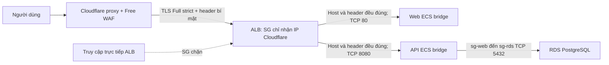

# WAF tiết kiệm chi phí cho HushStore

Quyết định ngày **2026-10-28**: dùng **Cloudflare Free WAF** trên proxy đã có của
`hushstore.io.vn` và `api.hushstore.io.vn`. Đây là thiết kế và mã triển khai;
**cấu hình WAF chưa apply AWS/Cloudflare, chưa kiểm thử lưu lượng thật**. Không thay thế các
biên bản trong `evidence/` hay kết quả KB8 của kiến trúc NACL cũ.

**AWS migration đã xong ngày 02/11/2026:** sáu subnet về default NACL, ba ACL và
20 rule cũ đã xóa, SG được đọc lại và xác minh. Serving stack vẫn tắt; WAF chờ
credential Cloudflare. Xem [biên bản apply](bien-ban-apply-sg-2026-11-02.md).

**Bản sửa trước triển khai 02/11/2026:** thêm guard cho script vận hành, kiểm tra
CNAME/header đã triển khai bằng preflight, backend S3 mã hóa với state key riêng
và chế độ IP visitor tại API. Chưa init/migrate backend, apply hoặc đo runtime.

## So sánh và lựa chọn

| Phương án | Chi phí tăng thêm | Phù hợp với đồ án |
|---|---|---|
| **Cloudflare Free — chọn** | $0/tháng phí gói WAF; không thêm máy/container | DNS và proxy đã có. Free Managed Ruleset, tối đa 5 custom rules và 1 rate rule. Cần khóa origin để không bị đi vòng. |
| AWS WAF Regional gắn ALB | Ví dụ ACL $5 + 3 managed groups và 2 rules $5 = khoảng $10/tháng cố định, cộng $0,60/triệu request; phí cố định chia theo giờ | Tích hợp AWS tốt; chỉ bật lúc demo giảm chi phí. Phải xóa ACL/rules khi nghỉ, chỉ bỏ association vẫn bị tính phí. Chưa gồm log/ALB/thuế, giá có thể khác theo region. |
| ModSecurity + OWASP CRS tự vận hành | Không phí license, nhưng dùng CPU/RAM và công bảo trì | Cần reverse proxy trên **cả hai đường web/API**, tránh port đi vòng, cập nhật engine/rules và tuning. Host t3.micro 1 GB đã chạy ứng dụng/agent; chưa có đo tải để bảo đảm đủ RAM. Không chọn cho đợt này. |

Nguồn: [Cloudflare plans](https://www.cloudflare.com/plans/),
[WAF availability](https://developers.cloudflare.com/waf/),
[AWS WAF pricing](https://aws.amazon.com/waf/pricing/),
[OWASP CRS containers](https://github.com/coreruleset/modsecurity-crs-docker).
Chi phí AWS hiện có (ALB, NAT, EC2, RDS…) vẫn giữ nguyên; “$0 WAF” không có nghĩa
toàn bộ hệ thống miễn phí. Không đăng ký Pro, AWS WAF, Bot Control hoặc dịch vụ mới.

## Luồng bảo vệ



- **Managed rules:** Cloudflare tự triển khai Free Managed Ruleset trên Free.
  Terraform không nhận quản lý phase managed và không bật ruleset trả phí.
  Phải xác nhận bộ Free đang hoạt động trên dashboard khi triển khai.
- **Custom rules:** chặn đường dẫn nhạy cảm và, khi danh sách không rỗng, chặn IP/CIDR
  chỉ trên hai host của HushStore. Dùng `block`, không dùng browser challenge cho API.
- **Rate limit:** 20 request/10 giây/IP/Cloudflare colo trên đường login, chặn 10 giây.
  Free không cho lọc Host/method trong rule này nên cùng path trên **toàn zone**
  cũng chịu giới hạn. Không đếm theo tài khoản, không bảo đảm quota toàn cầu chính xác;
  giữ rate limiter ứng dụng và **không đổi `rate_limiter_is_distributed`**.
- **Origin authentication:** Cloudflare `set` header `x-hushstore-origin` chỉ trên
  HTTPS, ghi đè giá trị client gửi; trên HTTP thì xóa header, không gửi secret qua
  đường không mã hóa. Hai listener rule ALB dùng **Host AND header**, default 403.
  SG chỉ allow 15 dải IPv4 Cloudflare trên TCP 80/443; không đổi egress ALB hay
  các rule web/RDS/endpoint. ALB hiện IPv4; client IPv6 vẫn vào được qua edge.

Host allowlist một mình không chống bypass: người gọi có thể gửi đúng `Host`.
IP allowlist một mình chỉ nhận diện mạng Cloudflare, không nhận diện zone của ta.
Header bí mật kết hợp cả hai điều kiện bổ sung ranh giới đó. TLS không bị hạ xuống
Flexible; Full (strict) kiểm chứng chỉ ở chặng HTTPS, không tự thay redirect HTTP.
HTTP không mang secret và ALB redirect 301 sang HTTPS. ACM validation CNAME vẫn DNS-only.
Health check ALB gọi thẳng target,
không đi qua listener nên không cần header này.

Tham khảo: [Free managed rules mặc định](https://developers.cloudflare.com/waf/get-started/),
[Free rate limits](https://developers.cloudflare.com/waf/rate-limiting-rules/),
[Header transform ghi đè](https://developers.cloudflare.com/rules/transform/request-header-modification/).

## Mã nguồn và phạm vi quản lý

| Đường dẫn | Trách nhiệm |
|---|---|
| `infra/cloudflare/` | Root Terraform độc lập: custom/rate/transform rules; provider Cloudflare được pin và có lockfile |
| `infra/tf/modules/security/cloudflare-ipv4.txt` | Snapshot từ [Cloudflare IPv4](https://www.cloudflare.com/ips-v4/), kiểm tra ngày 2026-10-28; review trước khi cập nhật |
| `infra/tf/modules/security/` | Bật allowlist Cloudflare trên SG ALB, giữ địa chỉ hai rule ALB cũ |
| `infra/tf/modules/alb/` | Thêm điều kiện header vào listener rule hiện hữu, không thay ALB/target group |
| `src/API/Middleware/ProxyHeaders.cs` | Chế độ direct ALB đọc XFF một hop; chế độ lockdown kiểm tra rồi đọc `CF-Connecting-IP` một hop |
| `infra/tf/modules/ecs/` | Chỉ thêm env proxy=true vào API khi cờ lockdown bật; không thêm env khi tắt |
| `infra/tf/envs/{prod,dev}/` | `enable_cloudflare_origin_lockdown` và secret; symlink dev giữ nguyên |

Không thêm Cloudflare provider vào AWS root. CI AWS không cần token Cloudflare.
Root Cloudflare không quản lý DNS, không đổi nameserver, không tạo zone, không sửa
SSL setting hoặc tự ghi đè ruleset managed. CNAME `alb` tiếp tục cập nhật theo DNS
của ALB mỗi lần bật; hai record `@`/`api` phải **proxied**.

## Triển khai trong phiên bật hệ thống tiếp theo

Các bước dưới đây **chưa được thực hiện**. Dùng đúng account/zone và môi trường
hiện tại; không dùng example thay toàn bộ tfvars AWS vì sẽ đổi công tắc chi phí.

1. Hoàn tất [hai mốc bỏ custom NACL](nacl-to-sg-migration.md) trước, giữ
   `enable_cloudflare_origin_lockdown = false` trong cả hai mốc. Không gộp thay đổi
   WAF vào plan chuyển association/xóa ACL. Chốt `check-plan` sẽ từ chối thay đổi
   SG/listener ngoài phạm vi đó.
2. Chuẩn bị token Cloudflare chỉ cho zone này, với quyền đọc zone/DNS/SSL cho
   preflight và quyền sửa WAF/Transform Rules theo
   [README của root](../infra/cloudflare/README.md). Token qua biến môi trường
   `CLOUDFLARE_API_TOKEN`, không lưu vào tfvars, CLI history hay git.
3. Chạy preflight chỉ đọc với `--expected-origin "$ALB_DNS"`, kiểm tra zone
   active/Free, hai host proxied, chuỗi CNAME tới ALB hiện tại, SSL strict,
   snapshot CIDR hiện hành và các phase ruleset đã tồn tại. CNAME `alb` được phép
   DNS-only; biết địa chỉ origin không đồng nghĩa bypass được SG/header. Kiểm tra dashboard
   Free Managed Ruleset bật, không có `skip`/allow ngoại lệ làm mất bảo vệ.
4. Nếu một phase đã có ruleset, **import và hợp nhất toàn bộ rule cần giữ** vào
   cấu hình rồi review plan. Import không tự giữ những rule vắng trong HCL;
   apply thiếu rule sẽ xóa nó. Không xóa ruleset có sẵn để “hết lỗi duplicate”.
5. Sinh secret ngẫu nhiên ít nhất 32 byte và dùng **cùng một giá trị** ở hai root.
   Có thể export `TF_VAR_cloudflare_origin_secret` từ secret manager hoặc prompt
   cục bộ. Không in secret; không dùng giá trị test/example. Terraform `sensitive`
   chỉ che màn hình, **state và saved plan vẫn chứa secret**. Bảo vệ state, backup
   và plan của root Cloudflare như AWS state. Backend mới dùng bucket state đã
   có, key riêng `cloudflare/terraform.tfstate`, encryption và S3 locking; cần
   quyền AWS backend nhưng không thêm AWS provider/tài nguyên. Chưa init hoặc
   migrate state trong phiên sửa mã. Nếu đã có local state, phải review và thực
   hiện migration state riêng; không bỏ nó bằng `-reconfigure`. Người có quyền
   đọc state/Cloudflare transforms/ALB DescribeRules vẫn đọc được secret.

Ví dụ lệnh kiểm cấu hình/plan, chạy từ repo root sau khi có biến môi trường:

```bash
umask 077
python3 infra/cloudflare/scripts/preflight.py --zone-id "$TF_VAR_zone_id" \
  --expected-origin "$ALB_DNS" --check-ip-ranges
terraform -chdir=infra/cloudflare init -lockfile=readonly
terraform -chdir=infra/cloudflare plan
```

6. Review plan Cloudflare: chỉ các phase custom/rate/transform dự kiến, không DNS,
   zone, gói trả phí hay rule của người khác bị mất. Apply trong phiên triển khai
   đã lên lịch. Chạy lại preflight với `--verify-origin-header` để so secret bằng
   digest, xác nhận enabled/scope HTTPS-set/HTTP-remove và thứ tự ghi đè. Kiểm tra truy cập
   bình thường và rule chặn trước khi khóa origin; WAF ở bước này **vẫn có thể bị
   đi vòng qua origin**.
7. Deploy image API có bản sửa proxy trước. Đặt `image_tag` bằng đúng SHA image đã
   review, giữ mọi công tắc tài nguyên như trước. Đặt
   `enable_cloudflare_origin_lockdown = true`, truyền cùng secret và tạo/review
   AWS plan: SG + listener và revision API có env
   `ProxyHeaders__CloudflareOriginLockdown=true`. **Dừng tại đây để duyệt trước apply.**
   Không bật app mode này khi origin còn nhận request ngoài đường Cloudflare đã xác thực.
   Plan hợp lệ: hai rule ALB CIDR đổi in-place, 28 ingress CIDR còn lại được thêm,
   hai listener rule thêm điều kiện header (nếu ALB đang bật). Không replace
   VPC/subnet/SG/ALB/endpoint/RDS, không tạo tài nguyên AWS tính phí.
8. **Chỉ trong phiên triển khai được duyệt sau này:** lưu ARN task definition API
   đang chạy để rollback, rồi apply saved plan đã review. Với Service đã tồn tại,
   Terraform giữ `ignore_changes = [task_definition]` cho CI, nên apply không tự
   chuyển task sang revision có env proxy. Đọc output `api_task_definition_arn`,
   kiểm tra image đúng commit có bản sửa và env=true, rồi update API Service sang
   đúng ARN đó và chờ healthy. Không dùng ARN revision mới nhất chưa review hoặc
   chỉ `--force-new-deployment` trên revision cũ. Nếu Service được tạo mới sau khi
   lockdown đã bật thì nó đã trỏ revision Terraform mới; vẫn kiểm tra task thực tế.
   Có thể có cửa sổ ngắn API còn đếm theo edge trước khi revision mới healthy;
   không tuyên bố chuyển đổi không gián đoạn. Chạy ma trận bên dưới, lưu bằng
   chứng mới; không ghi secret, cookie/token hoặc dữ liệu người dùng.

Các lệnh sau **chỉ là hướng dẫn cho bước 8, chưa chạy trong đợt sửa mã**:

```bash
# Trước apply: ghi lại ARN hiện tại; đây chỉ là metadata, không xuất secrets.
PREVIOUS_API_TASKDEF_ARN=$(aws ecs describe-services --cluster hushstore \
  --services hushstore-api --profile hushstore --region ap-southeast-1 \
  --query 'services[0].taskDefinition' --output text)
# Sau apply đã duyệt: chọn đúng revision Terraform vừa đăng ký, không lấy family latest.
API_TASKDEF_ARN=$(terraform -chdir=infra/tf/envs/prod output -raw api_task_definition_arn)
aws ecs describe-task-definition --task-definition "$API_TASKDEF_ARN" \
  --profile hushstore --region ap-southeast-1 \
  --query 'taskDefinition.containerDefinitions[].{name:name,image:image,proxy:environment[?name==`ProxyHeaders__CloudflareOriginLockdown`]}'
# Dừng nếu image/env không đúng; chỉ update sau khi đã review output ở trên.
aws ecs update-service --cluster hushstore --service hushstore-api \
  --task-definition "$API_TASKDEF_ARN" --profile hushstore --region ap-southeast-1 \
  --query 'service.taskDefinition' --output text
aws ecs wait services-stable --cluster hushstore --services hushstore-api \
  --profile hushstore --region ap-southeast-1
```

`down.sh` tiếp tục tắt AWS theo thiết kế. Cloudflare WAF miễn phí được giữ lại;
không disable WAF mỗi lần nghỉ demo. Lần `up.sh` sau vẫn cần cùng secret trong
môi trường Terraform và cập nhật CNAME `alb`. Đừng đánh giá WAF bằng DNS 530:
530/1016 trước đây là lỗi origin/DNS riêng, không phải kết quả block thành công.

## Kiểm thử runtime cần thực hiện

| Kịch bản | Kỳ vọng và bằng chứng |
|---|---|
| Web `/`, API `/health/ready`, login hợp lệ, CORS OPTIONS, giỏ hàng/checkout/upload | Chạy bình thường qua tên miền proxied; kiểm DB và ALB target healthy |
| GET `/.git/config` trên **cả hai host** | Edge block 403, có Cloudflare Ray ID và custom-rule event; không dùng 403 của listener làm bằng chứng WAF |
| Gửi client header `x-hushstore-origin: deliberately-wrong` qua tên miền | Cloudflare ghi đè; benign request vẫn thành công; không cho client chọn secret đến origin |
| Đưa IP kiểm thử `/32` hoặc `/128` vào `blocked_ip_cidrs` rồi kiểm từ IP đó | Edge block; gỡ IP sau thử, đường quản trị Cloudflare/SSM vẫn độc lập; đây là WAF deny, không phải SG deny |
| Burst login với tài khoản giả trong môi trường demo | Có rate-limit event của Cloudflare; phân biệt 429 ứng dụng và block edge, không suy ra chính xác request thứ 21 luôn bị chặn |
| Hai client IP khác nhau qua cùng edge | Ứng dụng ghi nhận hai IP/partition khác nhau; thử XFF giả không đổi danh tính; không dùng kết quả mock thay phép đo này |
| Task API thiếu/sai/lặp CF-Connecting-IP ở chế độ lockdown | Request ứng dụng bị 400; GET/HEAD health path đã định nghĩa không có CF header vẫn phục vụ health check |
| Gọi ALB trực tiếp với đúng Host/SNI | Không kết nối được từ IP ngoài Cloudflare (SG); 200 là lỗi bypass |
| Request từ một Cloudflare proxy/zone kiểm thử khác có Host thật nhưng thiếu/sai secret | ALB 403, không forward; chỉ làm khi sở hữu zone kiểm thử, không mở SG Internet để thử |
| SSM, pull ECR, CloudWatch, PostgreSQL | Vẫn hoạt động; WAF chỉ nằm trên HTTP inbound ALB |

Probe trực tiếp ALB cần DNS/IP **hiện tại**, không IP đã ghi trong báo cáo cũ:

```bash
# Sau lockdown, lệnh này từ máy ngoài Cloudflare phải timeout/không kết nối.
# Không dùng -k và không gửi secret để “làm cho test xanh”.
curl --connect-timeout 5 --max-time 10 \
  --connect-to "hushstore.io.vn:443:${ALB_DNS}:443" https://hushstore.io.vn/
curl --max-time 15 -D - -o /dev/null https://hushstore.io.vn/.git/config
curl --max-time 15 -D - -o /dev/null https://api.hushstore.io.vn/.git/config
```

SQLi/XSS probe chỉ dùng payload không phá hoại trên hệ thống mình quản lý.
Không đặt tiêu chí “mọi SQLi đều 403”: Free Managed Ruleset là tập con chống các
lỗ hổng phổ biến/ảnh hưởng cao, **không có Cloudflare OWASP Core Ruleset đầy đủ**.
Nếu giảng viên yêu cầu đầy đủ OWASP hoặc chứng cứ SQLi/XSS cụ thể không được Free
phủ, cần đánh giá AWS WAF/Pro hoặc CRS sau đo RAM, không dùng regex tự chế rồi gọi
đó là OWASP WAF. [Phạm vi các managed rulesets](https://developers.cloudflare.com/waf/managed-rules/)

## Vận hành, rollback và giới hạn

- False positive: tìm rule ID trong Security Events, sửa đúng rule/path phạm lỗi;
  không tạo global allow/skip. Free chỉ có sampled Security Events, không bảo đảm
  mọi request đều xuất hiện; kết hợp Ray ID và log origin, không bật paid logging.
- Secret rotation: cửa sổ bảo trì ngắn; ALB tạm nhận old+new trong cùng header
  condition (OR giá trị), Cloudflare chuyển sang new, kiểm tra rồi loại old.
  Cấu hình hiện chỉ giữ một secret nên việc rotation phải có plan riêng, không
  đổi hai root đồng thời rồi mặc định không downtime.
- Rollback khóa origin: khi SG/listener vẫn khóa, chuyển API về ARN trước lockdown
  đã lưu (env proxy không có hoặc false), kiểm tra healthy, rồi mới đổi flag AWS
  về false và apply plan đã review để mở lại ALB/bỏ header condition. Không mở
  ingress trước khi app ngừng tin CF header: request trực tiếp có thể giả header.
  **WAF sau rollback có thể bị bypass.** Ưu tiên sửa header/CIDR hơn mở lại;
  không rollback NACL để chữa lỗi WAF.
- SG áp dụng ở EC2 host với `bridge`; outbound web TCP 80/443 vẫn rộng. WAF không
  bảo vệ database protocol, lưu lượng nội bộ hoặc thay IAM/auth/parameterized SQL.
- API giữ `ForwardLimit = 1`: mặc định đọc XFF do ALB append; khi lockdown bật thì
  kiểm tra đúng một IP trong CF-Connecting-IP rồi dùng header đó thay XFF. Chỉ API
  có env này, chỉ tin khi SG/listener đã khóa đúng. Không tăng quota đăng ký/login
  để che lỗi IP. Health GET/HEAD tại `/health`, `/health/live`, `/health/ready`
  được phép thiếu header để ALB/Docker probe; header malformed vẫn bị từ chối.
  Bộ đếm vẫn dùng RemoteIpAddress sau middleware; cần đo lại attribution runtime.
- Cập nhật snapshot CIDR qua review khi preflight báo lệch; không fetch mạng trong
  `terraform plan` để tránh tự mở rộng allowlist ngoài review.

## Trạng thái xác minh

Kiểm thử cấu hình chạy bằng mock provider (không gọi CRUD Cloudflare/AWS) được
ghi nhận ngày 2026-10-28:

- **115/115 Terraform tests AWS** đạt trên tám module; network/security/alb mock,
  các module khác có data source chỉ đọc. Không có run apply trong bộ test.
- **14/14 Terraform tests Cloudflare** đạt, mock plan, không cần token.
- **20/20 Python tests migration** và **11/11 preflight** đạt, toàn bộ dùng fixture
  cục bộ; không gọi API Cloudflare thật.
- `validate` prod/dev, root Cloudflare và bốn tổ hợp migration stage1/stage2 ×
  prod/dev đạt. Format file nguồn, shell syntax và draw.io XML references đạt.
- Prod báo hai biến cũ `my_ip`/`enable_deny_demo` trong tfvars cục bộ; giữ cho mốc 1,
  bỏ theo hướng dẫn mốc 2. Không nâng AWS provider hoặc bỏ kiểm checksum.

`validate`/mock test kiểm HCL, schema và invariants;
chúng **không chứng minh** quyền token, entitlement Free, ruleset trên account,
DNS, header thực tế hay kết quả block runtime. Các mục runtime ở trên vẫn chờ
phiên triển khai. Chưa chạy live plan/apply trên state AWS/Cloudflare; guard hai
mốc đã kiểm bằng JSON fixtures, live plan vẫn phải review trong phiên chuyển đổi.
CI đã được thêm bước kiểm tra nhưng chưa chạy trên GitHub trong phiên này.
Lỗi CI/NuGet và DNS hiện hữu không được mở rộng sửa ở đợt này.

Kết quả mới và điểm dừng của live plan ngày 02/11 được ghi riêng tại
[kiểm tra trước apply](kiem-tra-truoc-apply-2026-11-02.md). Không gộp với kết quả
ngày 28/10 hoặc coi drift đã được đồng bộ state khi chưa apply refresh-only.
